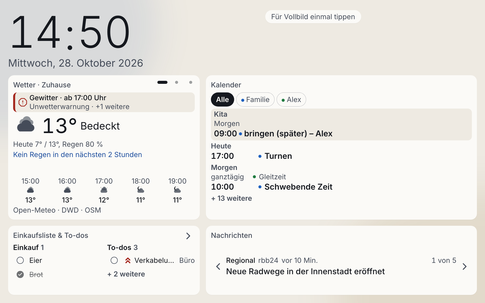

# Home Dashboard

[Deutsch](README.md) · **English**



A private family dashboard for a wall-mounted tablet: weather, a combined calendar,
shopping list and to-dos, and news headlines at a glance, with calm animations and
easy reading from a distance. It runs as a Docker container on a Synology NAS in the
home network. The interface is in German.

This project is my hands-on example of **spec-driven development with AI agents**
(Claude Code): from the idea through roadmap, requirements and technical specification
to tests, implementation, verification and deployment.

## Features

| Tile | Content |
| ---- | ------- |
| Weather | Forecast, rain radar and official warnings from open services (Open-Meteo, Bright Sky) |
| Calendar | A shared iCloud family calendar and two Google work calendars in one agenda, read-only through ICS feeds |
| Lists | Shopping list and to-dos with categories, suggestions and undo, editable from a phone as well |
| News | Local (rbb24) and national/international (Tagesschau) headlines from RSS feeds |

Also included: day and night mode, burn-in protection, automatic recovery after
connection loss, and an indicator of how fresh each data source is.

## Architecture

- **Frontend:** React, Vite, TypeScript, Tailwind CSS with design tokens, Motion for the
  rolling clock, German texts through i18next.
- **Backend:** Node.js 22, Fastify 5, TypeScript, TypeBox schemas, YAML configuration.
- **Data:** SQLite (better-sqlite3) with numbered SQL migrations and a nightly backup.
- **Operations:** One Docker image and Docker Compose, deployed from the Mac by a script.

Key decisions:

- The backend is the only gateway to external services. The frontend calls nothing
  directly, keys and calendar addresses stay on the NAS, and the tablet keeps showing
  the last stored data during an outage.
- The display polls a single endpoint (`GET /api/v1/snapshot`). The server computes how
  fresh each source is.
- Access is limited to the home network, calendars are read-only, and secrets never
  live in the repository.

Details are in [`docs/guidelines/architecture-reference.md`](docs/guidelines/architecture-reference.md)
and the domain documents under [`docs/`](docs/domain-index.md).

## How it was built

Development followed a fixed workflow, stored as skills in `.claude/skills/`:

1. **Briefing and roadmap:** A short briefing is broken down into epics.
2. **Brainstorming:** One requirements document (PRD) per epic with numbered acceptance
   criteria. I answer the open product decisions myself; the agent never ticks them off for me.
3. **Technical specification:** A test-driven plan derived from the PRD.
4. **Implementation:** Tests first, then code, in small atomic commits.
5. **Verification:** Every acceptance criterion is checked against tests and code.
6. **Documentation:** Verified outcomes flow into the long-lived documentation.

Advisor agents in `.claude/agents/` check decisions against the guidelines in
[`docs/guidelines/`](docs/guidelines/) (architecture, code style, UX, infrastructure,
security). They are advisory only; the decision stays with me. The specs of the
delivered epics are kept as a snapshot in the Git history.

## Tests

Backend and frontend have unit and integration tests (Vitest). The frontend is also
tested in a real browser with Playwright, covering layouts, night mode, recovery after
outages and a long-running soak test. Tests name the requirements they cover
(`FR-*`, `NFR-*`, `AC-*`) in a comment, see
[`docs/guidelines/testing-guidelines.md`](docs/guidelines/testing-guidelines.md).

## Development

Requirements: Node.js 22 or newer and pnpm.

```sh
# Backend
cd backend && pnpm install
pnpm test && pnpm typecheck

# Frontend
cd frontend && pnpm install
pnpm test && pnpm typecheck
pnpm dev
```

The backend reads `settings.yaml` and `credentials.yaml` from a configuration folder.
Templates with placeholders are in [`infrastructure/config.example/`](infrastructure/config.example/).
Real values never belong in the repository.

To refresh the screenshot with sample data:
`cd frontend && SCREENSHOT=1 pnpm exec playwright test e2e/screenshot.spec.ts`.

## Running on the NAS

Setup, rollout and troubleshooting are described in
[`infrastructure/README.md`](infrastructure/README.md) (German). Deployment is one
command: `scripts/deploy.sh` builds the image on the Mac, ships it over SSH and restarts
it (`--rollback` starts the previous build again).

## Note

The dashboard is meant for a private home network and deliberately has no user
accounts. It should not be reachable from the internet without additional protection.

## License

[MIT](LICENSE)
