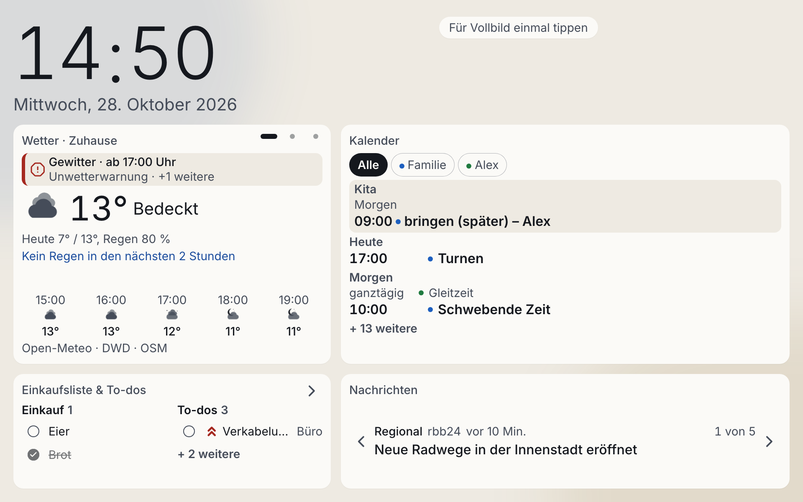

# Home-Dashboard

**Deutsch** · [English](README.en.md)



Ein privates Familien-Dashboard für ein wandmontiertes Tablet: Wetter, ein gemeinsamer
Kalender, Einkaufsliste und To-dos sowie Nachrichten-Schlagzeilen auf einen Blick,
mit ruhigen Animationen und aus Distanz gut lesbar. Es läuft als Docker-Container auf
einem Synology-NAS im Heimnetz.

Das Projekt ist mein Praxisbeispiel für **spezifikationsgetriebene Entwicklung mit
KI-Agenten** (Claude Code): von der Idee über Roadmap, Anforderungen und technische
Spezifikation bis zu Tests, Implementierung, Verifikation und Deployment.

## Funktionen

| Kachel | Inhalt |
| ------ | ------ |
| Wetter | Vorhersage, Regenradar und amtliche Warnungen aus offenen Diensten (Open-Meteo, Bright Sky) |
| Kalender | Geteilter iCloud-Familienkalender und zwei Google-Arbeitskalender in einer gemeinsamen Agenda, nur lesend über ICS-Feeds |
| Listen | Einkaufsliste und To-dos mit Kategorien, Vorschlägen und Rückgängig-Funktion, bearbeitbar auch vom Handy |
| Nachrichten | Schlagzeilen lokal (rbb24) und national/international (Tagesschau) per RSS |

Dazu kommen Tag-/Nachtmodus, Schutz vor Einbrennen, automatische Erholung nach
Verbindungsabbrüchen und eine Anzeige, wie aktuell jede Datenquelle ist.

## Architektur

- **Frontend:** React, Vite, TypeScript, Tailwind CSS mit Design-Tokens, Motion für die
  rollende Uhr, deutsche Texte über i18next.
- **Backend:** Node.js 22, Fastify 5, TypeScript, TypeBox-Schemas, YAML-Konfiguration.
- **Daten:** SQLite (better-sqlite3) mit nummerierten SQL-Migrationen, Nachtsicherung.
- **Betrieb:** Ein Docker-Image und Docker Compose, Deployment per Skript vom Mac aus.

Wichtige Entscheidungen:

- Das Backend ist das einzige Tor zu externen Diensten. Das Frontend ruft nichts direkt auf,
  Schlüssel und Kalenderadressen bleiben auf dem NAS, und das Tablet zeigt bei einem
  Ausfall die zuletzt gespeicherten Daten.
- Die Anzeige fragt einen einzigen Endpunkt ab (`GET /api/v1/snapshot`). Die Aktualität
  jeder Quelle berechnet der Server.
- Der Zugriff ist auf das Heimnetz beschränkt, Kalender werden nur gelesen, Geheimnisse
  liegen nie im Repository.

Details stehen in [`docs/guidelines/architecture-reference.md`](docs/guidelines/architecture-reference.md)
und in den Domänen-Dokumenten unter [`docs/`](docs/domain-index.md).

## Wie das Projekt entstand

Die Entwicklung folgte einem festen Ablauf, der in `.claude/skills/` als Skills hinterlegt ist:

1. **Briefing und Roadmap:** Aus einem kurzen Briefing entsteht die Aufteilung in Epics.
2. **Brainstorming:** Pro Epic ein Anforderungsdokument (PRD) mit nummerierten
   Abnahmekriterien. Offene Produktentscheidungen beantworte ich selbst, der Agent
   hakt nichts für mich ab.
3. **Technische Spezifikation:** Aus dem PRD ein testgetriebener Plan.
4. **Umsetzung:** Zuerst die Tests, dann der Code, in kleinen, atomaren Commits.
5. **Verifikation:** Jedes Abnahmekriterium wird gegen Tests und Code geprüft.
6. **Dokumentation:** Verifizierte Ergebnisse fließen in die dauerhafte Doku ein.

Beratende Agenten in `.claude/agents/` prüfen Entscheidungen gegen die Leitlinien in
[`docs/guidelines/`](docs/guidelines/) (Architektur, Code-Stil, UX, Infrastruktur,
Sicherheit). Sie sind nur beratend, die Entscheidung bleibt bei mir. Die Specs der
ausgelieferten Epics liegen als Momentaufnahme in der Git-Historie.

## Tests

Backend und Frontend haben Unit- und Integrationstests (Vitest). Das Frontend wird
zusätzlich mit Playwright im Browser getestet, unter anderem Layouts, Nachtmodus,
Wiederherstellung nach Ausfällen und ein Dauerlauf. Tests nennen die abgedeckten
Anforderungen (`FR-*`, `NFR-*`, `AC-*`) in einem Kommentar, siehe
[`docs/guidelines/testing-guidelines.md`](docs/guidelines/testing-guidelines.md).

## Entwickeln

Voraussetzungen: Node.js 22 oder neuer und pnpm.

```sh
# Backend
cd backend && pnpm install
pnpm test && pnpm typecheck

# Frontend
cd frontend && pnpm install
pnpm test && pnpm typecheck
pnpm dev
```

Das Backend liest `settings.yaml` und `credentials.yaml` aus einem Konfigurationsordner.
Vorlagen mit Platzhaltern liegen in [`infrastructure/config.example/`](infrastructure/config.example/).
Echte Werte gehören nie ins Repository.

Den Screenshot mit Beispieldaten erneuern:
`cd frontend && SCREENSHOT=1 pnpm exec playwright test e2e/screenshot.spec.ts`.

## Betrieb auf dem NAS

Die Anleitung zum Einrichten, Ausrollen und zur Fehlersuche steht in
[`infrastructure/README.md`](infrastructure/README.md). Das Deployment ist ein Befehl:
`scripts/deploy.sh` baut das Image auf dem Mac, überträgt es per SSH und startet es neu
(`--rollback` stellt die vorherige Version wieder her).

## Hinweis

Das Dashboard ist für ein privates Heimnetz gedacht und hat bewusst keine
Benutzerkonten. Es sollte nicht ohne zusätzlichen Schutz aus dem Internet erreichbar sein.

## Lizenz

[MIT](LICENSE)
