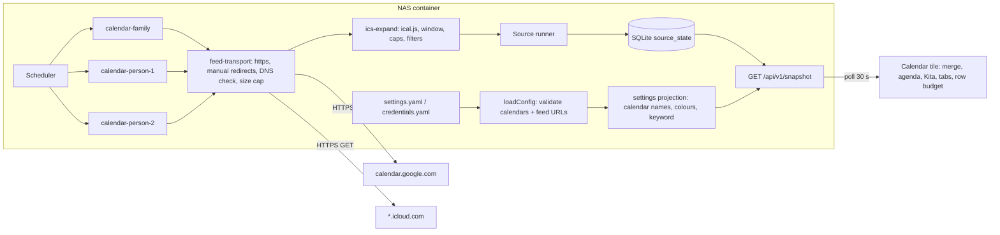

# Tech Spec: Combined Calendar

> **Status:** Ready
> **Confidence:** 90%
> **PRD:** [`prd-combined-calendar.md`](prd-combined-calendar.md)
> **Created:** 2026-10-28
> **Last updated:** 2026-10-28

## 1. Overview

The calendar tile shows the family calendar (Apple/iCloud) and the two Google work calendars in one agenda for today
and the next three days, with a Kita block, per-calendar colours and tabs. Calendars are read **read-only as ICS feeds**
(an iCloud published-calendar link and the Google "secret address in iCal format"): the feed URL is a bearer secret in
`credentials.yaml`, no account password, no OAuth refresh token and no write capability ever exists on the NAS.

| Source id | Feed | Interval | Stale after | Timeout | Snapshot payload |
| --------- | ---- | -------- | ----------- | ------- | ---------------- |
| `calendar-family` | iCloud published calendar (`webcal://` → https) | 900 s | 1800 s | 20 s | expanded events for the window |
| `calendar-person-1` | Google secret iCal address | 900 s | 1800 s | 20 s | same |
| `calendar-person-2` | Google secret iCal address | 900 s | 1800 s | 20 s | same |

Key decisions (details in "Architectural Decisions"):

- One source per calendar, so each fails, goes stale and is switched off on its own (AD-2).
- The backend parses the ICS with `ical.js` 2.2.1 and **expands** recurrences for a fixed window (today − 1 day to
  today + 6 days, household time zone). It stores only the expanded events (no raw ICS, no description, location or
  attendees) (AD-3, AD-4).
- Everything that depends on the current time is computed in the frontend from the server-based clock (hide ended
  events, day grouping, "Heute"/"Morgen", Kita block), as the weather rain statement (AD-5).
- Names, colours and the Kita keyword reach the frontend through an extension of the settings projection, so tabs and
  legend exist even when a calendar never loaded (AD-6).
- The egress rules of the security guidelines get a **deliberate, documented exception**: the host comes from the
  credentials file, validated against a code-side host-suffix allow-list, manual redirects, private addresses refused (AD-8).
- The tile does not scroll: a row budget fills whole rows by priority and ends with "+ n weitere" (AD-10).

Layers: backend and frontend. Infrastructure: runbook section and example credentials only (no image or compose change).

## 2. Architecture & Design

### 2.1 Component Diagram



### 2.2 Data Flow

1. Start: `loadConfig` validates `sources.calendar` and, for every enabled calendar, the feed URL in `credentials.yaml`
   (https or `webcal`, allowed host suffix, no userinfo, no port, no IP literal). Errors name file and key, never the value.
2. Every 900 s each enabled calendar source runs `fetch(signal)`: conditional GET (`If-None-Match` / `If-Modified-Since`
   from the previous response) through `feed-transport`; a 304 reuses the raw text kept in memory.
3. `ics-expand` parses the text, drops `STATUS:CANCELLED` and declined events, expands recurrences with exceptions inside the
   window, converts times (timed → ISO UTC, all-day → local date), sanitises and truncates titles, sorts and caps the list,
   and returns `CalendarPayload`. The runner stores it in `source_state` and keeps the previous payload on failure.
4. The display polls the snapshot every 30 s. The tile merges the entries of the three sources, removes duplicates (AD-7),
   filters ended events against the server-based now, groups by day in the settings time zone, extracts the Kita block,
   applies the selected tab and fills the row budget.
5. A calendar whose entry is `stale`, `error` or `never-loaded` is marked on its legend chip; its last events stay visible.

### 2.3 Integration Points

| System | Direction | Protocol | Purpose |
| ------ | --------- | -------- | ------- |
| Google Calendar secret iCal address (`calendar.google.com`) | Outbound, backend only | HTTPS GET, gzip | Work calendar of person 1 and 2 |
| iCloud published calendar (`*.icloud.com`, incl. redirect to `pNN-caldav.icloud.com`) | Outbound, backend only | HTTPS GET, up to 3 manual redirects | Shared family calendar |
| `/config/credentials.yaml` | Inbound (read-only mount) | File | Feed URLs (secrets) |
| `/data/dashboard.sqlite` | Both | SQLite `source_state` | Last expanded events (includes titles; part of the nightly backup, AD-9) |
| Browser | Inbound | HTTP same origin | `/api/v1/snapshot` only; no new route |

## 3. Data Model Changes

### 3.1 New Entities

Backend (TypeBox, `backend/src/sources/calendar/types.ts`), mirrored by hand in `frontend/src/tiles/calendar/types.ts` with a guard:

```text
CalendarEvent {
  uid: string            // ICS UID, max 100 chars, used only for de-duplication
  title: string          // control characters stripped, trimmed, max 120 chars, "" becomes "(ohne Titel)" in the frontend
  allDay: boolean
  start: string          // timed: ISO UTC ("2026-10-28T06:30:00.000Z"); all-day: local date "YYYY-MM-DD"
  end: string            // timed: ISO UTC; all-day: local date, EXCLUSIVE (ICS semantics)
  tentative: boolean
}
CalendarPayload { events: CalendarEvent[]  /* sorted by start, max 200 */, truncated: boolean }
```

Never copied from the feed: DESCRIPTION, LOCATION, ATTENDEE, ORGANIZER, URL, conference links, attachments, categories.

Settings (`backend/src/config/schema.ts`):

```text
sources.calendar?: {                      // optional; absent = tile off (placeholder stays)
  enabled: boolean                        // switches all three calendars together
  kitaKeyword: string                     // 1..30 chars, default in example file "Kita"
  calendars: {
    family:     CalendarSetting
    'person-1': CalendarSetting
    'person-2': CalendarSetting
  }
}
CalendarSetting {
  enabled: boolean
  name: string                            // 1..20 chars, shown in tabs and legend
  color: 'blue'|'green'|'orange'|'purple'|'teal'|'rose'   // named palette entries, tested in both themes
  selfAddresses?: string[]                // 0..5 e-mail addresses of the calendar owner, for declined detection
}
```

Credentials (`credentials.yaml`, existing `Record<string, Record<string,string>>` shape): `calendar-family: { url }`,
`calendar-person-1: { url }`, `calendar-person-2: { url }`.

Snapshot settings projection (extension of `SnapshotSettings`):

```text
calendar?: { kitaKeyword: string, calendars: { id: 'family'|'person-1'|'person-2', name: string, color: <palette key>, role: 'family'|'person' }[] }
```

Only enabled calendars, in the order family, person-1, person-2. URLs and e-mail addresses are never projected.

### 3.2 Modified Entities

- `Settings`/`SnapshotSettings` get the optional `calendar` parts above; `projectSettings` builds the projection.
- Frontend `SnapshotSettings` type and its guard accept the optional `calendar` field.
- `TileDefinition` (frontend) gets an optional `sourceIds?: readonly string[]` (the tile is shown when any of them is in the
  snapshot) and `deriveEntry?: (snapshot) => SourceSnapshot | undefined` (the entry that drives the tile frame state, see AD-11).
- `ApiErrorCode` is not changed; no new route.

### 3.3 Migration Plan

No database migration: payloads live in the existing `source_state` table as JSON. Nothing to roll back. An older build ignores unknown
sources.

## 4. API Design

No new endpoint. The snapshot gains up to three entries in `sources` (`calendar-family`, `calendar-person-1`, `calendar-person-2`) and the
optional `settings.calendar` object; the envelope is unchanged and everything keeps `Cache-Control: no-store`.

```json
{ "id": "calendar-family", "status": "fresh", "lastUpdated": "2026-10-28T09:10:00.000Z", "ageSeconds": 30,
  "staleAfterSeconds": 1800, "lastErrorCode": null,
  "data": { "truncated": false, "events": [
    { "uid": "k1@icloud.com", "title": "Kita holen – Alex", "allDay": false,
      "start": "2026-10-28T14:30:00.000Z", "end": "2026-10-28T15:00:00.000Z", "tentative": false },
    { "uid": "u2@icloud.com", "title": "Urlaub", "allDay": true, "start": "2026-10-30", "end": "2026-11-02", "tentative": false } ] } }
```

Size: about 200 bytes per event, typical 15 to 40 events per calendar in the 8-day window (3–8 KB), hard cap 200 events (about 40 KB) per
source, so the snapshot grows by at most about 120 KB in the worst case. Authorization: none (home network only).

## 5. Event Design

Not applicable: no queues or push channels. Refresh is the scheduler (backend), delivery is the existing 30 s snapshot poll.

## 6. Service Layer

### Backend (`backend/src/sources/calendar/`)

#### Module: FeedUrl (`feed-url.ts`)

- `normaliseFeedUrl(raw: string): URL` — rewrites `webcal://` to `https://`, requires `https:`, rejects userinfo, explicit ports other than 443,
  IP-literal hosts (v4 and v6), and hosts that do not match the allow-list. Throws a `FeedRejected('url')`.
- `isAllowedHost(host: string): boolean` — `host === s || host.endsWith('.' + s)` for `s` in `['calendar.google.com', 'icloud.com']`
  (constants in code, matched on a dot boundary).
- `loadConfig` calls it for each enabled calendar, so a wrong URL stops the start with an error naming `credentials.yaml` and the key.

#### Module: FeedTransport (`feed-transport.ts`)

```text
interface FeedResponse { status: 200|304; text?: string; etag?: string; lastModified?: string }
type FeedTransport = (url: URL, opts: { signal: AbortSignal; userAgent: string; maxBytes: number;
                                       etag?: string; lastModified?: string; resolve?: ResolveFn }) => Promise<FeedResponse>
createFeedTransport(): FeedTransport
```

- Built on `node:https` (no new dependency): `lookup` is a custom function that resolves the name, rejects any loopback, RFC 1918, link-local
  (169.254/16), CGNAT (100.64/10), unique-local (fc00::/7), `fe80::/10`, `::1`, unspecified and IPv4-mapped address, and returns the **validated**
  address so the connection cannot be redirected by DNS between check and connect.
- Redirects: `status` 301/302/303/307/308 is followed manually, at most 3 times; every hop repeats `normaliseFeedUrl` (https, allow-list,
  no userinfo, no port) and the address check. Cookies, `Authorization` and `Referer` are never sent; `User-Agent: home-dashboard/<build>`.
- Limits: one `AbortSignal` bounds the whole chain and the body; the body is read as a stream and aborted at `maxBytes` (8 MB of **decompressed**
  text; gzip is accepted and decoded with a size-limited stream); content type must be `text/calendar`, `text/plain` or `application/octet-stream`
  and the text must start with `BEGIN:VCALENDAR`.
- Failures throw `FeedRejected(reason)` with `reason` one of `url | host | redirect | private-address | size | content-type | status | parse`;
  nothing else (no message from the network, no URL) is ever attached.

#### Module: IcsExpand (`ics-expand.ts`)

```text
expandCalendar(text: string, opts: { now: Date; timezone: string; selfAddresses: readonly string[] }): CalendarPayload
```

- Parses with `ical.js` 2.2.1 (exact pin). Registers VTIMEZONE components; unknown TZIDs (for example Windows names) fall back to the household
  time zone for floating times and to UTC for unknown zones; the result is never an exception.
- Window: from 00:00 of (today − 1 day) to 00:00 of (today + 7 days) in the household time zone. Occurrences are kept when they overlap it.
- Recurrence: master events with `RRULE`, `RDATE`, `EXDATE`; `RECURRENCE-ID` overrides are related to their master (moved or changed single
  occurrences). Per master at most 400 iterations and no iteration beyond the window end; at most 5000 iterations per feed. Exceeding any cap sets `truncated`.
- Filters: `STATUS:CANCELLED`, and events whose `ATTENDEE` with an address in `selfAddresses` has `PARTSTAT=DECLINED`, are dropped. `STATUS:TENTATIVE`
  or `PARTSTAT=TENTATIVE` gives `tentative: true`. `CLASS` is ignored (all appointments are shown, PRD).
- Mapping: all-day (`VALUE=DATE`) gives local `YYYY-MM-DD` start and exclusive end (an all-day event without `DTEND` is one day); timed events give ISO
  UTC. Title: control characters removed, whitespace collapsed, trimmed, 120 characters. Sorted by start then title, capped at 200 (`truncated: true`).
- Parser errors are caught and rethrown as `FeedRejected('parse')`; the library's message (which can echo content) is discarded.

#### Service: CalendarSource (`calendar-source.ts`)

```text
createCalendarSource(opts: { id: 'calendar-family'|'calendar-person-1'|'calendar-person-2'; url: URL; timezone: string;
                             selfAddresses: string[]; transport: FeedTransport; userAgent: string; now?: () => Date;
                             logger?: Pick<Logger,'warn'> }): Source<CalendarPayload>
```

- `intervalSeconds: 900`, `staleAfterSeconds: 1800`, `timeoutMs: 20000`.
- Keeps `{ text, etag, lastModified }` of the last successful response in memory (not persisted) so a 304 can re-expand without a download; after a restart
  the first run is a plain GET.
- On `FeedRejected` it logs `{ sourceId, reason }` and rethrows so the runner stores `SOURCE_FETCH_FAILED`; a timeout stays `SOURCE_TIMEOUT`.

#### Wiring (`server.ts`)

`startServer(env, overrides)` gains `overrides.calendarTransport`. When `sources.calendar.enabled !== false`, one source per enabled calendar is created with the URL from
`config.credentials['calendar-<id>'].url`; names, colours and the keyword go into the projection. Disabled calendars create no source and are absent from tabs,
legend and snapshot. `logging.ts` redaction paths gain `*.url` and `*.calendarUrl`.

### Frontend (`frontend/src/tiles/calendar/`)

| File | Responsibility |
| ---- | -------------- |
| `types.ts` | Payload and projection mirrors, guards (`isCalendarPayload`, `isCalendarSettings`) |
| `merge.ts` | `mergeCalendars(entries, settings)`: tags every event with its calendar id, role and colour; de-duplicates (AD-7) |
| `agenda.ts` | Pure logic: `visibleEvents(events, now, tz)` (hide ended), `dayBuckets(events, now, tz, days=4)` (multi-day spans, "Tag n von m"), `splitKita(buckets, keyword, now, tz)`, `applyTab(...)` |
| `fit-rows.ts` | Pure `fitRows(items, budget)` (priority fill, collapsed later days, "+ n weitere") |
| `useFittingRows.ts` | `ResizeObserver` hook returning how many rows fit (probe row height), injectable for tests |
| `useIdleReset.ts` | Returns to the "Alle" tab after 60 s without input (wall only), resets on every pointer/keyboard input |
| `format.ts` | `Intl` day headings ("Heute", "Morgen", "Fr. 31.10."), time (24 h), "ganztägig", "Tag 2 von 3" |
| `CalendarTile.tsx` | Content component: reads the three entries and the projection, tabs, legend, Kita block, agenda, states |
| `Tabs.tsx` | Labelled segmented control (`role="tablist"`, ≥ 56 px on the wall, ≥ 44 px on the phone) |
| `Legend.tsx` | Colour chips with names; per-calendar stale marker ("Veraltet · vor 40 Min.") or "Noch nicht geladen" |
| `KitaBlock.tsx`, `Agenda.tsx` | Rendering of the block and the day groups |
| `heading.tsx` | Heading "Kalender" (no payload-derived text) |

Registry: a new tile `calendar-live` replaces the placeholder `calendar` (`replaces: 'calendar'`), same area `{col:6,row:1,colSpan:7,rowSpan:3}`, `sourceIds`
= the three source ids, `deriveEntry` as in AD-11, `freshFooter: false`, German `stateTexts`. The tile reads layout and theme from `ShellContext` and the
server-based `now` from `useSnapshot` exactly as `WeatherTile` does.

Tokens: six calendar colours (blue, green, orange, purple, teal, rose) as semantic tokens with day and night values in `styles/tokens.ts` and CSS
variables; each has ≥ 4.5:1 against the card in both themes (tested). All texts come from `i18n/de.ts` (`calendar.*`).

## Cross-Cutting Technical Design

### Domain Logic & Validation

- **Day model.** A day is a local calendar date in the settings time zone. Timed events cover every day they touch (an event ending exactly at 00:00 does not
  cover the next day). All-day events cover `[start, end)` dates. "Tag n von m" is shown from the second covered day on, for all-day and timed multi-day events.
- **Visibility.** A timed event is hidden when `end <= now`; an event without a positive duration (end ≤ start) is hidden when `start < now`. All-day events
  stay for their whole days. The window of the agenda is today to today + 3 (4 days); the payload covers today − 1 to today + 6, so the last day is not empty
  around midnight between two refreshes.
- **Ordering** per day: all-day first, then by start, then by title; family events before work events with equal start.
- **Kita block.** In "Alle" and "Familie", events of the family calendar whose title contains `kitaKeyword` (case-insensitive, trimmed) and that fall on today or
  tomorrow (after the visibility filter) go to the block and are removed from the agenda of the same view. No match for today or tomorrow: no block, no space.
- **Dedupe (AD-7).** In "Alle", an event is a duplicate of another when `uid` and `start` are equal, or when the lowercase trimmed titles and both `start` and `end`
  are equal. The kept copy is the family one, else the first calendar in the order family, person-1, person-2.
- **Tabs.** `Alle`, `Familie`, then one tab per enabled person. A tab whose calendar is disabled does not exist. Filtered tabs show every event of that calendar
  (no Kita block, no emphasis, all rows in body size).
- **Emphasis (wall, "Alle").** Family rows body size (32 px) semi-bold in the ink colour, work rows caption size (28 px) regular in a muted colour that still meets 4.5:1.
- **Row budget.** Rows are the Kita header and lines, day headings and event rows. `fitRows` keeps, in priority order, Kita block, today, tomorrow, later days; a day
  that does not fit completely collapses to its heading with a count ("Fr. 31.10. · 3 Termine"), and when rows still have to be dropped the last row becomes "+ n weitere"
  with the exact number of hidden events. Today's events are never silently dropped; if even they do not fit, the number appears in "+ n weitere". A row is never cut in half.
- **Phone.** All four days, no row budget, no "+ n weitere", titles may wrap to two lines, tabs as a sticky horizontally scrollable chip row, no idle reset.
- **Short screens** (`tablet-short`): legend only as sr-only text except stale chips, day heading inline is not used, the Kita block shows its lines compactly, the
  budget is simply smaller; type stays ≥ 28 px.
- **Validation.** Settings: names 1–20 chars, unique colours are recommended but not required, `selfAddresses` e-mail-like. Credentials: URL per enabled calendar required;
  unknown keys are ignored as for other tiles. Output validated by TypeBox (`calendarPayloadSchema`) before it is returned.

### Error Handling & Operational Concerns

- **Failures:** each source fails on its own through the runner (`SOURCE_FETCH_FAILED` / `SOURCE_TIMEOUT`), logging `{ sourceId, reason }` with `reason` from the closed enum above;
  never a URL, a redirect target, a host name from the credentials file, a feed fragment or a parser message. A failing refresh keeps the previous payload.
- **Frontend states:** per calendar `stale` → chip marker "Veraltet · vor 40 Min."; `never-loaded` → chip "Noch nicht geladen"; `error` with a payload → same as stale; `error` without payload
  → chip "Nicht verfügbar". All three unavailable → standard tile frame state through `deriveEntry` (AD-11).
- **Security & privacy:** see AD-8, AD-9 and the Security checks below. Titles of the work calendars reach every LAN device through the snapshot (accepted, PRD). The family iCloud link is readable by
  anyone who learns it; use a dedicated family calendar and rotate by unpublishing and publishing again; Google secret addresses are reset in the Google settings. Both procedures go into the runbook.
- **Performance:** ical.js parses synchronously. The 8 MB cap, conditional GET and a 15-minute interval bound the blocking time; a synthetic 5 MB feed must expand in under 3 s on the dev machine
  (test) and the NAS measurement is a manual verification item. If it ever blocks the event loop noticeably, moving parsing to a worker thread is the documented next step (not built).
- **Fair use:** 96 requests per calendar per day, conditional where the provider supports it.
- **Runtime configuration:** `sources.calendar.*` and three credential entries; no new environment variables.
- **Operational support:** a manual `backend/scripts/calendar-live-check.mjs <settings> <credentials>` fetches each feed once and prints only counts and shapes (events in window, all-day, recurring, response size,
  elapsed time), never titles or URLs; documented in the runbook.

### Rollout, Migration & Compatibility

Additive: new sources, an optional settings block, an optional projection field and a new frontend tile; the snapshot envelope is unchanged. Without `sources.calendar` (or with `enabled: false`) the placeholder
stays, so the deployment works before the household has created the feed links. Rollback: redeploy the previous build; the extra `source_state` rows are ignored. The deploy needs the three URLs in `credentials.yaml` first
(runbook) or the calendar block disabled, otherwise the start fails with a message naming the key.

### Architectural Decisions

| ID | Decision | Rationale |
| -- | -------- | --------- |
| AD-1 | Read-only ICS feeds: iCloud published calendar and Google secret iCal address; no CalDAV, no OAuth | Read-only by construction, no password or refresh token on the NAS, no consent flow on a headless box. If a company blocks the secret address, the household forwards work appointments into a private calendar and publishes that (runbook), the code is unchanged |
| AD-2 | Three fixed sources `calendar-family`, `calendar-person-1`, `calendar-person-2` | Independent freshness, failure and switch-off (AC-31, AC-32, AC-34); a single source would hide a broken feed behind a fresh timestamp |
| AD-3 | `ical.js` 2.2.1 (MPL-2.0, backend only, pinned) | Verified by a spike: recurrence, EXDATE, RECURRENCE-ID, VTIMEZONE and all-day expansion; no runtime dependencies; MPL-2.0 is fine for a private, undistributed backend |
| AD-4 | Backend expands recurrences for a fixed window (today − 1 to today + 6) with caps on iterations, events (200) and title length (120); only expanded events are stored | Keeps the frontend free of RRULE logic, bounds payload size, tolerates the 15 min refresh around midnight |
| AD-5 | Time-dependent logic (ended events, day grouping, labels, Kita block) lives in the frontend, driven by the server-based clock | Same reasoning as the weather rain statement: it must not go stale between refreshes and needs no device clock |
| AD-6 | Names, colours, roles and the Kita keyword are delivered through an extension of the settings projection | Tabs and legend exist even if a calendar never loaded; URLs and e-mail addresses stay out (user decision T3) |
| AD-7 | Duplicates across calendars are merged in "Alle" (same UID and start, or same title, start and end); the family copy wins | User decision T1 |
| AD-8 | Egress exception: feed host from credentials, but validated against code-side suffixes `calendar.google.com` and `icloud.com` (dot boundary), https only, no userinfo, no port, no IP literals, manual redirects (max 3, each hop revalidated), DNS result validated and pinned against private ranges, 8 MB streamed limit, one abort signal | Deliberate deviation from "fixed host constants, no redirects" in the security guidelines, needed because the URL is household-specific and iCloud redirects; recorded for the guideline update at reconciliation (user decision T4) |
| AD-9 | Payload cache stays in SQLite `source_state` like every source; work titles therefore appear in the nightly backup on the NAS (mode 0700) | User decision T2; survives restarts and internet outages; the runbook states it |
| AD-10 | Row budget instead of scrolling or CSS clipping; whole rows by priority, collapsed later days, "+ n weitere" | The wall tile cannot scroll and must never clip a row (UX review) |
| AD-11 | `TileDefinition.sourceIds` and `deriveEntry`: the tile is visible when any calendar source exists; the frame state is `never-loaded` if all enabled calendars never loaded, `error` if all errored without payload, `stale` (oldest age) if all are stale, otherwise `fresh`; per-calendar problems are shown inside the tile | One tile, several sources; single failures must not blank the tile |
| AD-12 | Declined events are detected only through optional `selfAddresses` (attendee `PARTSTAT=DECLINED`); cancelled through `STATUS:CANCELLED` | A feed does not say who the owner is; without the setting declined events stay visible |
| AD-13 | Conditional GET with the last ETag and Last-Modified; the last raw text is kept in memory only | Lower load and parse cost on the NAS; no raw feed on disk |
| AD-14 | Colours are named palette entries (blue, green, orange, purple, teal, rose) with tested day and night tokens | AC-15 allows colour choice in settings while the contrast floors stay guaranteed |
| AD-15 | Tabs live inside the tile content as a labelled segmented control; no automatic rotation; 60 s idle return to "Alle" on the wall only | Calendar content is read, not browsed (UX review); the weather dot indicators are unlabelled and cannot be reused |
| AD-16 | `CLASS:PRIVATE` is not treated specially | PRD: all appointments are shown with title |

## 7. Acceptance Criteria → Test Plan (TDD)

Legend: **BE** backend (`src/**/*.test.ts`, `test/**`, Vitest), **FE** frontend (Vitest/jsdom, canvas not needed), **E2E** Playwright against the production build with the real backend and a mocked
`/api/v1/snapshot` (as in `e2e/weather.spec.ts`). Feeds are faked with recorded fixtures in `backend/test/fixtures/calendar/`: `icloud-family.sample.ics`, `google-work.sample.ics` (both anonymised, with
VTIMEZONE, RRULE+EXDATE, a moved occurrence, all-day and multi-day events, a cancelled and a declined event, a tentative one), their expected payloads `*.expected.json` (golden, `UPDATE_FIXTURES=1`
regenerates) and `calendar.snapshot.sample.json` for the snapshot contract. A fake `FeedTransport` and a fake resolver replace the network. **Manual** items need real feeds or the real tablet.
Test titles use the repository style `it('…')`; every test group carries a `// Covers: …` comment naming the identifiers.

### 7.0 PRD Coverage Checklist

| PRD item | Addressed in | Proven by |
| -------- | ------------ | --------- |
| F-1 / FR-1, FR-10 | `merge.ts`, `agenda.ts`, `Agenda.tsx`, registry | AC-1 to AC-6 |
| F-2 / FR-2 | `ics-expand.ts`, `agenda.ts` | AC-7 to AC-12 |
| F-3 / FR-3 | tokens, `Legend.tsx`, settings projection | AC-13 to AC-15 |
| F-4 / FR-4, FR-5 | `Tabs.tsx`, `useIdleReset.ts`, emphasis rules | AC-16 to AC-21 |
| F-5 / FR-6 | `agenda.ts` `splitKita`, `KitaBlock.tsx`, settings | AC-22 to AC-27 |
| F-6 / FR-7, FR-8, FR-9 | sources, transport, loadConfig, `deriveEntry` | AC-28 to AC-34 |
| F-7 / FR-10 | phone variants of `CalendarTile` | AC-35 to AC-37 |
| FR-11, NFR-1 to NFR-7 | dictionary, see 7.1 | 7.1 |

### Feature 1: Combined agenda

#### AC-1: The default agenda shows all three calendars for today and the next three days, grouped by day with German headings

**PRD source:** F-1, FR-1  **Expected behavior:** one agenda "Alle" with day groups Heute, Morgen, weekday and date  **Touchpoints:** `merge.ts`, `agenda.ts`, `Agenda.tsx`, `format.ts`  **Unresolved:** none

| # | Test Case | Type | Test Name | Description |
| - | --------- | ---- | --------- | ----------- |
| 1 | Merge | Unit (FE) | `it('merges the events of all three calendars into one list')` | three payloads → one list with calendar tags |
| 2 | Day groups | Unit (FE) | `it('groups events into today, tomorrow and the next two days with German headings')` | now fixed, headings "Heute", "Morgen", "Fr. 31.10.", "Sa. 01.11." |
| 3 | Period | Unit (FE) | `it('ignores events after the fourth day and before today')` | |
| 4 | Browser | E2E | `test('shows the combined agenda with day headings on the wall')` | mocked snapshot |

#### AC-2: Within a day, appointments are ordered by start time; all-day first

**PRD source:** F-1  **Touchpoints:** `agenda.ts`

| # | Test Case | Type | Test Name | Description |
| - | --------- | ---- | --------- | ----------- |
| 1 | Order | Unit (FE) | `it('puts all-day events first and sorts the rest by start time then title')` | |
| 2 | Tie | Unit (FE) | `it('lists a family event before a work event with the same start')` | |

#### AC-3: A day without appointments is left out, except today ("Heute keine Termine")

| # | Test Case | Type | Test Name | Description |
| - | --------- | ---- | --------- | ----------- |
| 1 | Skip | Unit (FE) | `it('omits days without events')` | |
| 2 | Today | Unit (FE) | `it('says Heute keine Termine when today has no events')` | also after all of today's events ended |
| 3 | Browser | E2E | `test('shows Heute keine Termine and omits empty days')` | |

#### AC-4: If no calendar has any appointment in the period the tile shows a calm empty state

| # | Test Case | Type | Test Name | Description |
| - | --------- | ---- | --------- | ----------- |
| 1 | Empty | Unit (FE) | `it('shows the empty state text when no calendar has events in the period')` | text from the dictionary, no blank area |
| 2 | Tab empty | Unit (FE) | `it('shows a calm text for a tab whose calendar has no events')` | (also AC-21) |

#### AC-5: Each appointment shows start time (24 h), title and calendar colour; no location or description

**Touchpoints:** `Agenda.tsx`, `format.ts`, `ics-expand.ts` (field whitelist)

| # | Test Case | Type | Test Name | Description |
| - | --------- | ---- | --------- | ----------- |
| 1 | Row | Unit (FE) | `it('shows time, title and a colour dot per event')` | "14:30", dot class of the calendar colour |
| 2 | Fields | Unit (BE) | `it('never copies description, location, attendees or links into the payload')` | fixture with all of them; payload keys exactly the schema |
| 3 | Untitled | Unit (FE) | `it('shows a placeholder title for an event without title')` | |

#### AC-6: Text that does not fit is shortened with an ellipsis; the tile never overflows its card

| # | Test Case | Type | Test Name | Description |
| - | --------- | ---- | --------- | ----------- |
| 1 | Ellipsis | Unit (FE) | `it('truncates long titles with an ellipsis and keeps the full text for assistive technology')` | |
| 2 | Sanitise | Unit (BE) | `it('strips control characters and cuts titles at 120 characters')` | |
| 3 | Fit | E2E | `test('keeps the worst case inside the card at 1024x750, 1180x700 and 1920x1080')` | 10+ events today, long titles, Kita block, stale calendars; uses `tileFitProblems` |
| 4 | Row budget | Unit (FE) | `it('fills whole rows only and ends with + n weitere')` | see AC-37 note in `fit-rows` tests: priority order, collapsed later days, exact hidden count |

### Feature 2: Correct display of every kind of appointment

#### AC-7: All-day appointments show "ganztägig" and appear on their day only

| # | Test Case | Type | Test Name | Description |
| - | --------- | ---- | --------- | ----------- |
| 1 | Mapping | Unit (BE) | `it('maps VALUE=DATE events to local dates with an exclusive end')` | no DTEND → one day |
| 2 | Display | Unit (FE) | `it('shows ganztägig instead of a time and only on its day')` | |

#### AC-8: Multi-day appointments appear on every covered day, labelled "Tag n von m" from the second day; running events appear today

| # | Test Case | Type | Test Name | Description |
| - | --------- | ---- | --------- | ----------- |
| 1 | All-day span | Unit (FE) | `it('shows a three-day all-day event on each day with Tag 2 von 3 and Tag 3 von 3')` | |
| 2 | Timed overnight | Unit (FE) | `it('shows an event from 22:00 to 02:00 on both days and not on a third')` | end 00:00 does not cover the next day |
| 3 | Started before | Unit (FE) | `it('shows an event that started yesterday and runs into today')` | window includes yesterday in the payload |
| 4 | Payload window | Unit (BE) | `it('keeps occurrences that overlap the window from yesterday to six days ahead')` | |

#### AC-9: Recurring appointments appear on each occurrence including exceptions

| # | Test Case | Type | Test Name | Description |
| - | --------- | ---- | --------- | ----------- |
| 1 | RRULE | Unit (BE) | `it('expands a daily and a weekly rule inside the window')` | |
| 2 | EXDATE | Unit (BE) | `it('skips excluded occurrences')` | |
| 3 | Override | Unit (BE) | `it('uses the moved or renamed occurrence from RECURRENCE-ID')` | |
| 4 | Caps | Unit (BE) | `it('stops a runaway rule at the iteration cap and sets truncated')` | FREQ=SECONDLY |
| 5 | Golden | Contract (BE) | `it('turns the recorded feeds into the expected payloads')` | `*.expected.json` |

#### AC-10: Times are shown in the household time zone

| # | Test Case | Type | Test Name | Description |
| - | --------- | ---- | --------- | ----------- |
| 1 | TZID | Unit (BE) | `it('converts events entered in other time zones to UTC instants')` | America/New_York, UTC, floating, unknown Windows TZID |
| 2 | DST | Unit (BE) | `it('keeps 07:30 local across the October clock change')` | |
| 3 | Display | Unit (FE) | `it('formats times in the settings time zone, not the device zone')` | `Europe/Berlin` with a UTC device |

#### AC-11: Ended appointments of today are no longer shown; running and all-day ones stay

| # | Test Case | Type | Test Name | Description |
| - | --------- | ---- | --------- | ----------- |
| 1 | Hide | Unit (FE) | `it('hides a timed event once its end has passed')` | |
| 2 | Keep | Unit (FE) | `it('keeps a running event and an all-day event')` | |
| 3 | Clock | Unit (FE) | `it('uses the server-based now so a wrong device clock changes nothing')` | |
| 4 | Browser | E2E | `test('removes an ended event when the snapshot clock passes its end')` | fake clock |

#### AC-12: Cancelled and declined appointments are not shown; tentative ones are

| # | Test Case | Type | Test Name | Description |
| - | --------- | ---- | --------- | ----------- |
| 1 | Cancelled | Unit (BE) | `it('drops events with STATUS:CANCELLED')` | |
| 2 | Declined | Unit (BE) | `it('drops events the owner declined, matched by selfAddresses, case-insensitively')` | |
| 3 | No setting | Unit (BE) | `it('keeps declined events when no selfAddresses are configured')` | AD-12 |
| 4 | Tentative | Unit (BE) | `it('marks tentative events and keeps them')` | |

### Feature 3: Attribution

#### AC-13: Each appointment carries the colour of its calendar; the colours are distinguishable and meet contrast floors in both themes

| # | Test Case | Type | Test Name | Description |
| - | --------- | ---- | --------- | ----------- |
| 1 | Tokens | Unit (FE) | `it('gives every calendar colour at least 4.5:1 against the card in day and night theme')` | all six palette entries |
| 2 | Distinct | Unit (FE) | `it('keeps the three configured colours pairwise distinct')` | colour distance threshold on the example settings |
| 3 | Row colour | Unit (FE) | `it('colours each row by its calendar')` | |

#### AC-14: A legend names the calendars; colour is never the only indication

| # | Test Case | Type | Test Name | Description |
| - | --------- | ---- | --------- | ----------- |
| 1 | Legend | Unit (FE) | `it('lists every enabled calendar with colour and name in the Alle view')` | |
| 2 | Text | Unit (FE) | `it('exposes the calendar name as text for every event for assistive technology')` | sr-only name |

#### AC-15: Names and colours come from the household settings

| # | Test Case | Type | Test Name | Description |
| - | --------- | ---- | --------- | ----------- |
| 1 | Projection | Unit (BE) | `it('projects name, colour and role of enabled calendars and nothing else')` | no URL, no e-mail |
| 2 | Validation | Unit (BE) | `it('rejects an unknown colour or an empty name naming the key')` | |
| 3 | Render | Unit (FE) | `it('renders tabs and legend from the projection even when no source ever loaded')` | AD-6 |

### Feature 4: Family emphasis and switching

#### AC-16: Family appointments are visually stronger than work appointments in "Alle"; all text ≥ 28 px

| # | Test Case | Type | Test Name | Description |
| - | --------- | ---- | --------- | ----------- |
| 1 | Classes | Unit (FE) | `it('renders family rows in body size and semibold and work rows in caption size')` | |
| 2 | Floor | E2E | `test('has no text below 28px in the calendar tile at every size')` | computed styles |
| 3 | Contrast | Unit (FE) | `it('keeps the muted work text at 4.5:1 in both themes')` | |

#### AC-17: Tabs "Alle", "Familie" and one per person; active tab by shape and text; ≥ 56 px

| # | Test Case | Type | Test Name | Description |
| - | --------- | ---- | --------- | ----------- |
| 1 | Tabs | Unit (FE) | `it('renders Alle, Familie and one tab per enabled person from the projection')` | |
| 2 | Active | Unit (FE) | `it('marks the active tab with aria-selected and a filled shape')` | |
| 3 | Size | E2E | `test('has tabs of at least 56px on the wall and 44px on the phone')` | |
| 4 | Role | Unit (FE) | `it('exposes the tabs as a labelled tablist')` | NFR-5 |

#### AC-18: Selecting a tab shows only that calendar's appointments for the same period with the same rules

| # | Test Case | Type | Test Name | Description |
| - | --------- | ---- | --------- | ----------- |
| 1 | Filter | Unit (FE) | `it('shows only the selected calendar after a tap')` | |
| 2 | Rules | Unit (FE) | `it('applies ended, declined and multi-day rules in every tab')` | |
| 3 | Browser | E2E | `test('switches between the tabs without layout jumps')` | |

#### AC-19: Without input for 60 s the tile returns to "Alle"

| # | Test Case | Type | Test Name | Description |
| - | --------- | ---- | --------- | ----------- |
| 1 | Reset | Unit (FE) | `it('returns to Alle after 60 seconds without input on the wall')` | fake timers |
| 2 | Restart | Unit (FE) | `it('restarts the countdown on every input')` | |
| 3 | Cleanup | Unit (FE) | `it('clears its timer on unmount')` | NFR-1 |
| 4 | Browser | E2E | `test('returns to Alle after a minute')` | fake clock |

#### AC-20: One calm transition for view changes (short fade under reduced motion), no layout jumps

| # | Test Case | Type | Test Name | Description |
| - | --------- | ---- | --------- | ----------- |
| 1 | Classes | Unit (FE) | `it('uses the shared view-enter fade for a tab change')` | |
| 2 | Reduced | E2E | `test('uses a transition of at most 150 ms with reducedMotion=reduce')` | NFR-6 |

#### AC-21: A view whose calendar has no appointments in the period shows a calm text

| # | Test Case | Type | Test Name | Description |
| - | --------- | ---- | --------- | ----------- |
| 1 | Text | Unit (FE) | `it('shows the empty text for a tab without events')` | with AC-4 |

### Feature 5: Kita block

#### AC-22: Family events with the keyword (default "Kita", case-insensitive) appear in a block for today and tomorrow with day, time and title

| # | Test Case | Type | Test Name | Description |
| - | --------- | ---- | --------- | ----------- |
| 1 | Match | Unit (FE) | `it('lists family events containing the keyword for today and tomorrow')` | "kita", "KITA holen" |
| 2 | Scope | Unit (FE) | `it('ignores work events and events after tomorrow')` | |
| 3 | Browser | E2E | `test('shows the Kita block with day, time and title')` | |

#### AC-23: The block appears only when there is a match, otherwise it takes no space

| # | Test Case | Type | Test Name | Description |
| - | --------- | ---- | --------- | ----------- |
| 1 | None | Unit (FE) | `it('renders no block and no reserved space without a match')` | |
| 2 | Browser | E2E | `test('leaves the agenda layout unchanged without a Kita event')` | |

#### AC-24: The block's appointments are removed from the agenda below

| # | Test Case | Type | Test Name | Description |
| - | --------- | ---- | --------- | ----------- |
| 1 | No duplicates | Unit (FE) | `it('shows a Kita event in the block only, not again in the agenda')` | in Alle and Familie |

#### AC-25: The block is shown in "Alle" and "Familie", not in a person's view

| # | Test Case | Type | Test Name | Description |
| - | --------- | ---- | --------- | ----------- |
| 1 | Tabs | Unit (FE) | `it('shows the block in Alle and Familie and not in a person tab')` | person tab lists the event normally if it is theirs |

#### AC-26: The keyword is a household setting

| # | Test Case | Type | Test Name | Description |
| - | --------- | ---- | --------- | ----------- |
| 1 | Config | Unit (BE) | `it('validates kitaKeyword (1 to 30 characters) and projects it')` | |
| 2 | Custom | Unit (FE) | `it('uses the projected keyword instead of a built-in word')` | "Hort" |

#### AC-27: Ended appointments of today follow the visibility rule in the block as well

| # | Test Case | Type | Test Name | Description |
| - | --------- | ---- | --------- | ----------- |
| 1 | Ended | Unit (FE) | `it('removes an ended Kita event from the block')` | block disappears when none is left |

### Feature 6: Reliable data and freshness

#### AC-28: Calendars are read at least every 15 minutes; changes are visible within 15 minutes plus the polling delay

| # | Test Case | Type | Test Name | Description |
| - | --------- | ---- | --------- | ----------- |
| 1 | Interval | Unit (BE) | `it('declares a 900 second interval and a 1800 second stale threshold')` | |
| 2 | Scheduling | Integration (BE) | `it('refreshes each enabled calendar on its own schedule')` | `startServer` with fake transport and clock |
| 3 | Conditional | Unit (BE) | `it('sends If-None-Match and re-expands the kept text on a 304')` | AD-13, NFR-4 |

#### AC-29: No operation of the dashboard ever writes to a calendar account

| # | Test Case | Type | Test Name | Description |
| - | --------- | ---- | --------- | ----------- |
| 1 | Method | Unit (BE) | `it('only ever issues GET requests')` | transport request spy, including redirect hops |
| 2 | Routes | Integration (BE) | `it('exposes no route that changes or refreshes a calendar')` | route enumeration (also covers the cache rule test) |

#### AC-30: Credentials and links stay on the NAS and never appear in the browser, logs, backups or API responses

| # | Test Case | Type | Test Name | Description |
| - | --------- | ---- | --------- | ----------- |
| 1 | Responses | Integration (BE) | `it('never returns a feed URL in the snapshot, health or error responses')` | sentinel URL in credentials |
| 2 | Logs | Integration (BE) | `it('logs only the source id and a reason, never URLs or feed text')` | failing transport, parse error |
| 3 | Backup | Integration (BE) | `it('keeps the feed URL out of the database and the backup copy')` | scan the file for the sentinel |
| 4 | Bundle | Unit (FE) | `it('contains no feed URL or credentials in the built bundle')` | extend the existing bundle test |
| 5 | Redaction | Unit (BE) | `it('redacts url fields in logged objects')` | |

#### AC-31: A calendar that cannot be read keeps its last events, marked outdated with age; others show normally

| # | Test Case | Type | Test Name | Description |
| - | --------- | ---- | --------- | ----------- |
| 1 | Keep | Unit (BE) | `it('keeps the previous payload when a refresh fails')` | via the runner |
| 2 | Isolation | Integration (BE) | `it('keeps the other two calendars fresh when one feed fails')` | |
| 3 | Marker | Unit (FE) | `it('marks a stale calendar on its legend chip with Veraltet and its age and keeps its rows')` | |
| 4 | Browser | E2E | `test('shows one stale calendar without hiding the others')` | |

#### AC-32: A never-loaded calendar is named as not yet available while the others show

| # | Test Case | Type | Test Name | Description |
| - | --------- | ---- | --------- | ----------- |
| 1 | Chip | Unit (FE) | `it('shows Noch nicht geladen on the chip of a never-loaded calendar')` | |
| 2 | Others | Unit (FE) | `it('shows the loaded calendars normally meanwhile')` | |

#### AC-33: If all three are unavailable the foundation's states apply; no blank area, no technical code

| # | Test Case | Type | Test Name | Description |
| - | --------- | ---- | --------- | ----------- |
| 1 | Derive | Unit (FE) | `it('derives never-loaded, error, stale and fresh for the tile from the three entries')` | AD-11 table |
| 2 | Texts | Unit (FE) | `it('uses calendar-specific state texts without error codes')` | |
| 3 | Browser | E2E | `test('shows the error state when all calendars fail')` | |

#### AC-34: Each calendar can be switched off; the others keep working; legend, tabs and block follow

| # | Test Case | Type | Test Name | Description |
| - | --------- | ---- | --------- | ----------- |
| 1 | Per calendar | Integration (BE) | `it('creates no source for a disabled calendar and removes it from the projection')` | |
| 2 | Tile switch | Integration (BE) | `it('creates no calendar source when sources.calendar.enabled is false')` | placeholder stays |
| 3 | Frontend | Unit (FE) | `it('hides tab, legend chip and Kita block for a disabled family calendar')` | |
| 4 | Visibility | Unit (FE) | `it('shows the tile when any calendar source exists and the placeholder otherwise')` | `sourceIds` |
| 5 | Config | Unit (BE) | `it('fails the start naming credentials.yaml and the key when an enabled calendar has no valid url')` | message has no value |

### Feature 7: Phone

#### AC-35: The phone shows the same period, tabs and block without horizontal scrolling at 360 px

| # | Test Case | Type | Test Name | Description |
| - | --------- | ---- | --------- | ----------- |
| 1 | Content | Unit (FE) | `it('renders all days, the tabs and the Kita block on the phone without a row budget')` | |
| 2 | Layout | E2E | `test('has no horizontal scrolling at 360px')` | |

#### AC-36: Interactive elements on the phone are at least 44 px high

| # | Test Case | Type | Test Name | Description |
| - | --------- | ---- | --------- | ----------- |
| 1 | Targets | E2E | `test('has tab chips of at least 44px on the phone')` | |

#### AC-37: The phone does not return to "Alle" on its own

| # | Test Case | Type | Test Name | Description |
| - | --------- | ---- | --------- | ----------- |
| 1 | No reset | Unit (FE) | `it('keeps the selected tab on the phone after several minutes')` | |

### 7.1 Non-functional requirements and egress rules

| NFR | Approach | Evidence |
| --- | -------- | -------- |
| NFR-1 stability | Hooks clean up; no growing state; soak spec extended with calendar mocks | unit cleanup tests (AC-19.3), `e2e/soak.spec.ts` with calendar entries |
| NFR-2 readability | 28 px floor, tokens, row budget, fit tests with the worst case | AC-6.3, AC-16.2, AC-13.1 |
| NFR-3 security/privacy | AD-8, AD-9, field whitelist, redaction | AC-30 tests plus the egress tests below |
| NFR-4 efficiency | one fetch per calendar per interval, conditional GET, no browser request to providers | AC-28.3, E2E `makes no request to any other origin while the calendar tile runs` |
| NFR-5 accessibility | tablist, sr-only calendar name per event | AC-14.2, AC-17.4 |
| NFR-6 calm motion | shared fade, transform/opacity only | AC-20 |
| NFR-7 testability | recorded feeds, fake transport and resolver | all BE contract tests |

Egress and parsing tests (BE, `feed-url.test.ts`, `feed-transport.test.ts`, `ics-expand.test.ts`):

- `it('rewrites webcal to https')`; `it('accepts calendar.google.com and icloud.com subdomains and rejects evilicloud.com and icloud.com.evil.example')`; `it('rejects userinfo, ports, IP literals and http')`.
- `it('refuses a name that resolves to a private, loopback, link-local, CGNAT, unique-local or IPv4-mapped address')`; `it('refuses a redirect to a private address or to a host outside the allow-list')`; `it('follows at most three redirects')`.
- `it('connects to the validated address only')` (pinning), `it('aborts the body at the size limit, also for gzip')`, `it('rejects content that does not start with BEGIN:VCALENDAR')`.
- `it('expands a synthetic 5 MB feed in under 3 seconds')` (performance guard).
- `it('contacts no host outside the allow-list in any scenario')` (fake resolver records names).

**Manual verification (cannot run in CI):** the real Google secret addresses and the iCloud published link of the household work (the company policy may block the secret address), `calendar-live-check.mjs` shapes, the parse time on the NAS,
that a new event shows up within 15 minutes, and behaviour on the real tablet (legibility from 2–3 m, tab touch feel, idle return).

## 8. Infrastructure Changes

| Resource | Type | Location | Notes |
| -------- | ---- | -------- | ----- |
| Calendar settings block | Configuration example | `infrastructure/config.example/settings.example.yaml` | `sources.calendar` with three calendars, colours, `kitaKeyword`, `selfAddresses` |
| Calendar credential entries | Configuration example | `infrastructure/config.example/credentials.example.yaml` | `calendar-family`, `calendar-person-1`, `calendar-person-2` with placeholder `url`; the real file stays git- and docker-ignored |
| Runbook section "Kalender" | Documentation | `infrastructure/README.md` | how to obtain each link, where to put it (mode 0600), rotation (unpublish/publish again; reset the Google secret address), what a leaked link means, work titles in the backup, outbound HTTPS to Google and iCloud hosts, the forwarding fallback if the company blocks the address, `calendar-live-check.mjs`, enabling per calendar |
| Compose, image, ports | — | — | unchanged; outbound HTTPS to `calendar.google.com` and `*.icloud.com` is noted for the firewall |

## 9. Implementation Plan

| Step | Description | Layer | Dependencies | Complexity |
| ---- | ----------- | ----- | ------------ | ---------- |
| 1 | Settings schema `sources.calendar`, projection, example files, `loadConfig` validation of calendar settings and feed URLs, redaction paths | backend | — | Medium |
| 2 | `feed-url.ts` with allow-list tests | backend | 1 | Low |
| 3 | `feed-transport.ts`: https with pinned lookup, manual redirects, limits, fake resolver and transport helpers | backend | 2 | High |
| 4 | Types, `ics-expand.ts`, fixtures and golden payloads (recurrence, exceptions, zones, filters, caps) | backend | — | High |
| 5 | `calendar-source.ts` with conditional GET, wiring in `startServer`, snapshot contract fixture, leakage tests | backend | 1, 3, 4 | Medium |
| 6 | Frontend types and guards, projection type, `TileDefinition.sourceIds`/`deriveEntry`, dictionary | frontend | 5 (contract) | Medium |
| 7 | Pure logic: `merge.ts`, `agenda.ts`, `fit-rows.ts`, `format.ts` | frontend | 6 | High |
| 8 | Tokens for the six colours, `Tabs`, `Legend`, `KitaBlock`, `Agenda`, `useFittingRows`, `useIdleReset` | frontend | 7 | High |
| 9 | `CalendarTile`, registry entry `calendar-live`, states, phone variant | frontend | 8 | Medium |
| 10 | E2E specs (agenda, tabs, Kita, states, fit at all sizes with the worst case, phone, no foreign origin), soak extension | frontend | 9 | Medium |
| 11 | `calendar-live-check.mjs`, runbook section | backend / infrastructure docs | 5 | Low |
| 12 | Manual verification with the real feeds and the tablet | all | 10, 11 | Medium |

The backend contract (steps 1–5) precedes the frontend consumer (step 6). Each step is single-layer and mergeable; tests come first.

## 10. Risks & Mitigations

| Risk | Impact | Likelihood | Mitigation |
| ---- | ------ | ---------- | ---------- |
| The company blocks the Google secret address | Work calendar unavailable | Medium | Early manual check (step 12 can start first); forwarding fallback into a private published calendar, documented; per-calendar switch-off |
| Google feeds lag by minutes to hours | "Fresh" tile shows old data | Medium | Documented; freshness means the fetch succeeded; 15 min interval is not the limit |
| Large feeds (years of history) block the event loop while parsing | Slow API during parsing | Medium | 8 MB cap, conditional GET, 15 min interval, performance test, worker thread as documented next step |
| iCloud link readable by anyone who learns it, rotation only by unpublishing | Family data exposure | Low | Dedicated family calendar, runbook rotation steps, no secrets in logs or tickets |
| DNS pinning with `node:https` is subtle (IPv6, redirects, proxies) | Wrong rejection or bypass | Medium | Dedicated tests including redirect to private address, fake resolver, manual live check |
| Recurrence edge cases (exceptions, zones, DST, unknown TZID) | Missing or wrong appointments | Medium | Recorded feeds of both providers, golden payloads, explicit fallbacks |
| Declined events cannot be detected without `selfAddresses` | Declined meetings stay visible | Medium | Optional setting, documented in the example file and runbook |
| Row budget hides appointments on small tablets | Information missing | Medium | "+ n weitere" with exact count, today never dropped silently, tabs filter to see the rest, fit tests with the worst case |
| De-duplication merges two different appointments | One appointment missing | Low | Equal UID and start, or equal title, start and end only |
| Work titles in the nightly backup | Titles on the NAS backup | Low | Backup folder mode 0700 on the NAS; stated in the runbook (user decision) |
| Kita keyword misses entries titled differently | Block empty | Medium | Keyword configurable; tabs show everything |

## 11. Iteration Log

### Iteration 1 — 2026-10-28

- Questions asked: 4 (T1–T4, in chat) plus a design review by the architecture, security and UX advisors and a library spike
- Questions resolved: 4
- Confidence: 55% → 90%
- Summary of changes: Full spec drafted from the PRD, the foundation and weather docs. A spike confirmed that `ical.js` 2.2.1 expands RRULE, EXDATE, RECURRENCE-ID overrides, VTIMEZONE and all-day events correctly.
  Decisions with the user: T1 duplicates are merged (AD-7); T2 the payload cache stays in SQLite and therefore in the backup (AD-9); T3 names and colours through the settings projection (AD-6); T4 strict egress with
  allow-list, manual redirects and private-address blocking (AD-8). The PRD's open question about the Google access was answered "unknown" and is handled by AD-1 plus the risk table.
  Decisions taken by the spec author (to confirm at review): feed size cap 8 MB, window today − 1 to today + 6, 200 events per source, `selfAddresses` for declined detection (AD-12), tile-level `sources.calendar.enabled`,
  colour palette of six named entries (AD-14), tabs inside the tile without rotation (AD-15), row budget with "+ n weitere" (AD-10), `sourceIds`/`deriveEntry` framework extension (AD-11).
  Advisor input incorporated: (architecture) three sources, frontend time logic, projection for names, 304 handling, caps and `truncated`, tile-level switch; (security) allow-list with dot boundary, manual redirects,
  DNS validation and pinning, streamed limits, field whitelist, redaction, runbook rotation steps, reasons enum instead of messages; (UX) row budget instead of clipping, emphasis through size and weight within the 28 px floor,
  stale marker on the legend chip, labelled tabs, short-screen and phone variants, worst-case fit tests. Guideline updates implied (to be written by `reconcile-docs`): the egress exception in the security and architecture
  guidelines, the "Calendar sources" decision, the infrastructure networking note.

---

## Open Questions

_None — all questions are reconciled._
