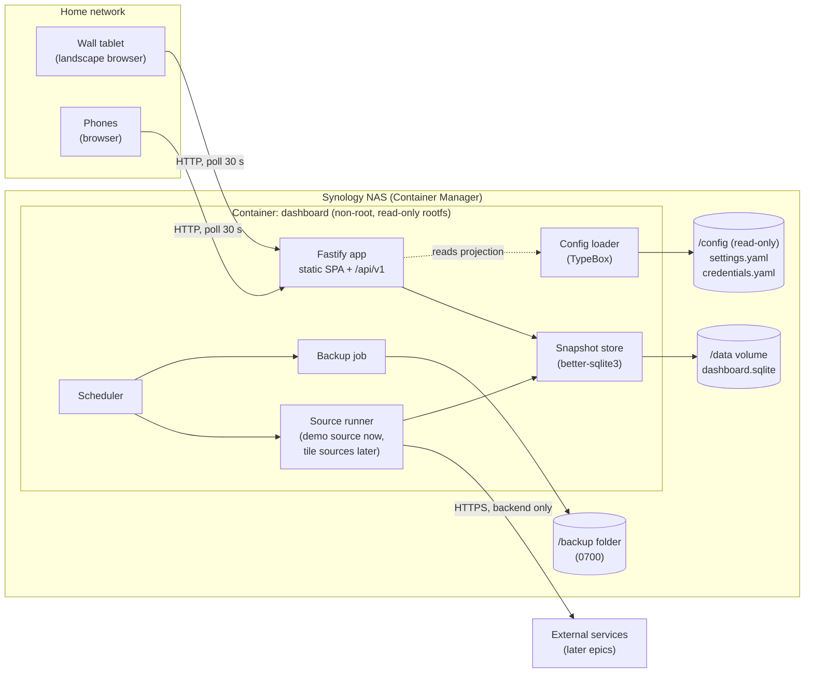
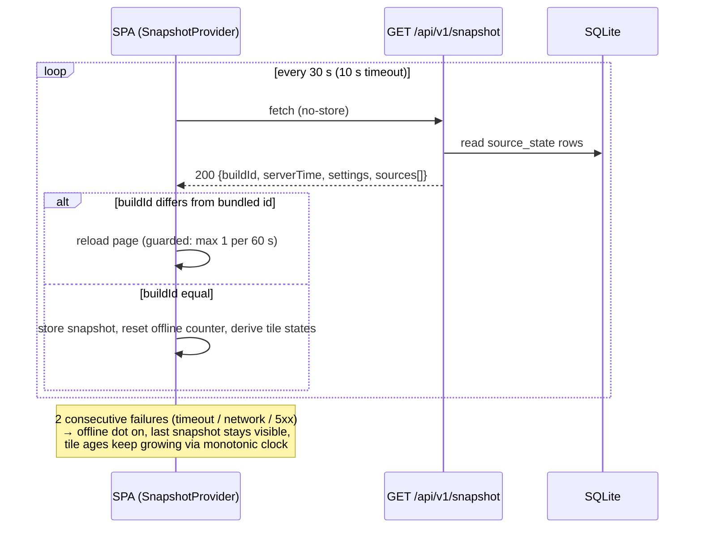

# Tech Spec: Dashboard Foundation

> **Status:** Ready
> **Confidence:** 91%
> **PRD:** [`prd-dashboard-foundation.md`](prd-dashboard-foundation.md)
> **Created:** 2026-10-28
> **Last updated:** 2026-10-28

## 1. Overview

Greenfield delivery of the shared base of Home-Dashboard. **Affected layers: frontend,
backend, infrastructure.** The repository contains no code yet, so this spec also fixes the
first conventions that the guidelines left open (data fetching, animation, i18n, SQLite,
scheduler, configuration, file structure) so `reconcile-docs` can fold them in afterwards.

Approach, in one paragraph: one Node/Fastify container serves both the built React SPA and a
small versioned API (`/api/v1`). A backend scheduler runs *sources* (the unit later epics
implement) on an interval, writes the last result into SQLite and never lets a failure erase
data. The SPA polls one endpoint, `GET /api/v1/snapshot`, every 30 s. The snapshot carries a
build id, per-source freshness computed by the server, and a whitelisted projection of the
settings. A failed poll is the offline signal; a changed build id reloads the page. The UI is
a landscape tile grid with a fluid design-token scale, CSS-first animation plus a lean Motion
hybrid for the rolling clock, automatic night mode with burn-in drift, a list-first phone
layout, and German texts via i18next. Everything ships as one x86_64 image deployed to the
Synology NAS by a one-command script (`docker save | ssh | docker load`), bound to the
NAS's LAN address only, with read-only mounted settings/credentials files and an in-container
nightly SQLite online backup.

Key decisions (details in *Architectural Decisions*): polling + build-id reload, Fastify
static hosting, better-sqlite3 + numbered SQL migrations, own in-process scheduler, own
`useSnapshot` hook (no query library), CSS + Motion hybrid, i18next, YAML + TypeBox
configuration, separate `frontend/` and `backend/` packages.

## 2. Architecture & Design

### 2.1 Component Diagram



### 2.2 Data Flow

**Scheduled refresh (backend only).** On start the scheduler runs every enabled source once
and then chains a `setTimeout` per source with `intervalSeconds`. `SourceRunner.refresh`
calls `source.fetch(signal)` with a timeout. Success → `store.recordSuccess(id, payload, now)`.
Failure or timeout → `store.recordFailure(id, code, now)`; the previous payload and
`last_success_at` stay untouched. A failing source never throws into the scheduler and never
touches other sources.

**Display poll.**



**Freshness without the device clock (FR-7).** The server sends `ageSeconds` per source
(computed from its own clock at response time). The SPA stores the monotonic receipt time
(`performance.now()`) and shows `ageSeconds + elapsedSinceReceipt`. A tile turns stale when
that sum exceeds `staleAfterSeconds`, also while the backend is unreachable. The server also
sends `status`, which the SPA uses as the source of truth whenever it has a fresh snapshot.

**Night mode and drift.** Pure client behaviour driven by the projected settings
(`timezone`, `nightFrom`, `nightTo`). The tablet's own clock is used only for the wall-clock
time of day, evaluated in the configured IANA timezone.

**Startup.** `main.ts` loads and validates the configuration (fail closed), opens SQLite
(WAL), runs pending migrations, builds the app, starts the scheduler, then listens.

### 2.3 Integration Points

| System | Direction | Protocol | Purpose |
|--------|-----------|----------|---------|
| Wall tablet / phone browsers | Inbound | HTTP on the NAS LAN address, one port | SPA + `/api/v1` |
| `/config` bind mount (read-only) | Inbound | File (YAML) | `settings.yaml`, `credentials.yaml` |
| `/data` volume | Both | SQLite file | Source cache, migrations state |
| `/backup` folder | Outbound | File | Nightly SQLite online backup, 14 copies |
| Container Manager healthcheck | Inbound | HTTP `GET /api/v1/health` (inside the container) | Container health status |
| Mac → NAS | Outbound (deploy time only) | SSH, `docker save` / `docker load` | Image transfer and restart |
| External data services | Outbound (backend only) | HTTPS | None in this epic; the source interface is the integration point for later epics |

## 3. Data Model Changes

### 3.1 New Entities

SQLite file `dashboard.sqlite` in `DATA_DIR`. Pragmas on open: `journal_mode = WAL`,
`synchronous = NORMAL`, `foreign_keys = ON`, `busy_timeout = 5000`.

```sql
-- backend/src/db/migrations/001_create_source_state.sql
CREATE TABLE source_state (
  source_id             TEXT    NOT NULL PRIMARY KEY,
  payload_json          TEXT,                       -- last successful payload, NULL until first success
  last_success_at       INTEGER,                    -- epoch ms, server clock
  last_attempt_at       INTEGER,                    -- epoch ms
  last_error_code       TEXT,                       -- e.g. SOURCE_FETCH_FAILED | SOURCE_TIMEOUT, NULL after a success
  consecutive_failures  INTEGER NOT NULL DEFAULT 0
) STRICT;
```

TypeScript row/domain types (backend, source of truth for the wire format):

```ts
export type SourceStatus = 'never-loaded' | 'fresh' | 'stale' | 'error';

export interface SourceState {
  sourceId: string;
  payload: unknown | null;
  lastSuccessAt: number | null;
  lastAttemptAt: number | null;
  lastErrorCode: SourceErrorCode | null;
  consecutiveFailures: number;
}

export type SourceErrorCode = 'SOURCE_FETCH_FAILED' | 'SOURCE_TIMEOUT';
```

Status derivation (`deriveStatus(state, staleAfterSeconds, now)`):

| Condition | Status |
|-----------|--------|
| No row, or no success and no attempt yet | `never-loaded` |
| No successful payload and last attempt failed | `error` |
| Successful payload and `now - lastSuccessAt > staleAfterSeconds` | `stale` |
| Otherwise (payload present, within threshold) | `fresh` |

`loading` (before the first snapshot arrives) and `empty` (a fresh source whose payload is
legitimately empty) are frontend states; `empty` is decided by each tile.

### 3.2 Modified Entities

None (greenfield).

### 3.3 Migration Plan

- Migrations are hand-written, numbered, forward-only `.sql` files in
  `backend/src/db/migrations/` (the stack's own tooling here *is* this runner, matching the
  decision to avoid an ORM; there is nothing to generate).
- `runMigrations(db, dir)`: reads files sorted by numeric prefix, compares with
  `PRAGMA user_version`, applies each pending file inside one transaction, then sets
  `user_version` to its number. Aborts startup on any error. Files are copied into the image
  (`dist/db/migrations`).
- Rollback policy: forward-only; a bad release is rolled back by redeploying the previous
  image tag, which refuses to start if `user_version` is higher than its newest migration
  (explicit startup guard `DB_SCHEMA_NEWER_THAN_APP`).
- No data migration is required for this epic.

## 4. API Design

All endpoints live under `/api/v1/`. Every route has Fastify (TypeBox/JSON-Schema) request
and response schemas. Authorization: none (home-network only, no accounts, per PRD).
`Cache-Control: no-store` is added to every `/api/*` response.

### Endpoint: GET /api/v1/health

- **Handler:** `healthRoute` (v1)
- **Request:** none
- **Response 200:**
  ```json
  { "status": "ok" }
  ```
- **Response 503:**
  ```json
  { "status": "error" }
  ```
- **Status codes:** 200 (process up, `SELECT 1` succeeds), 503 (database check failed)
- **Authorization:** none. The body is exactly this object: no version, uptime, source names
  or error text. Used by the compose healthcheck.

### Endpoint: GET /api/v1/snapshot

- **Handler:** `snapshotRoute` (v1)
- **Request:** none (no query parameters; unknown parameters ignored)
- **Response 200:**
  ```json
  {
    "buildId": "3f9c2ab",
    "serverTime": "2026-10-28T10:15:00.000Z",
    "settings": {
      "timezone": "Europe/Berlin",
      "display": { "nightFrom": "22:00", "nightTo": "06:30", "dailyReloadAt": "04:00" }
    },
    "sources": [
      {
        "id": "demo",
        "status": "fresh",
        "data": { "value": 42 },
        "lastUpdated": "2026-10-28T10:14:30.000Z",
        "ageSeconds": 30,
        "staleAfterSeconds": 120,
        "lastErrorCode": null
      }
    ]
  }
  ```
  Field rules: `status` ∈ `never-loaded | fresh | stale | error`; `data` is `null` while no
  success exists; `lastUpdated` is `null` until the first success; `lastErrorCode` is `null`
  or `SOURCE_FETCH_FAILED | SOURCE_TIMEOUT` (never an error message); `sources` contains only
  enabled sources, ordered by id. `settings` is an **explicit allowlist** built field by field
  (never a filtered copy of the configuration); location, credentials, backup and source
  settings are never projected.
- **Status codes:** 200, 500 (error envelope)
- **Authorization:** none

### Error envelope (all non-2xx responses except health 503)

```json
{ "error": { "code": "NOT_FOUND", "message": "Route GET /api/v1/x not found", "details": null } }
```

- `code`: stable `UPPER_SNAKE` enum, the frontend i18n key (`errors.<code>`).
  Foundation codes: `NOT_FOUND` (404), `VALIDATION_FAILED` (400), `PAYLOAD_TOO_LARGE` (413),
  `INTERNAL_ERROR` (500).
- `message`: English developer text, never shown to users, never contains stack traces,
  config values or secrets.
- `details`: optional, `null` when absent.
- One shared Fastify `setErrorHandler`, a JSON `setNotFoundHandler` for `/api/*`, and a
  response schema for the envelope. Non-`/api/` unknown GET paths return `index.html`
  (SPA fallback); other methods on them return the 404 envelope.

### Static delivery (not versioned API)

| Path | Behaviour |
|------|-----------|
| `/assets/*` (hashed) | `Cache-Control: public, max-age=31536000, immutable` |
| `/index.html`, `/`, SPA fallback, `/manifest.webmanifest` | `Cache-Control: no-cache` |
| `/api/*` | `Cache-Control: no-store` |

Security headers via `@fastify/helmet`: CSP
`default-src 'self'; img-src 'self' data:; style-src 'self'; style-src-attr 'unsafe-inline'; script-src 'self'; connect-src 'self'; frame-ancestors 'none'; base-uri 'none'; form-action 'none'`
(no third-party origins; fonts are self-hosted), `X-Content-Type-Options: nosniff`,
`Referrer-Policy: no-referrer`. No CORS plugin is registered. Body limit 64 KiB, connection
and request timeouts set explicitly, logger redaction configured.

## 5. Event Design

Not applicable: there are no queues, topics or server push channels. The only asynchronous
mechanisms are (a) the in-process scheduler (§6, Scheduler) and (b) client polling of
`GET /api/v1/snapshot` (§2.2). Server push (SSE) was evaluated and rejected (see
*Architectural Decisions* AD-1).

## 6. Service Layer

### Backend

All services are created in `main.ts` (composition root) and passed explicitly to
`buildApp(deps)`; there are no module-level singletons.

```ts
export interface AppDeps {
  config: AppConfig;
  store: SnapshotStore;
  clock: Clock;
  sources: readonly Source[];
  buildId: string;
  staticDir?: string;
  logger?: FastifyBaseLogger | LoggerOptions;
}
export function buildApp(deps: AppDeps): Promise<FastifyInstance>;
```

#### Service: ConfigLoader (`config/load-config.ts`)

- **Responsibility:** Read `settings.yaml` (required) and `credentials.yaml` (optional in
  this epic) from `CONFIG_DIR`, parse with `yaml`, validate with TypeBox, return an
  immutable `AppConfig`. Fail closed.
- **Interface:**
  ```ts
  export interface Settings {
    timezone: string;                       // IANA, validated via Intl
    location: { name: string; latitude: number; longitude: number };
    display: { nightFrom: string; nightTo: string; dailyReloadAt: string }; // HH:MM
    sources: { demo: { enabled: boolean } };
    backup: { time: string; retention: number };                            // HH:MM, 1..60
  }
  export type Credentials = Readonly<Record<string, Readonly<Record<string, string>>>>;
  export interface AppConfig { settings: Settings; credentials: Credentials }
  export function loadConfig(env: NodeJS.ProcessEnv, fs?: FileReader): AppConfig;
  export function projectSettings(settings: Settings): SnapshotSettings;
  ```
- **Dependencies:** `fs` (injectable), `yaml`, `@sinclair/typebox`.
- **Key logic:** Unknown top-level keys → error. Errors report the file, key path and rule
  (e.g. `settings.yaml: display.nightFrom must match HH:MM`), **never the value**.
  `credentials.yaml` with group/other-readable mode → structured warning (names only, no
  values); unreadable file (`EACCES`, UID mismatch) → startup failure with a message that
  names the file and the UID/ownership hint. `projectSettings` builds the allowlist
  `{ timezone, display: { nightFrom, nightTo, dailyReloadAt } }`.
- Operational environment variables (non-secret): `CONFIG_DIR` (default `/config`),
  `DATA_DIR` (`/data`), `BACKUP_DIR` (`/backup`), `PORT` (`8080`), `HOST` (`0.0.0.0` inside
  the container; exposure is limited by the compose port publishing), `BUILD_ID`, `STATIC_DIR`.

#### Service: SnapshotStore (`cache/snapshot-store.ts`)

- **Responsibility:** Persist and read `source_state`; the only module that touches that table.
- **Interface:**
  ```ts
  export interface SnapshotStore {
    recordSuccess(sourceId: string, payload: unknown, now: number): void;
    recordFailure(sourceId: string, code: SourceErrorCode, now: number): void;
    get(sourceId: string): SourceState | undefined;
    ping(): boolean;                         // SELECT 1 for health
  }
  export function createSnapshotStore(db: Database): SnapshotStore;
  ```
- **Key logic:** `recordFailure` upserts `last_attempt_at`, `last_error_code`,
  `consecutive_failures + 1` and leaves `payload_json` / `last_success_at` untouched.
  `recordSuccess` sets payload, timestamps, clears `last_error_code`, resets failures.
  Payload is JSON-serialised; a payload that cannot be serialised is treated as a failure.

#### Service: Scheduler (`scheduler/scheduler.ts`)

- **Responsibility:** Run named jobs at intervals or daily at HH:MM in a timezone; isolate
  failures; stop cleanly.
- **Interface:**
  ```ts
  export interface Timers {
    setTimeout(fn: () => void, ms: number): unknown;
    clearTimeout(handle: unknown): void;
  }
  export interface Clock { now(): number }
  export interface Scheduler {
    every(name: string, intervalMs: number, job: () => Promise<void>, opts?: { runAtStart?: boolean }): void;
    dailyAt(name: string, hhmm: string, timeZone: string, job: () => Promise<void>): void;
    stop(): Promise<void>;
  }
  export function createScheduler(deps: { clock: Clock; timers: Timers; logger: Logger }): Scheduler;
  export function nextDailyRun(nowMs: number, hhmm: string, timeZone: string): number;
  ```
- **Key logic:** chained `setTimeout` (next run scheduled after the previous finished, so a
  slow job can never overlap itself); each job wrapped in try/catch with a structured warning
  (name + error class only); `stop()` clears timers and awaits running jobs; `nextDailyRun` is
  a pure function using `Intl.DateTimeFormat` parts and handles DST gaps/overlaps
  deterministically (skipped hour → next valid instant; repeated hour → first occurrence).

#### Service: SourceRunner (`sources/source-runner.ts`) and Source contract

- **Responsibility:** Execute `source.fetch` with a timeout, map the outcome to the store.
- **Interface:**
  ```ts
  export interface Source<T = unknown> {
    readonly id: string;               // kebab-case, unique
    readonly intervalSeconds: number;
    readonly staleAfterSeconds: number; // default convention: 2 × intervalSeconds
    readonly timeoutMs: number;
    fetch(signal: AbortSignal): Promise<T>;
  }
  export function createSourceRunner(deps: { store: SnapshotStore; clock: Clock; logger: Logger }): {
    refresh(source: Source): Promise<void>;
  };
  export function registerSources(scheduler: Scheduler, runner: SourceRunner, sources: readonly Source[]): void;
  ```
- **Key logic:** `AbortSignal.timeout(source.timeoutMs)`; a rejected promise with an
  `AbortError`/`TimeoutError` → `SOURCE_TIMEOUT`, any other rejection → `SOURCE_FETCH_FAILED`.
  Log lines contain `{ sourceId, code }` only, never payloads or error messages from remote
  systems. External payloads must be mapped to internal types inside each source before
  returning (guideline: map external payloads before use).
- **Demo source** (`sources/demo-source.ts`): `id: 'demo'`, deterministic counter payload
  `{ value: number }`, `intervalSeconds: 60`, `staleAfterSeconds: 120`; enabled through
  `settings.sources.demo.enabled` (default `false` in the shipped example). Failure injection
  exists only in tests, by injecting a fake `fetch`. There is no production kill switch.
  Later tile epics add real sources to the same list and add no scheduler code.

#### Service: SnapshotService (`snapshot/build-snapshot.ts`)

- **Interface:**
  ```ts
  export function buildSnapshot(input: {
    sources: readonly Source[]; store: SnapshotStore; settings: Settings;
    buildId: string; now: number;
  }): Snapshot;
  ```
- **Key logic:** `ageSeconds = floor((now - lastSuccessAt) / 1000)` (`null` fields when
  never loaded); `deriveStatus` per §3.1; `serverTime` ISO from the injected clock.

#### Service: BackupJob (`backup/backup-job.ts`)

- **Interface:**
  ```ts
  export function createBackupJob(deps: {
    db: Database; dir: string; retention: number; clock: Clock; logger: Logger;
  }): () => Promise<void>;
  ```
- **Key logic:** ensure `dir` exists with mode `0700`; `await db.backup(tmpPath)`
  (better-sqlite3 online backup, WAL-safe) into `dashboard-YYYYMMDD-HHmmss.sqlite.tmp`, then
  `rename` to the final name; prune files matching `dashboard-*.sqlite` beyond `retention`
  (oldest first, by name); log `{ file, bytes, pruned }`. Registered with
  `scheduler.dailyAt('backup', settings.backup.time, settings.timezone, job)`. Backups
  contain only the database, never configuration or credentials. Restore is a documented
  manual procedure (stop container, copy file to `/data/dashboard.sqlite`, remove `-wal/-shm`,
  start).

### Frontend

State flows one way: `SnapshotProvider` (polling, offline, version guard) → context →
`useTileState(sourceId)` → `Tile` components.

#### Module: SnapshotProvider (`src/snapshot/`)

- **Responsibility:** Poll, hold the latest snapshot, expose connection state.
- **Interface:**
  ```ts
  export interface SnapshotContextValue {
    snapshot: Snapshot | null;            // last good snapshot, never cleared on failure
    receivedAtMonotonic: number | null;   // performance.now() at receipt
    offline: boolean;                     // true after 2 consecutive failed polls
  }
  export function SnapshotProvider(props: {
    pollMs?: number;                      // default 30_000
    timeoutMs?: number;                   // default 10_000
    bundledBuildId?: string;              // default __BUILD_ID__
    children: ReactNode;
  }): JSX.Element;
  export function useSnapshot(): SnapshotContextValue;
  ```
- **Key logic:** `fetch` with `AbortController` timeout, `cache: 'no-store'`; one in-flight
  request at a time (a new tick is skipped while a request runs); offline after 2 consecutive
  failures, cleared on the first success; the first successful snapshot after a failure
  needs no manual action (AC-13/14). Interval and listeners are cleaned up on unmount.
- **Version guard** (`versionGuard.ts`): if `snapshot.buildId !== bundledBuildId` (and the
  bundled id is not the dev value `dev`), call `location.reload()` unless a reload already
  happened within the last 60 s (`sessionStorage` timestamp; storage access wrapped in
  try/catch). **Daily housekeeping reload:** once per day, on the first poll after
  `settings.display.dailyReloadAt` in the configured timezone, the page reloads (same guard).
  This bounds any slow browser-side drift independently of the 7-day target.
- **Freshness** (`freshness.ts`, pure): 
  ```ts
  export type TileStatus = 'loading' | 'never-loaded' | 'empty' | 'fresh' | 'stale' | 'error';
  export function effectiveAgeSeconds(source: SourceSnapshot, receivedAt: number, nowMono: number): number;
  export function deriveTileStatus(args: {
    source: SourceSnapshot | undefined; snapshotPresent: boolean;
    receivedAt: number | null; nowMono: number; isEmpty: (data: unknown) => boolean;
  }): TileStatus;
  ```

#### Module: Tile framework (`src/tiles/`)

```ts
export interface TileDefinition {
  id: string;
  titleKey: ParseKeys;                 // typed i18n key
  sourceId?: string;                   // optional binding to a backend source
  requiresSource?: boolean;            // hide the tile when the source is absent from the snapshot
  tablet: { col: number; row: number; colSpan: number; rowSpan: number }; // 12 × 6 grid
  phoneOrder: number;                  // list-first: lists = 0
  isEmpty?: (data: unknown) => boolean;
  Component: ComponentType<TileContentProps>;
}
export const tileRegistry: readonly TileDefinition[];   // tiles/registry.ts
```

`Tile` renders the chrome (title, last-updated footer in German via `Intl.RelativeTimeFormat`,
amber stale accent) and picks `TileState` content for `loading | never-loaded | empty | error`.
`fresh` and `stale` render the tile's `Component` with its last data. No state ever renders an
empty box: every state has a label and an icon (lucide-react SVG). Placeholder tiles `weather`,
`calendar`, `lists`, `news` use a `PlaceholderTile` component ("Kommt bald"); the `demo` tile
is bound to source `demo` with `requiresSource: true`. Adding a real tile in a later epic =
one registry entry.

#### Module: Shell (`src/shell/`)

`Shell` (landscape tile grid + clock + status dot), `Clock` (HH:mm and date, `RollingDigit`
via Motion, one 1 s `setInterval`, cleared on unmount), `StatusDot` (offline indicator),
`useDayNight`, `useBurnInDrift`, `useKioskMode`, `PhoneLayout`.

- **Layout:** CSS Grid, 12 × 6 named cells, `grid-template-rows` in `fr` so the grid fills
  16:10 and 4:3 landscape viewports (`100dvh`, no scrolling). Layout mode is chosen by a
  media query: `@media (min-width: 1024px) and (orientation: landscape)` = tablet layout,
  everything else = phone layout (single column, tiles ordered by `phoneOrder`, scroll
  allowed, no drift).
- **useDayNight:** `(settings, nowDate) => 'day' | 'night'` pure helper
  `isNight(now, tz, nightFrom, nightTo)` (supports ranges that cross midnight); re-evaluated
  by a 30 s tick; sets `data-theme` on `<html>`. Night tokens dim luminance and reduce
  saturation; all tiles remain visible.
- **useBurnInDrift:** tablet layout only; every 5 min picks the next offset from a fixed cycle
  of 8 positions within ±8 px and applies `transform: translate3d(x, y, 0)` to the shell
  wrapper with a 60 s ease transition (transform only). Active in night theme and,
  at half amplitude, in day theme (decision AD-10); disabled under reduced motion.
- **useKioskMode:** first `pointerup` while not fullscreen and not `display-mode: standalone`
  calls `document.documentElement.requestFullscreen()` (with `webkitRequestFullscreen`
  fallback), errors swallowed; shows the discreet hint `kiosk.tapForFullscreen` while
  fullscreen is available but inactive; requests `navigator.wakeLock.request('screen')` only
  when `window.isSecureContext && 'wakeLock' in navigator`, re-requests on
  `visibilitychange` and on the sentinel's `release` event. Over plain HTTP on the LAN
  (decision AD-5) the Wake Lock API is not available; keep-awake then relies on the
  documented tablet settings (AC-39). A web app manifest (`display: fullscreen`) plus the
  Apple web-app meta tags allow "add to home screen" standalone mode, which also removes
  browser chrome on iPadOS.

#### Module: i18n (`src/i18n/`)

`i18next` + `react-i18next`, single namespace, language `de`, resources in `de.ts` typed via
`declare module 'i18next' { interface CustomTypeOptions { resources: … } }` so unknown keys fail
`tsc`. Dates, times, relative time and plurals use `Intl` with `de-DE`. API `error.code`
values map to `errors.<CODE>` keys. ESLint `react/jsx-no-literals` (and a ban on string
literals in `aria-label`/`title` props) enforces "no hard-coded UI strings".

#### Module: Design tokens and motion (`tailwind.config.ts`, `src/styles/`)

- **Type scale (tablet layout), fluid with hard floors** (FR-3):
  `caption: max(28px, 1.35vw)`, `body: max(32px, 1.6vw)`, `title: max(40px, 2.1vw)`,
  `display: max(64px, 4vw)`, `clock: max(160px, 11vw)`. Phone layout uses `16px`–`20px`
  (normal reading distance); the 28 px floor applies to the tablet layout only.
- **Colors, spacing, radii, shadows, durations, easings** are semantic tokens
  (`surface`, `surface-raised`, `ink`, `ink-muted`, `accent`, `warn` (amber), `danger`, …) with
  day and night values as CSS variables switched by `[data-theme]`.
- **Font:** one self-hosted variable sans-serif (`@fontsource-variable/inter`), no external
  font requests (CSP).
- **Animation (hybrid, AD-6):** CSS keyframes/transitions on `transform`/`opacity` for tile
  entrance (stagger via `style={{ '--i': n }}` and `animation-delay: calc(var(--i) * 80ms)`),
  slow ambient background drift (two blurred gradient layers, 90 s loop, `transform` only)
  and stale/offline transitions. `motion` (`LazyMotion` + `domAnimation`, `m.*` components)
  is used only for the rolling clock digits and number transitions with a spring.
  `<MotionConfig reducedMotion="user">` plus a global
  `@media (prefers-reduced-motion: reduce)` rule replace movement with static display or a
  150 ms opacity fade. Hard rules: no animation of layout properties, no `will-change`
  left permanently on large layers, no infinite JS animation loops.
- **Icons:** `lucide-react` (tree-shaken SVG). No emoji.

### Cross-Cutting Technical Design

#### Domain Logic & Validation

- Freshness rules are defined once on the server (§3.1) and mirrored client-side in
  `freshness.ts` only to keep ageing while offline; the server `status` wins whenever a
  snapshot is fresh.
- `staleAfterSeconds` per source defaults to `2 × intervalSeconds`; each `Source` declares it.
- Settings validation: `HH:MM` pattern `^([01]\d|2[0-3]):[0-5]\d$`; `timezone` verified with
  `Intl.DateTimeFormat(undefined, { timeZone })`; `backup.retention` 1–60; source ids
  `^[a-z][a-z0-9-]*$`.
- Concurrency: SQLite WAL with one writer (the process); `better-sqlite3` is synchronous, so
  scheduler jobs and requests never interleave inside a statement. Backups use the online
  backup API and need no lock coordination.
- A failure in one source, one job or one request never terminates the process; unhandled
  rejections are logged and the process exits non-zero only for startup errors (compose
  restarts it).

#### Error Handling & Operational Concerns

- **Errors:** shared envelope (§4); stack traces never leave the process.
- **Logging:** Fastify's pino logger, JSON to stdout, Docker `json-file` driver capped at
  10 MB × 3 files. `redact` configuration for `req.headers.authorization`, `req.headers.cookie`
  and any `*.credentials*` / `*password*` / `*token*` paths. Source logs contain ids and error
  codes only. Config errors name keys, never values (guideline: never log credentials).
- **Health:** `GET /api/v1/health` for the compose healthcheck (`node` one-liner using
  `fetch`; no curl in the slim image), `interval 30s`, `timeout 5s`, `retries 3`,
  `start_period 20s`. On-screen: offline dot + per-tile staleness (AC-36).
- **Security (security-advisor input, mandatory):**
  - published port bound to `${DASHBOARD_BIND_IP}` (the NAS LAN address, a DHCP reservation
    or static IP is a documented prerequisite), never `0.0.0.0`, never `network_mode: host`;
    no router port forwarding, UPnP off, QuickConnect/DDNS/DSM reverse proxy do not expose
    the port; Synology firewall allows the port from the LAN subnet only;
  - container: numeric non-root `user`, `read_only: true`, `tmpfs: /tmp`, writable only
    `/data` and `/backup`, `cap_drop: [ALL]`, `security_opt: [no-new-privileges:true]`,
    `privileged: false`, no `docker.sock`, image pinned by tag (and digest in the deploy
    record);
  - `/config` mounted `:ro`; `credentials.yaml` mode `0600` owned by the container UID;
    files excluded by `.gitignore` and `.dockerignore`; secrets reach neither image layers,
    nor the bundle, nor logs, nor backups; backups folder mode `0700`, outside shared/media
    folders;
  - no CORS plugin, strict CSP without third-party origins, `no-store` on `/api/*`;
  - phone list editing without login is accepted (PRD FR-22); the lists epic must add input
    validation, body limits and revisit rate limiting. Guest devices are assumed to be on a
    separate network.
- **Privacy:** location is household-private and stays in the backend; nothing is sent to
  third parties in this epic; no analytics.
- **Performance/Stability:** snapshot payload kept small (source payloads are bounded by
  each tile's own mapping); single polling timer; no state accumulates in the SPA (the latest
  snapshot replaces the previous one); all listeners/timers cleaned up; daily housekeeping
  reload; measured by the soak procedure (NFR-1/NFR-2).
- **Wake Lock over HTTP:** documented limitation (see `useKioskMode`).

#### Rollout, Migration & Compatibility

- First deployment is a clean install on the NAS (runbook). Updates: `scripts/deploy.sh`
  builds `linux/amd64`, streams the image with `docker save | ssh | docker load`, uploads
  only `docker-compose.yml`, restarts with `docker compose up -d`, keeps the previous tag for
  rollback and prunes older tags. Data survives (volumes). The open tablet reloads itself via
  the build id. No feature flags. Rollback = redeploy previous tag (schema guard in §3.3).
- Backward compatibility: `/api/v1/snapshot` is the contract all tile epics extend by adding
  sources, not by changing the envelope. A breaking change requires `/api/v2`.
- No existing data or consumers to migrate.

#### Architectural Decisions

| ID | Decision | Rationale |
|----|----------|-----------|
| AD-1 | Polling `GET /api/v1/snapshot` every 30 s; failed poll = offline; `buildId` mismatch = reload | No connection state to babysit over days; SSE half-open sockets/proxy buffering avoided; epic 4 can reconsider push for list edits |
| AD-2 | Fastify serves the built SPA (`@fastify/static`) in one container | Same origin, no CORS, one port/healthcheck; split is cheap later because the API is versioned |
| AD-3 | `better-sqlite3` + numbered `.sql` migrations (`user_version` runner), `node:*-slim` (glibc) base image | Synchronous, small, online `backup()`; prebuilt x86_64 binary; no ORM needed |
| AD-4 | Own in-process scheduler (chained `setTimeout`, injectable clock/timers) | Interval jobs only; no dependency; deterministic fake-timer tests |
| AD-5 | Plain HTTP on the LAN; keep-awake via documented tablet settings; Wake Lock only where the browser allows it | No certificate maintenance on tablet/phones; Fullscreen API does not need a secure context |
| AD-6 | Animation hybrid: CSS for entrances/ambient/states; `motion` (LazyMotion `m`) only for the rolling clock and number springs | Premium feel where it counts, small bundle, only transform/opacity |
| AD-7 | `useSnapshot` hook + context, no query library | One endpoint, server-defined freshness; revisit in `shopping-list-todos` for mutations |
| AD-8 | i18next + react-i18next, typed German resources | User decision; keeps room for more languages and plural/format handling |
| AD-9 | `settings.yaml` + `credentials.yaml` mounted read-only, validated by TypeBox, fail closed, explicit projection allowlist | Secrets not visible in `docker inspect`; comments allowed in hand-edited file; one schema tool shared with Fastify |
| AD-10 | Burn-in drift active in night theme and at half amplitude by day (tablet layout only) | PRD AC-18 requires drift in night appearance; static day elements also benefit; transform-only |
| AD-11 | Daily housekeeping reload at `display.dailyReloadAt` (default 04:00) | Cheap insurance for NFR-1 on a low-powered browser; guarded against reload loops |
| AD-12 | Separate `frontend/` and `backend/` packages (own `package.json`, lockfile); root holds `scripts/`, `docs/`, `infrastructure/` | No shared code, simpler per-layer Docker contexts; API types are mirrored by hand and checked by a contract test against a backend-owned fixture |
| AD-13 | Nightly backup runs inside the container via online backup; 14 copies; Hyper Backup picks up the folder | WAL-safe snapshot, unit-testable, independent of DSM scheduler |
| AD-14 | Deploy by `docker save | ssh | docker load`; dedicated passphrase-protected ed25519 key, key-only login, pinned host key, no secrets transferred, no `set -x` | No registry service to secure; nothing leaves the home network |
| AD-15 | Foundation ships `/api/v1/health` and `/api/v1/snapshot` only; the demo source is a normal `Source`, disabled by default | Later epics replace the demo and add no scheduler or store code |

#### Repository Layout (first conventions)

```text
backend/                      package.json, pnpm-lock.yaml, tsconfig.json, eslint.config.js, .prettierrc
  src/main.ts                 composition root
  src/app.ts                  buildApp(deps)
  src/errors.ts               envelope + handlers
  src/config/                 load-config.ts, schema.ts
  src/routes/                 health.route.ts, snapshot.route.ts
  src/sources/                source.ts, source-runner.ts, demo-source.ts
  src/snapshot/               build-snapshot.ts, derive-status.ts
  src/cache/                  snapshot-store.ts
  src/scheduler/              scheduler.ts, next-daily-run.ts
  src/backup/                 backup-job.ts
  src/db/                     database.ts, migrate.ts, migrations/001_create_source_state.sql
  test/                       fixtures/snapshot.sample.json, hygiene.test.ts, infrastructure.test.ts, restart.test.ts
frontend/                     package.json, pnpm-lock.yaml, vite.config.ts, tailwind.config.ts, playwright.config.ts
  public/manifest.webmanifest, icons
  src/main.tsx, App.tsx
  src/api/                    client.ts, types.ts
  src/snapshot/               SnapshotProvider.tsx, useSnapshot.ts, freshness.ts, versionGuard.ts
  src/shell/                  Shell.tsx, Clock.tsx, RollingDigit.tsx, StatusDot.tsx, PhoneLayout.tsx, useDayNight.ts, useBurnInDrift.ts, useKioskMode.ts
  src/tiles/                  Tile.tsx, TileState.tsx, PlaceholderTile.tsx, registry.ts, demo/DemoTile.tsx
  src/i18n/                   index.ts, de.ts
  src/styles/                 index.css, tokens.ts
  e2e/                        *.spec.ts, soak.spec.ts, screenshots/dashboard-foundation/
infrastructure/               Dockerfile, docker-compose.yml, .env.example, config.example/settings.example.yaml,
                              config.example/credentials.example.yaml, README.md (runbook)
scripts/                      deploy.sh, deploy.env.example
.gitignore, .dockerignore
```

Naming: backend kebab-case files, camelCase functions, PascalCase types; frontend PascalCase
`.tsx` components, camelCase hooks/utilities (`useX.ts`), tests `<file>.test.ts(x)` colocated;
Playwright in `frontend/e2e`; backend tests colocated as `src/**/*.test.ts` plus
`backend/test/**` for cross-cutting/repository tests. Test names use `describe('<unit>')` and
`it('<behaviour in plain English>')`. Each test or `describe` carries an adjacent comment
`// Covers: AC-n, FR-n …` with identifiers verbatim.

Tooling baseline (both packages): TypeScript `strict`, `noUncheckedIndexedAccess`,
typescript-eslint with `no-explicit-any`, Prettier (`singleQuote`, `printWidth 100`), scripts
matching the testing baseline (`test`, `lint`, `format:check`, `typecheck`, frontend `build`
and `e2e`); no fix-applying script is part of any gate. New dependencies (to be noted in the
final docs): backend — `fastify`, `@fastify/static`, `@fastify/helmet`, `@sinclair/typebox`,
`yaml`, `better-sqlite3`; frontend — `react`, `react-dom`, `i18next`, `react-i18next`,
`motion`, `lucide-react`, `@fontsource-variable/inter`, Tailwind CSS; dev — Vitest,
`@testing-library/react`, jsdom, Playwright, ESLint, Prettier.

## 7. Acceptance Criteria → Test Plan (TDD)

Legend — Layer: **BE** backend, **FE** frontend, **IN** infrastructure. Test type: Unit,
Integration (real SQLite in a temp dir, `app.inject`), Contract, E2E (Playwright against the
built SPA served by a static server with `page.route` mocking of `/api/v1/snapshot` and
Playwright's clock), Manual (cannot be proven in this repository's tooling; closest automated
validation listed, residual check recorded in the verification report as
`MANUAL_VALIDATION_REQUIRED`).

### 7.0 PRD Coverage Checklist

| PRD item | Addressed in | Proven by |
|----------|--------------|-----------|
| F-1 / FR-1, FR-2, FR-3, FR-4 | §6 Shell, Tile framework, i18n, tokens | AC-1, AC-2, AC-3, AC-4, AC-37 |
| F-2 / FR-15 | §6 Design tokens and motion | AC-5, AC-6, AC-7, AC-8 |
| F-3 / FR-5, FR-6, FR-7 | §3.1 status, §6 freshness, Tile | AC-9, AC-10, AC-11, AC-12 |
| F-4 / FR-11, FR-12, FR-16 | §2.2, SnapshotProvider, versionGuard, useKioskMode | AC-13, AC-14, AC-15, AC-16, AC-38, AC-39 |
| F-5 / FR-13 | useDayNight, useBurnInDrift | AC-17, AC-18, AC-19, AC-40 |
| F-6 / FR-14 | PhoneLayout, registry `phoneOrder` | AC-20, AC-21 |
| F-7 / FR-8, FR-9, FR-10, FR-21 | Scheduler, SourceRunner, SnapshotStore | AC-22, AC-23, AC-24, AC-25 |
| F-8 / FR-17, FR-25 | ConfigLoader, example files | AC-26, AC-27, AC-28 |
| F-9 / FR-18, FR-19, FR-22, FR-23, FR-24 | Dockerfile, compose, backup, deploy script, runbook | AC-29 to AC-33, AC-41, AC-42, AC-43 |
| F-10 / FR-20 | health route, StatusDot | AC-34, AC-35, AC-36 |
| NFR-1 Stability | daily reload, cleanup rules, soak | AC-16 soak (Manual + accelerated automated) |
| NFR-2 Performance | CSS-first animation, single timer | AC-8 soak with heap ceiling: JS heap after 24 h ≤ 1.25 × heap at minute 10, no monotonic growth trend |
| NFR-3 Resilience | last-known-data store, fallback states | AC-12, AC-23, AC-25 |
| NFR-4 Readability | tokens with floors, best-effort contrast (≥ 4.5:1 body text, ≥ 3:1 large text asserted in token test) | AC-2, AC-19, AC-20 |
| NFR-5 Security | §6 security list | AC-27, AC-32, AC-35, plus API header tests |
| NFR-6 Privacy | no third-party requests, CSP | CSP header test, E2E asserts no off-origin requests |
| NFR-7 Operability | runbook, deploy script | AC-28, AC-29, AC-42 |
| NFR-8 Compatibility | amd64 image, 16:10/4:3 | AC-33, AC-37 |
| NFR-9 i18n | i18next + `de.ts` | AC-3 |
| NFR-10 Observability | structured logs, offline dot | AC-27 (redaction), AC-36 |

### Feature 1: Distance-readable dashboard shell

#### AC-1: On a landscape tablet screen in fullscreen, the dashboard shows a clock, the date and placeholder tiles without scrolling

**PRD source:** F-1, FR-1
**Expected behavior:** At 1920×1200 the page shows clock, German date and four placeholder tiles, document does not scroll.
**Implementation touchpoints:** `Shell`, `Clock`, `tileRegistry`, `PlaceholderTile`, `index.css` grid
**Unresolved technical questions:** none

| # | Test Case | Type | Test Name | Description |
|---|-----------|------|-----------|-------------|
| 1 | Clock and date render in German | Unit (FE) | `it('renders the time and a German long date')` | `Clock` with fixed `Date` → `14:05`, `Mittwoch, 28. Oktober 2026` |
| 2 | Shell lists registry tiles | Unit (FE) | `it('renders one tile per registry entry in tablet layout')` | Four placeholders present |
| 3 | No scroll at tablet size | E2E | `test('fits 1920x1200 without scrolling')` | `scrollHeight <= innerHeight`, `scrollWidth <= innerWidth` |

**Arrange:** `SnapshotProvider` fed a fixture snapshot; Playwright mock route. **Key assertions:** clock text, four tile titles from `de.ts`, no overflow.

#### AC-2: The smallest text meets the 2–3 m minimum

**PRD source:** FR-3, NFR-4
**Expected behavior:** In tablet layout no rendered text is smaller than 28 px.
**Implementation touchpoints:** `tokens.ts`, `tailwind.config.ts`, `index.css`
**Unresolved technical questions:** none

| # | Test Case | Type | Test Name | Description |
|---|-----------|------|-----------|-------------|
| 1 | Token floors | Unit (FE) | `it('keeps every tablet type token at or above 28px at 1280, 1920 and 2048 px widths')` | Evaluate `max()` token formulas |
| 2 | Contrast ratios | Unit (FE) | `it('keeps text/background contrast above 4.5:1 in day and night themes')` | WCAG ratio helper over token pairs (large text ≥ 3:1) |
| 3 | Rendered sizes | E2E | `test('has no text node below 28px in tablet layout')` | Walk text nodes, `getComputedStyle().fontSize` at 1280×800, 1920×1200, 2048×1536 |

**Arrange:** token module imported directly; Playwright viewports. **Key assertions:** min font size ≥ 28, contrast thresholds.

#### AC-3: All user-visible texts are German and come from a central text source

**PRD source:** FR-2, NFR-9
**Expected behavior:** No hard-coded UI string; every key used exists in `de.ts`.
**Implementation touchpoints:** `i18n/de.ts`, `i18n/index.ts`, ESLint config
**Unresolved technical questions:** none

| # | Test Case | Type | Test Name | Description |
|---|-----------|------|-----------|-------------|
| 1 | Typed keys | Unit (FE) | `it('resolves every dictionary key to a non-empty German string')` | Iterate resources |
| 2 | Error-code mapping | Unit (FE) | `it('has an errors.* entry for every backend error code')` | Compare to the code list in the backend fixture |
| 3 | Lint gate | Static | `eslint . (react/jsx-no-literals)` | Gate fails on JSX text literals; part of the verification baseline |
| 4 | Rendered shell | Unit (FE) | `it('renders the shell with only dictionary text')` | Render with `i18n` set to a pseudo-language (`xx`) and assert no German leakage outside the dictionary |

**Arrange:** `i18n` test instance. **Key assertions:** no missing keys, pseudo-language renders pseudo strings everywhere.

#### AC-4: Adding a tile requires no change to the shell's layout rules

**PRD source:** FR-4
**Expected behavior:** A tile added through a registry entry appears in tablet and phone layout.
**Implementation touchpoints:** `registry.ts`, `Shell`, `PhoneLayout`
**Unresolved technical questions:** none

| # | Test Case | Type | Test Name | Description |
|---|-----------|------|-----------|-------------|
| 1 | Extra tile in tablet grid | Unit (FE) | `it('renders a tile added to a test registry without shell changes')` | `Shell` accepts `registry` prop; add a demo entry |
| 2 | Grid placement | Unit (FE) | `it('places each tile on the declared grid area')` | Style `grid-column/row` from definition |
| 3 | Overlap guard | Unit (FE) | `it('rejects registry entries whose grid areas overlap')` | Dev-time validation helper |

**Arrange:** test registry with an extra `TileDefinition`. **Key assertions:** DOM contains the new tile; validator throws on overlap.

#### AC-37: Layout works on 16:10 and 4:3 landscape screens

**PRD source:** F-1, NFR-8
**Expected behavior:** No clipping, overlap or scrolling at 1920×1200 and 2048×1536 (and 1280×800).
**Implementation touchpoints:** grid CSS, tokens
**Unresolved technical questions:** none

| # | Test Case | Type | Test Name | Description |
|---|-----------|------|-----------|-------------|
| 1 | No overflow | E2E | `test('has no scrolling at 1920x1200, 2048x1536 and 1280x800')` | Per-viewport overflow check |
| 2 | No overlap | E2E | `test('keeps tile boxes inside the viewport and non-overlapping')` | Compare `getBoundingClientRect` pairs |
| 3 | Screenshot evidence | E2E | `test('captures layout screenshots')` | Saved to `e2e/screenshots/dashboard-foundation/` for the UX review |

**Arrange:** Playwright viewports, fixture snapshot. **Key assertions:** rect containment, zero pairwise intersections.

### Feature 2: Animated design language

#### AC-5: On first load, tiles animate in with a staggered entrance

**PRD source:** F-2
**Expected behavior:** Each tile gets `--i` and an entrance animation with increasing delay; only `transform`/`opacity`.
**Implementation touchpoints:** `Tile`, `index.css`
**Unresolved technical questions:** none

| # | Test Case | Type | Test Name | Description |
|---|-----------|------|-----------|-------------|
| 1 | Stagger index | Unit (FE) | `it('sets an increasing --i on each tile')` | Inline style values 0..n |
| 2 | Animation properties | E2E | `test('animates tiles in with increasing delay using only transform and opacity')` | `getAnimations()` keyframes inspected; delays strictly increase |

**Arrange:** default motion preferences. **Key assertions:** animation delays increase; animated properties ⊆ {transform, opacity}.

#### AC-6: The clock and changing values transition smoothly

**PRD source:** F-2
**Expected behavior:** When the minute changes, digits roll (spring) instead of jumping.
**Implementation touchpoints:** `RollingDigit`, `Clock`
**Unresolved technical questions:** none

| # | Test Case | Type | Test Name | Description |
|---|-----------|------|-----------|-------------|
| 1 | Digit change animates | Unit (FE) | `it('renders both the leaving and entering digit during a transition')` | Advance fake timers across a minute boundary |
| 2 | Reduced motion | Unit (FE) | `it('swaps digits without movement when reduced motion is requested')` | `matchMedia` mock |
| 3 | Browser check | E2E | `test('shows a transform transition when the minute changes')` | Playwright clock fast-forward 60 s |

**Arrange:** fake timers, `matchMedia` stub. **Key assertions:** transitional DOM state exists; no transform under reduced motion.

#### AC-7: With "reduce motion", non-essential motion is replaced by static display or fades

**PRD source:** FR-15
**Expected behavior:** Entrances become ≤ 150 ms opacity fades, ambient background and drift stop.
**Implementation touchpoints:** global CSS media query, `MotionConfig`, `useBurnInDrift`
**Unresolved technical questions:** none

| # | Test Case | Type | Test Name | Description |
|---|-----------|------|-----------|-------------|
| 1 | Drift off | Unit (FE) | `it('does not apply drift offsets under reduced motion')` | Hook returns `{x:0,y:0}` |
| 2 | CSS fallback | E2E | `test('uses opacity-only animations and no ambient loop with reducedMotion=reduce')` | `page.emulateMedia({ reducedMotion: 'reduce' })`; assert running animations ⊆ opacity, duration ≤ 150 ms |

**Arrange:** emulated media. **Key assertions:** no transform animations running.

#### AC-8: After 24 h of continuous running animations show no stutter and memory stays within the ceiling

**PRD source:** F-2, NFR-2
**Expected behavior:** No heap growth trend; frame pacing acceptable on the target tablet.
**Implementation touchpoints:** all timers/listeners, CSS-first animation
**Unresolved technical questions:** none (the ceiling is fixed here: heap at 24 h ≤ 1.25 × heap at minute 10)

| # | Test Case | Type | Test Name | Description |
|---|-----------|------|-----------|-------------|
| 1 | Cleanup | Unit (FE) | `it('clears all intervals and listeners on unmount')` | Count timers via fake timers; zero after unmount |
| 2 | Accelerated soak | E2E (`@soak`, excluded from default gate) | `test('keeps JS heap flat over 10 minutes with 1 s polling')` | CDP `Performance.getMetrics`, slope ≤ threshold |
| 3 | Real 24 h run | Manual | `soak.spec.ts` with `SOAK_HOURS=24` on the target tablet | Records heap samples and dropped-frame ratio; result attached to verification |

**Arrange:** `playwright test --grep @soak`. **Key assertions:** `JSHeapUsedSize` end ≤ 1.25 × start; no uncaught errors. **Testability note:** a 24 h run needs the real device; the accelerated variant is the closest automated proof.

### Feature 3: Common tile states

#### AC-9: A demo tile can be put into each state and each state is distinct

**PRD source:** F-3, FR-5
**Expected behavior:** `loading`, `never-loaded`, `empty`, `fresh`, `stale`, `error` render distinct labelled content.
**Implementation touchpoints:** `Tile`, `TileState`, `DemoTile`
**Unresolved technical questions:** none

| # | Test Case | Type | Test Name | Description |
|---|-----------|------|-----------|-------------|
| 1 | All states | Unit (FE) | `it.each(states)('renders a distinct labelled view for %s')` | Snapshot of accessible text/roles per state |
| 2 | Distinctness | Unit (FE) | `it('gives every state a unique label and icon')` | Set size equals state count |
| 3 | Browser | E2E | `test('shows each state with the mocked snapshots')` | Route returns fixtures per state; screenshots |

**Arrange:** fixture sources for each status. **Key assertions:** labels from dictionary, no duplicated markup.

#### AC-10: In the stale state the tile shows last known content plus the last update time in German

**PRD source:** FR-7
**Expected behavior:** Footer reads `zuletzt aktualisiert vor 5 Min.`; content remains.
**Implementation touchpoints:** `Tile` footer, `Intl.RelativeTimeFormat`, `freshness.ts`
**Unresolved technical questions:** none

| # | Test Case | Type | Test Name | Description |
|---|-----------|------|-----------|-------------|
| 1 | Relative time | Unit (FE) | `it('formats ageSeconds as German relative time')` | 45 s, 5 min, 3 h, 2 d |
| 2 | Content kept | Unit (FE) | `it('keeps rendering the last data when stale')` | Stale status + data |
| 3 | Server clock only | Unit (FE) | `it('derives age from ageSeconds and the monotonic clock, not from Date.now')` | Mock `Date.now` to a wrong year; result unchanged |

**Arrange:** stale source fixture. **Key assertions:** text, content presence, independence from device clock.

#### AC-11: A tile becomes stale after its threshold and returns to fresh after the next successful update

**PRD source:** FR-6
**Expected behavior:** Server `status` and client ageing agree; recovery is automatic.
**Implementation touchpoints:** `deriveStatus` (BE), `deriveTileStatus` (FE)
**Unresolved technical questions:** none

| # | Test Case | Type | Test Name | Description |
|---|-----------|------|-----------|-------------|
| 1 | Server threshold | Unit (BE) | `it('marks a source stale only after staleAfterSeconds')` | Boundary: equal vs +1 s |
| 2 | Client ageing offline | Unit (FE) | `it('turns stale while offline when age plus elapsed exceeds the threshold')` | Fake performance clock |
| 3 | Recovery | Unit (FE) | `it('returns to fresh when the next snapshot is fresh')` | Provider re-render |
| 4 | Default threshold | Unit (BE) | `it('declares staleAfterSeconds as twice the interval for the demo source')` | 60 → 120 |

**Arrange:** injected clocks. **Key assertions:** boundary behaviour, recovery without reload.

#### AC-12: No tile state ever results in an empty, unlabeled area

**PRD source:** FR-5, NFR-3
**Expected behavior:** Every state, including errors and null data, shows text and an icon.
**Implementation touchpoints:** `TileState`, `Tile`
**Unresolved technical questions:** none

| # | Test Case | Type | Test Name | Description |
|---|-----------|------|-----------|-------------|
| 1 | Null data guard | Unit (FE) | `it('never renders an empty body for null data')` | `fresh` with `data: null` degrades to `empty` |
| 2 | Component crash | Unit (FE) | `it('shows the error state when a tile component throws')` | Error boundary per tile |
| 3 | Property test | Unit (FE) | `it('yields non-empty accessible text for all status combinations')` | Exhaustive matrix of status × data presence |

**Arrange:** throwing test component. **Key assertions:** error boundary label shown; other tiles unaffected.

### Feature 4: Unattended stability and self-recovery

#### AC-13: With the backend stopped the display shows a calm offline indication and keeps data; it clears on return

**PRD source:** FR-11
**Expected behavior:** After 2 failed polls the offline dot appears; data stays; the first success removes it.
**Implementation touchpoints:** `SnapshotProvider`, `StatusDot`
**Unresolved technical questions:** none

| # | Test Case | Type | Test Name | Description |
|---|-----------|------|-----------|-------------|
| 1 | Offline after two failures | Unit (FE) | `it('sets offline after two consecutive failed polls and keeps the last snapshot')` | Fake fetch + timers |
| 2 | Timeout counts as failure | Unit (FE) | `it('treats a request over the timeout as a failure')` | Never-resolving fetch |
| 3 | Recovery | Unit (FE) | `it('clears offline on the first successful poll')` | Failure then success |
| 4 | No overlapping polls | Unit (FE) | `it('skips a tick while a request is still in flight')` | Request counter |
| 5 | Browser | E2E | `test('shows and hides the offline dot as the snapshot route fails and recovers')` | `route.abort()` then `fulfill` |

**Arrange:** fake `fetch`, fake timers. **Key assertions:** offline flag transitions, content persists.

#### AC-14: After a NAS restart the open display reconnects without being touched

**PRD source:** F-4, FR-18
**Expected behavior:** Container restarts automatically, the tablet resumes polling and shows current data.
**Implementation touchpoints:** compose `restart`, `SnapshotProvider`, startup sequence
**Unresolved technical questions:** none

| # | Test Case | Type | Test Name | Description |
|---|-----------|------|-----------|-------------|
| 1 | Provider reconnect | E2E | `test('keeps polling during an outage and resumes without reload')` | Abort for 90 s (fast-forward), restore, assert fresh data and no navigation |
| 2 | Restart policy | Integration (IN) | `it('declares restart: unless-stopped')` | Parse compose in `backend/test/infrastructure.test.ts` |
| 3 | Startup order | Integration (BE) | `it('serves the snapshot after startup with data from the previous run')` | Create app on an existing DB file |
| 4 | Real NAS reboot | Manual | Runbook check: reboot NAS, watch tablet | Result recorded in verification |

**Arrange:** temp DB with prior rows. **Key assertions:** no manual action; snapshot contains cached data. **Testability note:** a NAS reboot cannot be simulated in the repository tooling.

#### AC-15: After a new version is deployed the open display shows it without manual reload

**PRD source:** FR-12
**Expected behavior:** A differing `buildId` triggers one guarded reload.
**Implementation touchpoints:** `versionGuard.ts`, `BUILD_ID` (image build arg → backend env and Vite `define`)
**Unresolved technical questions:** none

| # | Test Case | Type | Test Name | Description |
|---|-----------|------|-----------|-------------|
| 1 | Reload on mismatch | Unit (FE) | `it('reloads when the snapshot buildId differs from the bundled id')` | Spy `location.reload` |
| 2 | Loop guard | Unit (FE) | `it('reloads at most once per 60 seconds')` | Two mismatches in a row |
| 3 | Dev id | Unit (FE) | `it('never reloads when the bundled id is dev')` | |
| 4 | Storage unavailable | Unit (FE) | `it('still reloads once when sessionStorage throws')` | In-memory fallback guard |
| 5 | Browser | E2E | `test('navigates when the mocked snapshot returns a new buildId')` | `page.waitForNavigation` |
| 6 | Same id in both artifacts | Integration (BE) | `it('reports the BUILD_ID env value in the snapshot')` | `buildId` equality |

**Arrange:** `__BUILD_ID__` defined in test setup. **Key assertions:** reload count.

#### AC-16: The display survives 7 days of continuous operation without a freeze

**PRD source:** NFR-1
**Expected behavior:** No freeze, crash or manual action.
**Implementation touchpoints:** daily reload, cleanup discipline, container restart policy
**Unresolved technical questions:** none

| # | Test Case | Type | Test Name | Description |
|---|-----------|------|-----------|-------------|
| 1 | Daily reload | Unit (FE) | `it('reloads once per day after dailyReloadAt in the configured timezone')` | Fake clock across two days incl. DST change |
| 2 | Backend soak | Integration (BE) | `it('keeps refreshing sources for 10000 simulated intervals without growth')` | Fake timers; store row count and timer count stay constant |
| 3 | Accelerated browser soak | E2E (`@soak`) | see AC-8 #2 | |
| 4 | 7-day run | Manual | `soak.spec.ts` / observation on the target tablet | Result in verification report |

**Arrange:** fake timers. **Key assertions:** constant resource counts. **Testability note:** 7 days of wall time cannot run in CI.

#### AC-38: One tap enters fullscreen and keeps the screen awake; interruptions are recovered

**PRD source:** FR-16
**Expected behavior:** First tap requests fullscreen; wake lock is requested where the platform allows it and re-acquired after release; a discreet hint shows while fullscreen is available but inactive. Over plain HTTP the Wake Lock API is unavailable, so the app skips it silently (see AD-5, AC-39).
**Implementation touchpoints:** `useKioskMode`, `manifest.webmanifest`, `index.html` meta
**Unresolved technical questions:** none (PRD deviation noted in the iteration log)

| # | Test Case | Type | Test Name | Description |
|---|-----------|------|-----------|-------------|
| 1 | Tap → fullscreen | Unit (FE) | `it('requests fullscreen on the first pointerup')` | Mock `requestFullscreen` |
| 2 | Hint visibility | Unit (FE) | `it('shows the tap hint only while fullscreen is available and inactive')` | |
| 3 | Wake lock re-acquire | Unit (FE) | `it('requests the wake lock again after release and on visibilitychange')` | Fake sentinel |
| 4 | Insecure context | Unit (FE) | `it('does nothing and does not throw when the wake lock API is unavailable')` | `isSecureContext=false` |
| 5 | Rejections | Unit (FE) | `it('swallows fullscreen and wake lock rejections')` | |
| 6 | Manifest | Unit (FE) | `it('ships a manifest with display fullscreen and German name')` | Parse JSON |

**Arrange:** `document` and `navigator` stubs. **Key assertions:** call counts, no unhandled rejections.

#### AC-39: Recommended tablet kiosk settings are documented

**PRD source:** FR-16, NFR-7
**Expected behavior:** The runbook contains a "Tablet" section (auto-lock off, guided access/kiosk mode, brightness/night, add-to-home-screen, battery care, Wake Lock over HTTP caveat).
**Implementation touchpoints:** `infrastructure/README.md`
**Unresolved technical questions:** none

| # | Test Case | Type | Test Name | Description |
|---|-----------|------|-----------|-------------|
| 1 | Docs present | Unit (BE repo test) | `it('documents tablet kiosk settings in the runbook')` | Heading and required keywords in `backend/test/hygiene.test.ts` |

**Arrange:** read `infrastructure/README.md`. **Key assertions:** headings and keywords exist.

### Feature 5: Day/night mode and burn-in protection

#### AC-17: The dashboard switches between day and night automatically at the configured times

**PRD source:** FR-13
**Expected behavior:** `data-theme` flips at `nightFrom`/`nightTo` in the configured timezone, including ranges crossing midnight, without reload.
**Implementation touchpoints:** `useDayNight`, `isNight`
**Unresolved technical questions:** none

| # | Test Case | Type | Test Name | Description |
|---|-----------|------|-----------|-------------|
| 1 | Range logic | Unit (FE) | `it.each(cases)('isNight(%s) is %s')` | 21:59, 22:00, 06:29, 06:30, equal bounds, non-midnight-crossing range |
| 2 | Timezone | Unit (FE) | `it('evaluates the schedule in the configured timezone, not the browser timezone')` | |
| 3 | DST | Unit (FE) | `it('stays correct across the DST change nights')` | 2026-03-29 and 2026-10-25 |
| 4 | Live switch | E2E | `test('switches theme at the configured time using the fake clock')` | `page.clock` |

**Arrange:** settings projection fixture. **Key assertions:** `html[data-theme]`.

#### AC-18: In night appearance static elements slowly shift position

**PRD source:** FR-13
**Expected behavior:** Offset changes every 5 min through a fixed cycle within ±8 px, transform only.
**Implementation touchpoints:** `useBurnInDrift`
**Unresolved technical questions:** none

| # | Test Case | Type | Test Name | Description |
|---|-----------|------|-----------|-------------|
| 1 | Cycle | Unit (FE) | `it('advances through 8 offsets every 5 minutes within 8px')` | Fake timers |
| 2 | No pixel static | Unit (FE) | `it('never repeats the same offset twice in a row')` | |
| 3 | Transform only | E2E | `test('applies the drift as a transform on the shell wrapper')` | Computed style |
| 4 | Phone layout | Unit (FE) | `it('does not drift in phone layout')` | |

**Arrange:** fake timers. **Key assertions:** offsets, property name.

#### AC-19: Both appearances meet the readability requirements

**PRD source:** NFR-4
**Expected behavior:** Contrast thresholds hold for day and night token sets.
**Implementation touchpoints:** `tokens.ts`
**Unresolved technical questions:** none

| # | Test Case | Type | Test Name | Description |
|---|-----------|------|-----------|-------------|
| 1 | Contrast | Unit (FE) | see AC-2 #2 | Both themes |
| 2 | Night legibility | E2E | `test('keeps text above the minimum size and contrast in night theme')` | Computed styles in night theme |

**Arrange:** set theme attribute. **Key assertions:** ratios and sizes.

#### AC-40: In night appearance all tiles remain visible, only dimmer

**PRD source:** F-5
**Expected behavior:** Same tile set in both themes; no tile hidden.
**Implementation touchpoints:** `Shell`, theme CSS
**Unresolved technical questions:** none

| # | Test Case | Type | Test Name | Description |
|---|-----------|------|-----------|-------------|
| 1 | Same tiles | E2E | `test('renders the same tiles in night theme as in day theme')` | Titles equal |
| 2 | Dimmer | Unit (FE) | `it('uses lower luminance surface and ink tokens at night')` | Luminance comparison |

**Arrange:** both themes. **Key assertions:** equal tile set, lower luminance.

### Feature 6: Phone-responsive view

#### AC-20: Usable on a phone viewport without horizontal scrolling and with comfortable touch targets

**PRD source:** FR-14, NFR-4
**Expected behavior:** At 390×844 there is no horizontal scroll; interactive elements are at least 44×44 px.
**Implementation touchpoints:** `PhoneLayout`, CSS
**Unresolved technical questions:** none

| # | Test Case | Type | Test Name | Description |
|---|-----------|------|-----------|-------------|
| 1 | No horizontal scroll | E2E | `test('has no horizontal scrolling at 390x844 and 360x740')` | `scrollWidth <= innerWidth` |
| 2 | Touch targets | E2E | `test('keeps every interactive element at least 44px')` | Bounding boxes |
| 3 | Layout switch | Unit (FE) | `it('uses the phone layout below 1024px or in portrait')` | `matchMedia` |

**Arrange:** mobile viewport. **Key assertions:** overflow and size checks.

#### AC-21: Lists tile first, other tiles compact below

**PRD source:** FR-14
**Expected behavior:** Order = `phoneOrder`; `lists` is first.
**Implementation touchpoints:** registry `phoneOrder`, `PhoneLayout`
**Unresolved technical questions:** none

| # | Test Case | Type | Test Name | Description |
|---|-----------|------|-----------|-------------|
| 1 | Order | Unit (FE) | `it('orders phone tiles by phoneOrder with lists first')` | |
| 2 | Browser | E2E | `test('shows the lists tile first on a phone viewport')` | DOM order |

**Arrange:** default registry. **Key assertions:** first tile id is `lists`.

### Feature 7: Scheduled data gathering with last-known-data fallback

#### AC-22: A demo source is fetched on schedule and its latest result plus update time reach the display

**PRD source:** FR-8
**Expected behavior:** Run at start, then every interval; snapshot returns payload, `lastUpdated`, `ageSeconds`.
**Implementation touchpoints:** `Scheduler`, `SourceRunner`, `demo-source`, `snapshotRoute`
**Unresolved technical questions:** none

| # | Test Case | Type | Test Name | Description |
|---|-----------|------|-----------|-------------|
| 1 | Run at start and chain | Unit (BE) | `it('runs the job at start and then after each interval')` | Fake timers |
| 2 | No overlap | Unit (BE) | `it('never starts a job again while the previous run is pending')` | |
| 3 | Daily time | Unit (BE) | `it.each(cases)('nextDailyRun %s')` | Europe/Berlin incl. DST gap and overlap |
| 4 | End to end | Integration (BE) | `it('exposes a refreshed demo source in the snapshot')` | Real SQLite, `app.inject` |
| 5 | Contract | Contract (BE+FE) | `it('validates the real snapshot against the schema and the shared fixture')` | `snapshot.sample.json` |

**Arrange:** temp SQLite, fake clock/timers. **Key assertions:** payload, timestamps, schema validity.

#### AC-23: When the demo source fails the previous result stays, "last updated" does not change, and the failure shows as stale

**PRD source:** FR-8, NFR-3
**Expected behavior:** Failure keeps payload and `lastSuccessAt`; `lastErrorCode` set; status becomes `stale` after the threshold.
**Implementation touchpoints:** `SnapshotStore.recordFailure`, `SourceRunner`
**Unresolved technical questions:** none

| # | Test Case | Type | Test Name | Description |
|---|-----------|------|-----------|-------------|
| 1 | Keep data | Unit (BE) | `it('keeps payload and lastSuccessAt when a refresh fails')` | |
| 2 | Error codes | Unit (BE) | `it('maps abort to SOURCE_TIMEOUT and other errors to SOURCE_FETCH_FAILED')` | |
| 3 | No leakage | Unit (BE) | `it('logs only source id and code for failures')` | Capture log stream; sentinel text in the thrown error is absent |
| 4 | Status | Integration (BE) | `it('reports stale with preserved data after repeated failures')` | |
| 5 | Never-loaded error | Unit (BE) | `it('reports error when the first fetch fails')` | |

**Arrange:** fake source rejecting with sentinel message. **Key assertions:** preserved fields, redacted logs.

#### AC-24: Cached data survives restart of the application and of the NAS

**PRD source:** FR-8
**Expected behavior:** A new app instance on the same DB file serves the old payload immediately.
**Implementation touchpoints:** `database.ts`, `migrate.ts`, volume `/data`
**Unresolved technical questions:** none

| # | Test Case | Type | Test Name | Description |
|---|-----------|------|-----------|-------------|
| 1 | Restart | Integration (BE) | `it('serves cached payloads after closing and reopening the database')` | `backend/test/restart.test.ts` |
| 2 | Migrations idempotent | Unit (BE) | `it('applies migrations once and sets user_version')` | |
| 3 | Newer schema guard | Unit (BE) | `it('refuses to start when user_version is newer than the app')` | |
| 4 | Volume declared | Integration (IN) | `it('mounts /data as a persistent bind mount')` | compose parse |

**Arrange:** temp dir DB file. **Key assertions:** same payload and timestamps after reopen.

#### AC-25: A failure of one source does not affect other sources

**PRD source:** FR-10
**Expected behavior:** Independent timers, try/catch per job, per-source rows.
**Implementation touchpoints:** `Scheduler`, `SourceRunner`
**Unresolved technical questions:** none

| # | Test Case | Type | Test Name | Description |
|---|-----------|------|-----------|-------------|
| 1 | Isolation | Integration (BE) | `it('keeps refreshing healthy sources while another one throws')` | Two fake sources |
| 2 | Throwing job | Unit (BE) | `it('continues scheduling after a job throws synchronously or rejects')` | |
| 3 | Snapshot | Integration (BE) | `it('returns fresh for the healthy source and error for the failing one')` | |

**Arrange:** `failing` and `healthy` sources. **Key assertions:** statuses independent.

### Feature 8: Household configuration and secrets

#### AC-26: Home location and other settings can be changed without changing code

**PRD source:** FR-17, FR-25
**Expected behavior:** Editing `settings.yaml` and restarting changes behaviour; no screen exists.
**Implementation touchpoints:** `load-config.ts`, `schema.ts`
**Unresolved technical questions:** none

| # | Test Case | Type | Test Name | Description |
|---|-----------|------|-----------|-------------|
| 1 | Load valid file | Unit (BE) | `it('loads settings from CONFIG_DIR')` | Temp dir |
| 2 | Changes applied | Unit (BE) | `it('reflects a changed nightFrom in the projected settings')` | |
| 3 | Validation | Unit (BE) | `it.each(invalid)('rejects %s naming the key but not the value')` | bad HH:MM, bad timezone, retention 0, unknown key, missing file |
| 4 | Projection allowlist | Unit (BE) | `it('projects only timezone and display settings')` | Location/backup/sources absent |
| 5 | No settings UI | Integration (BE) | `it('registers no route that writes configuration')` | Route table inspection |

**Arrange:** temp config dir. **Key assertions:** parsed values, error text content.

#### AC-27: Credentials never appear in repository, image, files delivered to clients, or logs

**PRD source:** NFR-5, NFR-6
**Expected behavior:** Sentinel secrets never occur outside `/config`.
**Implementation touchpoints:** loader, logger redaction, `.gitignore`, `.dockerignore`, `Dockerfile`, compose
**Unresolved technical questions:** none

| # | Test Case | Type | Test Name | Description |
|---|-----------|------|-----------|-------------|
| 1 | API responses | Integration (BE) | `it('never includes credential values in any API response')` | Sentinel in `credentials.yaml`; hit all routes incl. errors |
| 2 | Logs | Integration (BE) | `it('never writes credential values to logs, including on config errors')` | Capture pino stream |
| 3 | Redaction config | Unit (BE) | `it('redacts authorization, cookie and credential-like paths')` | |
| 4 | Repo hygiene | Unit (BE repo test) | `it('git-ignores and docker-ignores config credentials and deploy.env')` | `backend/test/hygiene.test.ts` |
| 5 | Image content | Unit (BE repo test) | `it('does not COPY config or credentials files in the Dockerfile')` | Parse Dockerfile |
| 6 | Bundle | Integration (FE) | `it('contains no credentials strings in the built bundle')` | grep `dist/` after `vite build` for keys named in the example credentials file |
| 7 | Permissions | Unit (BE) | `it('warns about group or world readable credentials without printing values')` | |

**Arrange:** sentinel `S3CR3T-TEST`. **Key assertions:** sentinel absent in all outputs.

#### AC-28: A documented example configuration with placeholders exists

**PRD source:** FR-17, NFR-7
**Expected behavior:** Example files exist, load successfully with the loader and contain only placeholders.
**Implementation touchpoints:** `infrastructure/config.example/*`, `.env.example`, `scripts/deploy.env.example`
**Unresolved technical questions:** none

| # | Test Case | Type | Test Name | Description |
|---|-----------|------|-----------|-------------|
| 1 | Examples validate | Unit (BE) | `it('loads settings.example.yaml and credentials.example.yaml with the real schema')` | |
| 2 | Placeholders only | Unit (BE repo test) | `it('uses obvious placeholders in credentials.example.yaml')` | e.g. `CHANGE_ME` |
| 3 | Comments | Unit (BE repo test) | `it('documents every setting with a comment')` | Each key preceded by comment |

**Arrange:** read example files. **Key assertions:** no real-looking secrets, schema pass.

### Feature 9: NAS deployment and home-network-only access

#### AC-29: Following the documented procedure on a clean NAS the dashboard runs and is reachable from tablet and phone

**PRD source:** FR-18, NFR-7
**Expected behavior:** Runbook steps (folders, UID/GID, config, DHCP reservation, hostname, first deploy) result in a running container.
**Implementation touchpoints:** `infrastructure/README.md`, `docker-compose.yml`, `deploy.sh`
**Unresolved technical questions:** none

| # | Test Case | Type | Test Name | Description |
|---|-----------|------|-----------|-------------|
| 1 | Compose valid | Static (IN) | `docker compose -f infrastructure/docker-compose.yml config --quiet` | Verification baseline gate |
| 2 | Runbook complete | Unit (BE repo test) | `it('documents first install, update, rollback, restore and troubleshooting')` | Headings |
| 3 | Local image smoke | Integration (IN) | `it('starts the image locally and answers /api/v1/health')` | Docker-gated test; `DEFERRED` rules per testing guidelines |
| 4 | Real NAS install | Manual | Runbook walk-through on the NAS | Result in verification |

**Arrange:** `docker build`, run with example config. **Key assertions:** health 200, SPA served. **Testability note:** the NAS itself is outside CI.

#### AC-30: After an update stored data is still there

**PRD source:** FR-18
**Expected behavior:** Data lives on a bind-mounted `/data`; redeploy does not touch it.
**Implementation touchpoints:** compose volumes, `deploy.sh`
**Unresolved technical questions:** none

| # | Test Case | Type | Test Name | Description |
|---|-----------|------|-----------|-------------|
| 1 | Volume config | Integration (IN) | `it('keeps /data outside the container filesystem')` | compose parse |
| 2 | Deploy script scope | Unit (BE repo test) | `it('never deletes or overwrites data, backup or config directories')` | DRY_RUN output has no `rm`/`rsync --delete` on those paths |
| 3 | Migration on update | Integration (BE) | `it('upgrades an older database file in place')` | Fixture DB at version 0 → latest |

**Arrange:** fixture DB. **Key assertions:** rows survive.

#### AC-31: After a NAS reboot the dashboard starts without manual action

**PRD source:** FR-18
**Expected behavior:** `restart: unless-stopped` plus Container Manager auto-start.
**Implementation touchpoints:** compose, runbook
**Unresolved technical questions:** none

| # | Test Case | Type | Test Name | Description |
|---|-----------|------|-----------|-------------|
| 1 | Policy | Integration (IN) | `it('declares restart: unless-stopped')` | compose parse |
| 2 | Docs | Unit (BE repo test) | `it('documents enabling Container Manager start on boot')` | |
| 3 | Real reboot | Manual | Reboot NAS and observe | Result in verification |

**Arrange:** compose. **Key assertions:** policy value. **Testability note:** a real reboot is manual.

#### AC-32: From outside the home network the dashboard cannot be reached

**PRD source:** FR-19, NFR-5
**Expected behavior:** The published port is bound to the LAN address only; no host networking; no CORS; documented router/firewall settings.
**Implementation touchpoints:** compose `ports`, runbook, Synology firewall
**Unresolved technical questions:** none

| # | Test Case | Type | Test Name | Description |
|---|-----------|------|-----------|-------------|
| 1 | Bind address | Integration (IN) | `it('publishes the port on DASHBOARD_BIND_IP only and never on 0.0.0.0')` | Parse `ports`; reject bare `8080:8080` and `0.0.0.0` |
| 2 | No host network | Integration (IN) | `it('does not use host networking, privileged mode or the docker socket')` | |
| 3 | Hardening | Integration (IN) | `it('runs read-only, non-root, with all capabilities dropped')` | `read_only`, `user`, `cap_drop`, `no-new-privileges` |
| 4 | Headers | Integration (BE) | `it('sends CSP, nosniff and no-referrer and registers no CORS headers')` | `app.inject` |
| 5 | External reachability | Manual | From mobile data and an external port scan of the WAN IP | Result in verification |

**Arrange:** compose parse; `app.inject`. **Key assertions:** bind IP variable, absent risky options, header values. **Testability note:** reachability from the internet cannot be proven in-repo.

#### AC-33: The delivered images run on the NAS (Intel x86_64)

**PRD source:** NFR-8
**Expected behavior:** The image is built for `linux/amd64` and starts with the native `better-sqlite3` binding.
**Implementation touchpoints:** `Dockerfile`, `deploy.sh`, compose `platform`
**Unresolved technical questions:** none

| # | Test Case | Type | Test Name | Description |
|---|-----------|------|-----------|-------------|
| 1 | Platform declared | Integration (IN) | `it('pins platform linux/amd64 in compose and build script')` | |
| 2 | Binary check | Integration (IN) | `it('loads better-sqlite3 inside the amd64 image')` | `docker run --platform linux/amd64 … node -e "new (require('better-sqlite3'))(':memory:')"` (Docker-gated) |
| 3 | On the NAS | Manual | `docker image inspect` and health on the NAS | Result in verification |

**Arrange:** `docker build --platform linux/amd64`. **Key assertions:** `uname -m` is `x86_64`, binding loads.

#### AC-41: Every night a copy of the data is written to a NAS folder and the restore procedure works

**PRD source:** FR-23
**Expected behavior:** Backup at `backup.time` in the configured timezone; 14 copies kept; restore documented.
**Implementation touchpoints:** `backup-job.ts`, `scheduler.dailyAt`, compose `/backup`, runbook
**Unresolved technical questions:** none

| # | Test Case | Type | Test Name | Description |
|---|-----------|------|-----------|-------------|
| 1 | Backup file valid | Integration (BE) | `it('writes a consistent SQLite copy that opens and contains the rows')` | While writes continue |
| 2 | Atomic | Unit (BE) | `it('writes to a temp name and renames only after success')` | |
| 3 | Retention | Unit (BE) | `it('keeps only the newest N backups')` | |
| 4 | Directory mode | Unit (BE) | `it('creates the backup directory with mode 0700')` | |
| 5 | Scheduling | Unit (BE) | `it('schedules the job daily at backup.time in the configured timezone')` | |
| 6 | Failure | Unit (BE) | `it('logs a failed backup and keeps running')` | |
| 7 | Restore | Integration (BE) | `it('starts from a restored backup file')` | Copy backup to `DATA_DIR`, boot app, read rows |
| 8 | No credentials | Unit (BE) | `it('backs up only the database file')` | |

**Arrange:** temp dirs, fake clock. **Key assertions:** file validity, count, mode.

#### AC-42: One documented command builds, transfers and restarts the dashboard, retaining data

**PRD source:** FR-24
**Expected behavior:** `scripts/deploy.sh` builds amd64, streams the image, uploads only the compose file, restarts, keeps the previous tag.
**Implementation touchpoints:** `scripts/deploy.sh`, `deploy.env.example`
**Unresolved technical questions:** none

| # | Test Case | Type | Test Name | Description |
|---|-----------|------|-----------|-------------|
| 1 | Syntax | Static | `bash -n scripts/deploy.sh` | Part of the repo test |
| 2 | Dry run | Unit (BE repo test) | `it('prints the build, save, ssh, load and compose up steps in dry-run mode')` | `DRY_RUN=1` spawned from the test |
| 3 | Security rules | Unit (BE repo test) | `it('uses StrictHostKeyChecking=yes, IdentitiesOnly, key auth, and no set -x')` | |
| 4 | No secrets | Unit (BE repo test) | `it('never transfers the config directory or credentials')` | Only compose file and image |
| 5 | Rollback | Unit (BE repo test) | `it('keeps the previous image tag and supports --rollback')` | |
| 6 | Real deploy | Manual | Run against the NAS | Result in verification |

**Arrange:** `deploy.env.example` values. **Key assertions:** command list, flags.

#### AC-43: Reachable under the configured local hostname, no login, guest-network assumption documented

**PRD source:** FR-22
**Expected behavior:** No authentication code or prompts; runbook documents hostname/DHCP reservation, router DNS entry, guest network assumption and the accepted phone-edit risk.
**Implementation touchpoints:** runbook, API (no auth)
**Unresolved technical questions:** none

| # | Test Case | Type | Test Name | Description |
|---|-----------|------|-----------|-------------|
| 1 | No login | E2E | `test('loads the dashboard without any login prompt')` | |
| 2 | Hostname independence | Integration (BE) | `it('serves the same content for any Host header')` | No host allowlist breaks LAN name/IP access |
| 3 | Docs | Unit (BE repo test) | `it('documents hostname, DHCP reservation, guest network assumption and phone edit risk')` | |
| 4 | Real hostname | Manual | Open `http://dashboard.home` from tablet and phone | Result in verification |

**Arrange:** `app.inject` with different `Host`. **Key assertions:** 200 for all hosts, docs headings.

### Feature 10: Operational visibility

#### AC-34: The container manager shows the dashboard's health status

**PRD source:** FR-20
**Expected behavior:** Compose healthcheck calls `/api/v1/health`; unhealthy when the DB check fails.
**Implementation touchpoints:** `health.route.ts`, compose `healthcheck`
**Unresolved technical questions:** none

| # | Test Case | Type | Test Name | Description |
|---|-----------|------|-----------|-------------|
| 1 | Healthcheck declared | Integration (IN) | `it('defines a node-based healthcheck against /api/v1/health with interval, timeout, retries and start_period')` | |
| 2 | OK | Integration (BE) | `it('returns 200 {status:ok} when the database responds')` | |
| 3 | Failure | Integration (BE) | `it('returns 503 {status:error} when the database check fails')` | Fake store `ping()` false |
| 4 | Real status | Manual | Container Manager shows "healthy" | Result in verification |

**Arrange:** `app.inject`, fake store. **Key assertions:** status code and body.

#### AC-35: The health signal contains no household data, credentials or error details

**PRD source:** NFR-5
**Expected behavior:** Body is exactly `{"status":"ok"}` or `{"status":"error"}`.
**Implementation touchpoints:** `health.route.ts`
**Unresolved technical questions:** none

| # | Test Case | Type | Test Name | Description |
|---|-----------|------|-----------|-------------|
| 1 | Exact body | Contract (BE) | `it('returns exactly one key named status')` | `Object.keys` equality |
| 2 | No headers leak | Integration (BE) | `it('adds no version or server headers and sets no-store')` | |
| 3 | Error path | Integration (BE) | `it('does not echo exception messages on failure')` | Throw sentinel from `ping` |

**Arrange:** sentinel-throwing store. **Key assertions:** sentinel absent.

#### AC-36: Stale data or an unreachable backend is visible on the dashboard

**PRD source:** FR-5, FR-11, NFR-10
**Expected behavior:** Amber footer on stale tiles; global dot when offline.
**Implementation touchpoints:** `Tile`, `StatusDot`
**Unresolved technical questions:** none

| # | Test Case | Type | Test Name | Description |
|---|-----------|------|-----------|-------------|
| 1 | Stale accent | Unit (FE) | `it('marks a stale tile with the warn accent and relative time')` | |
| 2 | Offline dot | Unit (FE) | `it('shows the offline dot only while offline')` | |
| 3 | Browser | E2E | `test('shows both indications together when a stale snapshot is served while the poll fails')` | Screenshot |

**Arrange:** stale fixture + aborted route. **Key assertions:** accent class/token, dot presence.

## 8. Infrastructure Changes

| Resource | Type | Location | Notes |
|----------|------|----------|-------|
| `Dockerfile` | Multi-stage image (build frontend → build backend → runtime) | `infrastructure/Dockerfile` | Runtime `node:<LTS>-bookworm-slim` pinned by tag, `--platform linux/amd64`, `ARG BUILD_ID` → `ENV BUILD_ID` and Vite `define`; non-root numeric user; production deps only; copies `dist`, migrations and the built SPA; no config files |
| `docker-compose.yml` | Compose service `dashboard` | `infrastructure/docker-compose.yml` | `platform: linux/amd64`; `ports: ["${DASHBOARD_BIND_IP}:${DASHBOARD_PORT:-8080}:8080"]`; `user: "${DASHBOARD_UID}:${DASHBOARD_GID}"`; `read_only: true`; `tmpfs: [/tmp]`; `cap_drop: [ALL]`; `security_opt: [no-new-privileges:true]`; `restart: unless-stopped`; volumes `./config:/config:ro`, `./data:/data`, `./backup:/backup`; healthcheck (node `fetch` of `/api/v1/health`); `logging` json-file 10 MB × 3 |
| `.env.example` | Non-secret compose variables | `infrastructure/.env.example` | `DASHBOARD_BIND_IP`, `DASHBOARD_PORT`, `DASHBOARD_UID`, `DASHBOARD_GID`, `BUILD_ID` |
| Example configuration | YAML | `infrastructure/config.example/` | `settings.example.yaml`, `credentials.example.yaml` (placeholders, comments) |
| Runbook | Markdown | `infrastructure/README.md` | First install, update, rollback, backup restore, hostname/DHCP reservation, Synology firewall, router (no port forwarding, UPnP off), guest network assumption, tablet kiosk settings, Wake Lock over HTTP caveat, troubleshooting, NAS user/SSH key setup |
| Deploy script | Bash | `scripts/deploy.sh`, `scripts/deploy.env.example` | Build, `docker save | ssh | docker load`, upload compose file, `docker compose up -d`, keep previous tag, `--rollback`, `DRY_RUN=1`; no `set -x`, no secrets transferred |
| Ignore files | Config | `.gitignore`, `.dockerignore` | `infrastructure/config/`, `**/credentials.yaml`, `scripts/deploy.env`, `.env`, data and backup folders |
| NAS folders | Manual | `/volume1/docker/home-dashboard/{config,data,backup}` | `config` read-only for the container, `credentials.yaml` 0600, `backup` 0700, ownership aligned with the container UID |
| Container Manager project | Manual | NAS | Created once from the compose file; auto-start on boot enabled |
| Router / firewall | Manual | Home router, DSM firewall | DHCP reservation for the NAS, local DNS entry (e.g. `dashboard.home`), no port forwarding, UPnP off, firewall allows the port from the LAN subnet only |

## 9. Implementation Plan

Backend contract steps (3–6) precede the frontend consumer (step 10). Each step is a single
layer and a mergeable unit; tests come first within each step.

| Step | Description | Layer | Dependencies | Estimated Complexity |
|------|-------------|-------|--------------|---------------------|
| 1 | Backend scaffold: package, `tsconfig` strict, ESLint, Prettier, Vitest, scripts matching the gates, `.gitignore` | backend | — | Low |
| 2 | Config loader: TypeBox schemas, YAML parsing, validation errors without values, projection allowlist, example files | backend | 1 | Medium |
| 3 | Error envelope, `buildApp(deps)`, `/api/v1/health`, security headers, body limit, log redaction, `no-store` hook | backend | 2 | Medium |
| 4 | SQLite: `database.ts`, migration runner + `001`, `SnapshotStore`, status derivation | backend | 1 | Medium |
| 5 | Scheduler (`every`, `dailyAt`, `nextDailyRun`) with fake-timer tests | backend | 1 | Medium |
| 6 | `Source` contract, `SourceRunner`, demo source, `buildSnapshot`, `GET /api/v1/snapshot`, golden fixture `snapshot.sample.json`, schema contract test | backend | 3, 4, 5 | Medium |
| 7 | Static serving: `@fastify/static`, SPA fallback, cache headers, helmet CSP | backend | 3 | Low |
| 8 | Backup job and wiring in `main.ts` (daily schedule, retention, mode 0700) | backend | 4, 5 | Medium |
| 9 | Frontend scaffold: Vite, React, Tailwind tokens, i18next typed resources, ESLint (`jsx-no-literals`), Vitest + Testing Library, Playwright config, manifest | frontend | — | Medium |
| 10 | API client + types mirroring the backend, `SnapshotProvider`, `freshness.ts`, `versionGuard.ts` (incl. daily reload), contract test against `snapshot.sample.json` | frontend | 6, 9 | Medium |
| 11 | Tile framework: `Tile`, `TileState` (all states), error boundary, registry, placeholder + demo tiles | frontend | 10 | Medium |
| 12 | Shell: landscape grid, fluid tokens, `Clock` + `RollingDigit` (Motion), `StatusDot`, entrance and ambient CSS animation, reduced-motion handling | frontend | 11 | High |
| 13 | Day/night theme and burn-in drift | frontend | 12 | Medium |
| 14 | Phone layout (list-first, touch targets) | frontend | 12 | Low |
| 15 | Kiosk mode: fullscreen on tap, optional wake lock, hint, manifest/meta | frontend | 12 | Low |
| 16 | E2E suite and accelerated soak spec; screenshots for the UX review | frontend | 12–15 | Medium |
| 17 | Dockerfile, compose, `.env.example`, example config, `.dockerignore`; infrastructure repo tests | infrastructure | 2, 7, 8, 12 | Medium |
| 18 | Deploy script, `deploy.env.example`, runbook (`infrastructure/README.md`) and repo tests | infrastructure | 17 | Medium |
| 19 | Real-device verification on the NAS and tablet (health, reboot, reachability, soak, hostname) | infrastructure | 18, 16 | Medium |

## 10. Risks & Mitigations

| Risk | Impact | Likelihood | Mitigation |
|------|--------|------------|------------|
| DSM 7 limits `docker` CLI to administrators/sudo, so the "non-admin deploy user" cannot run `docker load` | Medium: deploy script cannot work as designed, or needs a more privileged account | Medium | Verify in step 19 early (step 18 prototype); fall back to a dedicated key-only admin-group user, SSH restricted to the LAN, residual risk documented |
| Wake Lock API unavailable over HTTP | Medium: tablet may sleep | High | Documented tablet settings (AC-39), standalone PWA mode, hint; revisit local TLS if the real tablet cannot be configured |
| Tablet not yet purchased: unknown browser, resolution, GPU | Medium: performance or layout rework | High | Fluid tokens, 16:10/4:3 tests, CSS-first animation, accelerated soak; re-measure on the real tablet (step 19) |
| Memory growth in the long-running browser | High: freeze after days | Medium | Single timer, strict cleanup, daily reload, soak evidence (AC-8/16) |
| `better-sqlite3` native binary missing/wrong architecture on the NAS | High: container does not start | Low | Debian-slim glibc image built `linux/amd64`; binding load test in the image (AC-33) |
| Building amd64 on an Apple Silicon Mac is slow (emulation) | Low | High | Accept; layer caching; documented |
| NAS LAN IP changes, so the bind address fails | High: service unreachable | Medium | DHCP reservation or static IP documented as prerequisite; healthcheck/troubleshooting section |
| UID/GID mismatch makes `/config`, `/data` or `/backup` unreadable/unwritable | Medium: startup failure | Medium | `DASHBOARD_UID/GID` variables, runbook ownership steps, startup errors that name the path and hint, never the content |
| CSP blocks inline styles used by animation libraries | Low | Medium | `style-src-attr 'unsafe-inline'` only for style attributes; E2E test fails on CSP violations (console listener) |
| Any LAN device (incl. guests) can edit lists later | Medium | Medium | Guest-network assumption documented; lists epic adds validation, body limits, revisits rate limiting |
| Schema/contract drift between hand-mirrored FE types and BE | Medium | Medium | Backend-owned golden fixture validated by backend schema and consumed by a frontend contract test |
| Reload loop if the bundled and server build ids can never match | High | Low | Same build arg feeds both; 60 s loop guard; E2E and unit tests; documented check in runbook |
| Burn-in drift or ambient animation harms perceived calm | Low | Low | Small amplitude, long durations; reduced-motion respected; review with screenshots |

## 11. Iteration Log

### Iteration 1 — 2026-10-28

- Questions asked: 12 (S1–S12, posed interactively in chat at the user's request instead of the file; plus follow-ups S6 re-ask for animation options and S8 security check)
- Questions resolved: 12
- Confidence: 55% → 91%
- Summary of changes: Drafted the full spec from the PRD, guidelines and advisor input
  (architecture, codestyle, security). Decisions taken with the user: AD-1 polling +
  build-id reload, AD-2 Fastify static hosting, AD-3 better-sqlite3 + SQL migrations, AD-4
  own scheduler, AD-5 plain HTTP + tablet settings for keep-awake, AD-6 CSS + Motion
  hybrid animation, AD-7 own `useSnapshot`, AD-8 i18next, AD-9 YAML + TypeBox configuration
  (security-advisor reviewed), AD-12 separate packages, AD-13 in-container online backup,
  AD-14 `docker save | ssh | docker load` deploy.
  Decisions taken by the spec author without a user question (to be confirmed at review):
  AD-10 (day-time drift at half amplitude), AD-11 (daily housekeeping reload at 04:00),
  AD-15 (demo source disabled by default), the `lucide-react` icon set, the Inter variable
  font, the PWA manifest, and warn-instead-of-fail for a too-open `credentials.yaml` mode.
  **PRD interpretation flagged:** PRD FR-16/AC-38 say the app keeps the screen awake; over
  plain HTTP the browser Wake Lock API is unavailable, so the spec implements keep-awake
  "where the platform allows" and relies on documented tablet settings (AC-39) otherwise.
  The PRD was not modified.
  Manual-verification ACs (real NAS/tablet): AC-8, AC-14, AC-16, AC-29, AC-31, AC-32, AC-33,
  AC-34, AC-42, AC-43 each have a closest automated proxy plus a recorded manual check.

---

## Open Questions

_None — all questions are reconciled._
