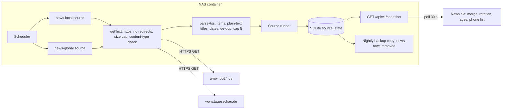

# Tech Spec: News Headlines

> **Status:** Ready
> **Confidence:** 91%
> **PRD:** [`prd-news-headlines.md`](prd-news-headlines.md)
> **Created:** 2026-11-01
> **Last updated:** 2026-11-01

## 1. Overview

The news tile shows the newest headlines of two public RSS feeds: **rbb24** (local, Berlin/Brandenburg) and **Tagesschau**
(global, national and international). The backend fetches and parses the feeds on a schedule, stores a tiny payload per feed (at most five
plain-text titles with publication time) and the display rotates through them one at a time. The tile replaces the placeholder `news`
tile in the existing wall slot (`col 6, row 5, 7 x 2`). No new route, no database migration, no new image or compose change.

| Source id | Feed (constant in code) | Group / label | Interval | Stale after | Timeout | Payload |
| --------- | ----------------------- | ------------- | -------- | ----------- | ------- | ------- |
| `news-local` | `https://www.rbb24.de/aktuell/index.xml/feed=rss.xml` | local / "Regional", source name "rbb24" | 900 s | 2700 s | 15 s | up to 5 headlines |
| `news-global` | `https://www.tagesschau.de/index~rss2.xml` | global / "Welt", source name "Tagesschau" | 900 s | 2700 s | 15 s | up to 5 headlines |

Both feeds were probed on 2026-11-01: HTTP 200 without redirect, RSS 2.0, `title`, `link`, `pubDate` (RFC 822), Tagesschau also `guid`, sizes 19 KB
(rbb24, 48 items) and 68 KB (Tagesschau, 56 items). The rbb24 file carries a licence comment: use only in non-commercial internet offerings, revocable,
no support or availability guarantee, **contents must not be archived** (see AD-10). Tagesschau (ARD-aktuell) states no such condition in the feed.

Key decisions (details in "Architectural Decisions"):

- One source per feed, switched together by `sources.news.enabled` (AD-1, as weather).
- The catalogue of feeds is a code constant; settings only switch the tile on or off (AD-2, egress rule).
- Only title, publication time, an id for de-duplication and the source name are kept; **no link, description, image or content** is read into the payload (AD-3, AC-26).
- Age text and ordering are computed in the frontend from the server-based clock (AD-5).
- Rotation reuses `useViewRotation` and `classifyGesture`, moved to a shared folder (AD-6).
- The tile frame state is derived from both sources (AD-7), as the calendar tile does.

Layers: backend and frontend. Infrastructure: example settings and a runbook paragraph only.

## 2. Architecture & Design

### 2.1 Component Diagram



### 2.2 Data Flow

1. Start: `loadConfig` accepts `sources.news.enabled`. When it is not `false` the server creates the two sources with the shared `fetch`.
2. Every 900 s each source calls `getText(url)` (GET, `accept: application/rss+xml, application/xml, text/xml`, identifying user agent, no cookies,
   no referrer, `redirect: 'error'`, 512 KB cap on the decoded body, content type must contain `xml`).
3. `parseRss(text, now)` extracts `item` elements, builds plain-text titles, parses `pubDate`, drops invalid or old items, de-duplicates and keeps the
   first five in feed order. The runner stores the payload; on failure it keeps the previous payload and stores only the error code.
4. The display polls the snapshot every 30 s. `buildHeadlines` joins both payloads (local first), computes ages with the server-based `now` and the
   frontend rotation shows one headline at a time (wall) or two grouped lists (phone).
5. A source in `stale`, `error` or `never-loaded` is marked on its own headlines; the other keeps working (AD-7).

### 2.3 Integration Points

| System | Direction | Protocol | Purpose |
| ------ | --------- | -------- | ------- |
| `www.rbb24.de` | Outbound, backend only | HTTPS GET, RSS 2.0 | Local headlines |
| `www.tagesschau.de` | Outbound, backend only | HTTPS GET, RSS 2.0 | Global headlines |
| `/data/dashboard.sqlite` | Both | SQLite `source_state` | Last payload per feed (at most 5 titles each); removed from backup copies (AD-10) |
| Browser | Inbound | HTTP same origin | `/api/v1/snapshot` only; no new route, no third-party request |

## 3. Data Model Changes

### 3.1 New Entities

Backend (TypeBox, `backend/src/sources/news/types.ts`), mirrored by hand in `frontend/src/tiles/news/types.ts` with a guard (`isNewsPayload`):

```text
NewsHeadline {
  id: string            // guid, else link path; max 100 chars; used only for de-duplication and as React key
  title: string         // plain text, control characters stripped, whitespace collapsed, max 160 chars (ellipsis when cut)
  publishedAt: string   // ISO UTC, never later than "now"
}
NewsPayload {
  group: 'local' | 'global'
  sourceName: string    // "rbb24" | "Tagesschau" (constant of the catalogue)
  headlines: NewsHeadline[]   // 0..5, feed order (newest first)
}
```

Never copied from the feed: link, description, content, enclosures, images, categories, author.

Settings (`backend/src/config/schema.ts`):

```text
sources.news?: { enabled: boolean }     // optional; absent = enabled (like weather); false = placeholder tile
```

Credentials: none. Projection: nothing is added to `SnapshotSettings`.

Catalogue (`backend/src/sources/news/catalogue.ts`):

```text
const newsFeeds = {
  local:  { sourceId: 'news-local',  url: 'https://www.rbb24.de/aktuell/index.xml/feed=rss.xml', sourceName: 'rbb24' },
  global: { sourceId: 'news-global', url: 'https://www.tagesschau.de/index~rss2.xml',            sourceName: 'Tagesschau' },
} as const
```

### 3.2 Modified Entities

- `Settings` gets the optional `sources.news`; `settingsSchema` rejects unknown keys as before.
- Frontend `TileDefinition.replaces` becomes `string | readonly string[]`; `visibleTiles` and `findOverlaps` handle both (AD-8). Existing entries are unchanged.
- `backup-job.ts` removes `news-%` rows from the backup copy (AD-10).

### 3.3 Migration Plan

No schema migration: payloads live in the existing `source_state` table as JSON. Nothing to roll back; an older build ignores unknown sources.

## 4. API Design

No new endpoint. The snapshot gains up to two entries (`news-local`, `news-global`) in `sources`; the envelope and `Cache-Control: no-store` are unchanged.

```json
{ "id": "news-local", "status": "fresh", "lastUpdated": "2026-11-01T10:30:00.000Z", "ageSeconds": 40,
  "staleAfterSeconds": 2700, "lastErrorCode": null,
  "data": { "group": "local", "sourceName": "rbb24", "headlines": [
    { "id": "https://www.rbb24.de/panorama/beitrag/2026/11/halloween-nacht-berlin-brandenburg-bilanz.html",
      "title": "Etwas Pyrotechnik, ansonsten wenig Straftaten an Halloween", "publishedAt": "2026-11-01T09:43:13.000Z" } ] } }
```

Size: about 250 bytes per headline, at most 5 per source, so the snapshot grows by about 3 KB. Authorization: none (home network only).

## 5. Event Design

Not applicable: refresh is the scheduler, delivery is the existing 30 s snapshot poll.

## 6. Service Layer

### Backend (`backend/src/sources/news/`)

#### Module: TextFetch (`text-fetch.ts`)

```text
getText(fetchImpl: typeof fetch, url: URL, o: { signal: AbortSignal; userAgent: string; maxBytes: number }): Promise<string>
```

Mirrors `getJson` in `sources/weather/http.ts` and reuses its `readLimited` and `UpstreamError` (imports from `../weather/http.js`): `redirect: 'error'`,
`credentials: 'omit'`, `referrerPolicy: 'no-referrer'`, non-2xx and non-`xml` content types throw `UpstreamError`, the body is decoded as UTF-8 text, errors
never carry the URL or upstream text. Aborts propagate so the runner reports `SOURCE_TIMEOUT`.

#### Module: RssParse (`rss-parse.ts`)

```text
parseRss(text: string, opts: { now: number; max: number }): NewsHeadline[]     // throws UpstreamError when the document is not RSS
```

- Takes `rss > channel > item` elements. Parsing uses `fast-xml-parser` 5.11.2 (exact pin, new backend dependency) with `processEntities` limited to the five XML entities and numeric
  character references, DOCTYPE entities ignored, `ignoreAttributes: true`, CDATA read as text and `htmlEntities` off; a thrown parser error is caught and rethrown as `UpstreamError` (its message is discarded).
- Title: tags removed, HTML/XML entities decoded once (numeric and the five named ones; other named entities are dropped), control characters removed,
  whitespace collapsed, trimmed, cut at 160 characters with an ellipsis. Empty titles drop the item.
- `publishedAt`: `pubDate` (RFC 822) or `dc:date` (ISO) parsed with `Date.parse`; invalid dates drop the item; dates later than `now + 5 min` are clamped to `now`;
  items older than 72 h are dropped.
- `id`: `guid` text, else `link`, else a hash of the normalised title; max 100 chars. The link text is used only to build the id and is never stored under another key.
- De-duplication: first by `id`, then by lower-cased title without punctuation. Feed order is kept; the first `max` (5) items remain.
- A document with no `rss/channel` throws `UpstreamError`; a valid feed with zero usable items returns `[]` (empty state).

#### Service: NewsSource (`news-source.ts`)

```text
createNewsSource(deps: { group: 'local'|'global'; fetchImpl: typeof fetch; userAgent: string; now?: () => number }): Source<NewsPayload>
```

`intervalSeconds: 900`, `staleAfterSeconds: 2700`, `timeoutMs: 15_000`, id and URL from the catalogue. `fetch(signal)` = `getText` (maxBytes 512 000) → `parseRss` → payload.
Output is validated with `Value.Check(newsPayloadSchema, …)` before returning.

#### Wiring (`server.ts`)

When `config.settings.sources.news?.enabled !== false`, both sources are pushed with `overrides.fetchImpl ?? fetch`, the user agent `home-dashboard/<buildId>` and
`overrides.now`. `loadConfig` needs no credential check. `infrastructure/config.example/settings.example.yaml` gets a `news: { enabled: true }` block.

### Frontend (`frontend/src/tiles/news/`)

| File | Responsibility |
| ---- | -------------- |
| `types.ts` | `NewsPayload` mirror and `isNewsPayload` guard |
| `derive.ts` | `deriveNewsEntry(snapshot)`: entry that drives the tile frame (AD-7) |
| `headlines.ts` | `buildHeadlines(entries, now)`: local first, then global; each item has `group`, `sourceName`, `title`, `publishedAt`, `stale` (its source is stale or its payload is old) |
| `format.ts` | Age text via the foundation's age formatter ("gerade eben" under 15 s, "vor 12 Min.", "vor 3 Std."), beyond 24 h a date (`Intl.DateTimeFormat('de')`) |
| `NewsTile.tsx` | Content component: reads entries and the server-based `now`, wall rotation, phone list, states |
| `HeadlineCard.tsx` | One headline: label ("Regional"/"Welt"), source name, age, stale marker, title (line-clamped) |
| `HeadlineControls.tsx` | Position text "3 von 10" and previous/next buttons (≥ 56 px wall) |
| `PhoneList.tsx` | Two grouped sections without rotation, rows ≥ 44 px, no links |
| `heading.tsx` | Not needed: base title `tiles.news` stays |

Shared move (AD-6): `tiles/weather/useViewRotation.ts` and `tiles/weather/gestures.ts` (with their tests) move to `tiles/shared/`; weather imports are updated. The rotation hook
is used with `viewCount = headlines.length`, `dwellMs = 15_000`, `resumeMs = 60_000`; `autoplay` is true only while the derived tile state is `fresh` (Q3 decided: AD-7). The fade uses the same `view-enter`/`view-exit` classes and
`FADE_MS` as weather, and `prefers-reduced-motion` already shortens it to 150 ms in the shared CSS.

Registry: tile `news-live` (`sourceIds: ['news-local','news-global']`, `requiresSource: true`, `replaces: ['news','demo']`, `deriveEntry: deriveNewsEntry`, same area as `news`,
`phoneOrder: 3`, `freshFooter: false`, `stateTexts` for never-loaded and error, `isEmpty` when all present payloads have zero headlines). German texts live in `i18n/de.ts` under `news.*`
(labels, `position`, `previous`, `next`, states, stale marker, "Quelle").

Layout: the wall slot is 7 x 2 grid cells (roughly one third of the height, about 117 px at 1180 x 700), so the card is a single column: meta row
(label · source · age, 28 px), title (32 px, at most two lines on short screens, three on tall ones, ellipsis beyond), control row (position text and the two buttons). On
screens up to 850 px high exactly one headline with source and age is shown; the position text stays, the buttons keep their 56 px size inside the card padding.

## Cross-Cutting Technical Design

### Domain Logic & Validation

- Everything time-dependent (age text, the 24 h date switch) is computed in the frontend with `Date.parse(serverTime) + monotonic delta`, as weather and calendar do.
- `publishedAt` is untrusted upstream data: clamped to now, parsed defensively, never used for ordering across groups (local first, then global, feed order inside a group).
- Titles are rendered only as React text nodes; no `dangerouslySetInnerHTML`.

### Error Handling & Operational Concerns

- Failures: the runner stores `SOURCE_FETCH_FAILED` or `SOURCE_TIMEOUT`; logs contain the source id and error code only, never URL, XML or titles.
- Security: fixed hosts as constants, no redirects, size cap, content-type check, no entity expansion, plain-text titles, CSP unchanged. The two hosts are added to the
  "Outbound Requests" list of the security guideline by `reconcile-docs`.
- Fair use: 2 requests per 15 min in total, independent of open displays. No `If-Modified-Since` is used (feeds are small).
- Performance: three more DOM nodes per layer; text and opacity animations only; the rotation timer is the existing hook (cleared on unmount).
- Observability: stale or error is visible on the tile; nothing else is added.

### Rollout, Migration & Compatibility

No migration. `sources.news` is optional and defaults to enabled; `enabled: false` restores the placeholder. Rollback = previous image (the rows left in `source_state` are ignored).

### Architectural Decisions

- **AD-1** One source per feed so each fails, goes stale and is judged on its own (PRD FR-6, AC-19).
- **AD-2** Feeds are a code catalogue, never configuration: it keeps the "fixed hosts" egress rule without an exception. Changing a feed is a code change.
- **AD-3** The payload carries no link, description or image (AC-26, out of scope), which also keeps the stored copy minimal.
- **AD-4** Feed order is the ranking ("most important"): the Tagesschau front-page feed and the rbb24 feed are editorially ordered newest first; no scoring.
- **AD-5** Ages and the 24 h switch are computed in the frontend.
- **AD-6** Rotation and gesture logic are shared with weather in `tiles/shared/` instead of being copied.
- **AD-7** `deriveNewsEntry`: no entry present → tile hidden; every present entry `never-loaded` → `never-loaded`; none has data and at least one failed → `error`; otherwise `stale` only when every entry with data is stale (oldest age), else `fresh`. A single stale source is marked on its own headlines (decided: rotation keeps running over all headlines while only one source is stale; the stale source's headlines carry the amber "Veraltet" marker with age).
- **AD-8** `replaces` accepts a list so `news-live` can replace both the placeholder and the demo tile without an overlap finding.
- **AD-9** Contract fixtures are trimmed recordings of the real feeds in `backend/test/fixtures/news/` (about 8 items each, titles with entities and CDATA kept).
- **AD-10** (rbb24 "must not be archived") Only the current five titles per feed are kept, overwritten on every refresh; the nightly backup job deletes `source_state` rows whose id starts with `news-` from the backup copy, so no headline history accumulates. After a restore the tile shows the never-loaded state until the first refresh.
- **AD-11** XML is parsed with `fast-xml-parser` (exact pin, entity expansion limited), not by hand.

## 7. Acceptance Criteria → Test Plan (TDD)

Test names follow the repository's plain-sentence `it('…')` convention. Each test group starts with a `// Covers: …` comment (testing guidelines). Backend tests:
`backend/src/sources/news/*.test.ts`, `backend/test/news-contract.test.ts`; frontend: `frontend/src/tiles/news/*.test.tsx`; E2E: `frontend/e2e/news.spec.ts` (helper `news-helpers.ts`
like `weather-helpers.ts`).

### Feature F-1: Local and global headlines

#### AC-1: headlines from at least one local and one global source
**PRD source:** FR-1 · **Touchpoints:** `catalogue.ts`, `news-source.ts`, `server.ts`, `headlines.ts` · **Unresolved:** none

| # | Test Case | Type | Description |
|---|-----------|------|-------------|
| 1 | Both sources registered | Integration (`server.test`) | With news enabled the snapshot contains `news-local` and `news-global`. |
| 2 | Contract with recorded feeds | Contract | `news-contract.test.ts`: both fixtures yield 1..5 headlines that pass `newsPayloadSchema`. |
| 3 | Tile shows both groups | Unit (`NewsTile.test`) | Local and global headlines appear across one rotation. |

#### AC-2: title, source name and local/global label
**PRD source:** FR-2 · **Touchpoints:** `HeadlineCard.tsx`, `de.ts` · **Unresolved:** none

| # | Test Case | Type | Description |
|---|-----------|------|-------------|
| 1 | Card content | Unit | A local headline shows "Regional", "rbb24" and its title; a global one "Welt", "Tagesschau". |
| 2 | Label is text | Unit | The label is text content, not an icon or color only. |

#### AC-3: plain-text titles
**PRD source:** FR-2, NFR-4 · **Touchpoints:** `rss-parse.ts`, `HeadlineCard.tsx` · **Unresolved:** none

| # | Test Case | Type | Description |
|---|-----------|------|-------------|
| 1 | Entities and CDATA | Unit (`rss-parse.test`) | `&#252;`, `&amp;`, CDATA and `<b>` inside a title come out as plain text without raw markup. |
| 2 | Hostile input | Unit | A title with a `<script>` tag, a DOCTYPE with entities and 1 MB of nested tags yields stripped text or `UpstreamError`, never expanded entities. |
| 3 | Rendered as text | Unit (`HeadlineCard.test`) | A title containing `` is rendered literally and creates no element. |

#### AC-4: duplicates appear once
**PRD source:** FR-2 · **Touchpoints:** `rss-parse.ts` · **Unresolved:** none

| # | Test Case | Type | Description |
|---|-----------|------|-------------|
| 1 | Same guid | Unit | Two items with the same guid give one headline. |
| 2 | Same title, different guid | Unit | Titles equal after case and punctuation normalisation give one headline. |

#### AC-25: at most five per source, local first
**PRD source:** F-1 · **Touchpoints:** `rss-parse.ts`, `headlines.ts` · **Unresolved:** none

| # | Test Case | Type | Description |
|---|-----------|------|-------------|
| 1 | Cap | Unit | A feed with 48 items yields exactly 5, in feed order. |
| 2 | Fewer items | Unit | A feed with 2 usable items yields 2. |
| 3 | Order | Unit (`headlines.test`) | `buildHeadlines` returns all local items before all global items. |

### Feature F-2: Calm rotating presentation

#### AC-5: one headline at a time, every 15 s (+/- 2 s)
**PRD source:** FR-3 · **Touchpoints:** `NewsTile.tsx`, shared `useViewRotation` · **Unresolved:** none

| # | Test Case | Type | Description |
|---|-----------|------|-------------|
| 1 | Single headline visible | Unit | Only one headline is exposed to assistive technology (`aria-hidden` on the outgoing layer). |
| 2 | Auto change | Unit (fake timers) | After 15 s the next headline is active; after the last, the first again. |
| 3 | Wall in browser | E2E | `news.spec.ts` observes a change within 13–17 s. |

#### AC-6: position indicated in text
**PRD source:** FR-3 · **Touchpoints:** `HeadlineControls.tsx`, `de.ts` · **Unresolved:** none

| # | Test Case | Type | Description |
|---|-----------|------|-------------|
| 1 | Position text | Unit | "3 von 10" is rendered as text and updates on change. |

#### AC-7: reduce motion fade at most 150 ms
**PRD source:** F-2 · **Touchpoints:** shared CSS (`view-enter`/`view-exit`) · **Unresolved:** none

| # | Test Case | Type | Description |
|---|-----------|------|-------------|
| 1 | Reduced motion | E2E | With `reducedMotion: 'reduce'` the computed transition duration of the layers is ≤ 150 ms and no transform is animated. |

#### AC-8: long headline never overflows
**PRD source:** F-2 · **Touchpoints:** `HeadlineCard.tsx` (line clamp), `rss-parse.ts` (160 chars) · **Unresolved:** none

| # | Test Case | Type | Description |
|---|-----------|------|-------------|
| 1 | Truncation | Unit | A 400-character title is cut to 160 characters with an ellipsis. |
| 2 | Fit | E2E | A 160-character title stays inside the tile at 1024 x 750 and 1180 x 700. |

#### AC-9: rotation stops in stale, error, never-loaded
**PRD source:** FR-8 · **Touchpoints:** `derive.ts`, `NewsTile.tsx` · **Unresolved:** none

| # | Test Case | Type | Description |
|---|-----------|------|-------------|
| 1 | Derivation | Unit (`derive.test`) | The rules of AD-7 for every combination of two entries. |
| 2 | Autoplay | Unit | `autoplay` is false when the derived tile state is not `fresh` and no timer is pending; it stays true while only one source is stale. |
| 3 | Frame state | Unit (`Tile.test` style) | The frame shows the German never-loaded and error texts instead of headlines. |

### Feature F-3: Manual navigation

#### AC-10: tap advances, swipe of at least 60 px navigates
**PRD source:** FR-4 · **Touchpoints:** `NewsTile.tsx`, shared `gestures.ts` · **Unresolved:** none

| # | Test Case | Type | Description |
|---|-----------|------|-------------|
| 1 | Tap | Unit | A pointer tap advances to the next headline. |
| 2 | Swipe | Unit | 60 px left → next, 60 px right → previous, wrapping; 59 px does nothing. |
| 3 | No page scroll | E2E | A horizontal swipe on the tile does not scroll the page. |

#### AC-11: input pauses, 60 s resume
**PRD source:** FR-4 · **Touchpoints:** shared `useViewRotation` · **Unresolved:** none

| # | Test Case | Type | Description |
|---|-----------|------|-------------|
| 1 | Pause and resume | Unit (fake timers) | After a tap no change for 59 s; rotation continues after 60 s. |

#### AC-12: same transition for manual changes
**PRD source:** F-3 · **Touchpoints:** `NewsTile.tsx` · **Unresolved:** none

| # | Test Case | Type | Description |
|---|-----------|------|-------------|
| 1 | Shared layers | Unit | A manual change produces the same `view-enter`/`view-exit` layers as an automatic one. |

#### AC-13: controls at least 56 px on the wall
**PRD source:** F-3 · **Touchpoints:** `HeadlineControls.tsx` · **Unresolved:** none

| # | Test Case | Type | Description |
|---|-----------|------|-------------|
| 1 | Target size | E2E | Previous and next buttons measure ≥ 56 x 56 px at 1024 x 750, 1180 x 700 and 1920 x 1200; they have German accessible names. |
| 2 | Buttons navigate | Unit | Next/previous change the headline and pause the rotation. |

### Feature F-4: Source and age

#### AC-14: source and age visible at 28 px or more
**PRD source:** FR-2, NFR-7 · **Touchpoints:** `HeadlineCard.tsx`, `format.ts` · **Unresolved:** none

| # | Test Case | Type | Description |
|---|-----------|------|-------------|
| 1 | Age formats | Unit (`format.test`) | 5 s → "gerade eben", 12 min → "vor 12 Min.", 3 h → "vor 3 Std.", 30 h → a German date. |
| 2 | Font size | E2E | Source and age text have a computed font size ≥ 28 px on the wall. |

#### AC-15: age from the server-based clock
**PRD source:** FR-5 · **Touchpoints:** `NewsTile.tsx` · **Unresolved:** none

| # | Test Case | Type | Description |
|---|-----------|------|-------------|
| 1 | Skewed device clock | Unit | With the device clock mocked 2 h ahead, the age is derived from `serverTime` and the monotonic delta only. |

### Feature F-5: Freshness, outage and empty states

#### AC-16: refresh every 15 minutes without a display
**PRD source:** FR-6 · **Touchpoints:** `news-source.ts`, `server.ts` · **Unresolved:** none

| # | Test Case | Type | Description |
|---|-----------|------|-------------|
| 1 | Declaration | Unit | Both sources declare `intervalSeconds` 900. |
| 2 | Scheduler | Integration | With fake timers the registered jobs call `fetch` at start and after 900 s with no HTTP client present. |

#### AC-17: stale after 45 minutes with last headlines
**PRD source:** FR-8 · **Touchpoints:** `news-source.ts`, `derive-status`, `NewsTile.tsx` · **Unresolved:** none

| # | Test Case | Type | Description |
|---|-----------|------|-------------|
| 1 | Threshold | Unit | `staleAfterSeconds` is 2700. |
| 2 | Failed refresh keeps payload | Integration | After a successful run and a failing one the snapshot entry is `stale` after 2700 s and still has the headlines. |
| 3 | Stale marker | Unit | A headline of a stale source shows the amber "Veraltet" marker with icon, text and age ("Veraltet · vor 50 Min."). |

#### AC-18: calm texts for never-loaded, first failure, empty
**PRD source:** FR-8 · **Touchpoints:** registry `stateTexts`, `isEmpty`, `de.ts` · **Unresolved:** none

| # | Test Case | Type | Description |
|---|-----------|------|-------------|
| 1 | Texts | Unit (`registry.test`) | The three German texts match the PRD exactly; no error codes appear. |
| 2 | Empty | Unit | Two present sources with zero headlines show "Noch keine Schlagzeilen". |

#### AC-19: one failing source does not hide the other
**PRD source:** FR-6 · **Touchpoints:** `derive.ts`, `headlines.ts` · **Unresolved:** none

| # | Test Case | Type | Description |
|---|-----------|------|-------------|
| 1 | One in error | Unit | `news-local` in `error` without data, `news-global` fresh → global headlines shown, tile `fresh`. |
| 2 | Isolation | Integration | A throwing local fetch leaves the global source's stored payload unchanged. |

#### AC-20: never blank
**PRD source:** NFR-3 · **Touchpoints:** `NewsTile.tsx` · **Unresolved:** none

| # | Test Case | Type | Description |
|---|-----------|------|-------------|
| 1 | Offline | E2E | With the backend unreachable after a first load the last headline stays visible with its age. |
| 2 | Fixture matrix | Unit | For every state combination the tile renders non-empty text. |

### Feature F-6: Phone list

#### AC-21: grouped list without rotation
**PRD source:** FR-9 · **Touchpoints:** `PhoneList.tsx` · **Unresolved:** none

| # | Test Case | Type | Description |
|---|-----------|------|-------------|
| 1 | Groups | Unit | With `layout: 'phone'` the sections "Regional" and "Welt" list all headlines; no timer is scheduled. |

#### AC-22: touch targets and no horizontal scrolling at 360 px
**PRD source:** F-6 · **Touchpoints:** `PhoneList.tsx` · **Unresolved:** none

| # | Test Case | Type | Description |
|---|-----------|------|-------------|
| 1 | Layout | E2E | At 360 px `scrollWidth <= clientWidth` and rows are ≥ 44 px high. |

#### AC-26: headlines are not links
**PRD source:** F-6, Out of Scope · **Touchpoints:** payload type, `PhoneList.tsx`, `HeadlineCard.tsx` · **Unresolved:** none

| # | Test Case | Type | Description |
|---|-----------|------|-------------|
| 1 | Payload has no link | Contract | The serialised payload of both fixtures contains no `http` URL other than inside the `id`, and no `link`/`description` key. |
| 2 | No anchors | Unit | The wall and phone render no `<a>` element inside the news tile. |

### Feature F-7: Wall fit

#### AC-23: content inside the tile at all sizes, 28 px text
**PRD source:** FR-10, NFR-7 · **Touchpoints:** all views · **Unresolved:** none

| # | Test Case | Type | Description |
|---|-----------|------|-------------|
| 1 | Fit matrix | E2E | At 1024 x 750, 1180 x 700, 1280 x 800, 1920 x 1200 and 2048 x 1536 every element lies inside the tile box with no scrolling; text ≥ 28 px. |
| 2 | Short screens | E2E | At ≤ 850 px height exactly one headline with source and age is visible. |

#### AC-24: German dictionary and contrast floors
**PRD source:** FR-11, NFR-7 · **Touchpoints:** `de.ts`, tokens · **Unresolved:** none

| # | Test Case | Type | Description |
|---|-----------|------|-------------|
| 1 | Dictionary | Unit (`de.test`) | All `news.*` keys exist; a source scan finds no hard-coded German text in `tiles/news/`. |
| 2 | Contrast | Unit | Title/text token pairs reach 7:1 (title) and 4.5:1 (others) in day and night. |

### Non-functional requirement validation

| NFR | Technical approach | Validation evidence |
| --- | ------------------ | ------------------- |
| NFR-1 | Shared rotation hook, no per-headline timers, layers unmounted after the fade | Extend `frontend/e2e/soak.spec.ts` with the news tile; memory trend unchanged |
| NFR-2 | Opacity-only fades, no layout animation | Unit test on class names; E2E reduced-motion check |
| NFR-3 | AD-1 and AD-7 | AC-19, AC-20 tests |
| NFR-4 | Constants, `redirect:'error'`, no entity expansion, text nodes | `text-fetch.test` (redirect refused, no cookie/referrer header), AC-3 tests, bundle test (no third-party URL) |
| NFR-5 | 900 s interval, 2 sources | AC-16 test |
| NFR-6 | Source names shown, no archiving of history (AD-10) | Review checklist in the runbook; `backup-job.test` for news-row removal (AD-10) |
| NFR-7 | Tokens and sizes | AC-23, AC-24 tests |
| NFR-8 | Runner logging of id and code only | Log-capture test: no URL or title in log output |

### PRD coverage checklist

F-1 → AC-1..4, 25 · F-2 → AC-5..9 · F-3 → AC-10..13 · F-4 → AC-14, 15 · F-5 → AC-16..20 · F-6 → AC-21, 22, 26 · F-7 → AC-23, 24.
FR-1..11 and NFR-1..8 map as listed in the tables above.

## 8. Infrastructure Changes

| Resource | Type | Location | Notes |
| -------- | ---- | -------- | ----- |
| `sources.news.enabled` | Settings example | `infrastructure/config.example/settings.example.yaml` | Default `true`; demo stays `false` |
| Egress | Firewall note | `infrastructure/README.md` runbook | NAS must reach `www.rbb24.de` and `www.tagesschau.de` on 443 |

No image, compose or credentials change.

## 9. Implementation Plan

| Step | Description | Dependencies | Complexity |
| ---- | ----------- | ------------ | ---------- |
| 1 | Record trimmed fixtures; `types.ts`, `catalogue.ts`; settings schema `sources.news` (tests first) | — | Low |
| 2 | `text-fetch.ts` and `rss-parse.ts` with unit tests  | 1 | Medium |
| 3 | `news-source.ts`, server wiring, contract test, example settings | 2 | Low |
| 4 | Backup copy without news rows  and test | 3 | Low |
| 5 | Move rotation and gesture hook to `tiles/shared/`; `replaces` list; registry tests | — | Low |
| 6 | Frontend types, `derive.ts`, `headlines.ts`, `format.ts` with tests | 3 | Medium |
| 7 | `NewsTile`, `HeadlineCard`, `HeadlineControls`, `PhoneList`, dictionary, registry entry | 5, 6 | Medium |
| 8 | E2E `news.spec.ts`, soak extension, fit matrix | 7 | Medium |
| 9 | Live check script `backend/scripts/news-live-check.mjs`, runbook paragraph | 3 | Low |

## 10. Risks & Mitigations

| Risk | Impact | Likelihood | Mitigation |
| ---- | ------ | ---------- | ---------- |
| rbb24 revokes use or changes the feed | Local source empty or stale | Medium | Own source state; AD-2 allows a one-line code change; live-check script |
| "No archiving" clause of rbb24 | Licence non-compliance | Low | AD-10: bounded cache, news rows excluded from backups |
| XML parsing of hostile input | Memory or CPU spike | Low | Size cap 512 KB, no entity expansion, parse inside the source timeout |
| Tile is only ~117 px high on 1180 x 700 | Cramped layout | Medium | One headline, line clamp, E2E fit matrix |
| Feed order is not "importance" | Weak headlines | Medium | Accepted (AD-4); front-page feed chosen for Tagesschau |
| Moving the rotation hook breaks weather | Regression | Low | Move with tests; run the weather suite and E2E |

## 11. Iteration Log

### Iteration 1 — 2026-11-01

- Questions asked: 3
- Questions resolved: 0
- Confidence: — → 72%
- Summary of changes: First draft from the PRD, the weather and calendar specs and the existing code (source runner, `getJson`, registry, rotation hook). Both feeds were
  probed live. Three decisions are left to the user: XML parsing approach, handling of the rbb24 archiving clause, and rotation while one source is stale.

### Iteration 2 — 2026-11-01

- Questions asked: 3
- Questions resolved: 3
- Confidence: 72% → 91%
- Summary of changes: Q1 `fast-xml-parser` 5.11.2 exact pin with limited entity handling (AD-11); Q2 keep only the current five titles and strip `news-` rows from backup copies (AD-10);
  Q3 rotation keeps running while a single source is stale, markers on its headlines, tile stale only when all sources with data are stale (AD-7).

---

## Open Questions

_None — all questions are reconciled._
