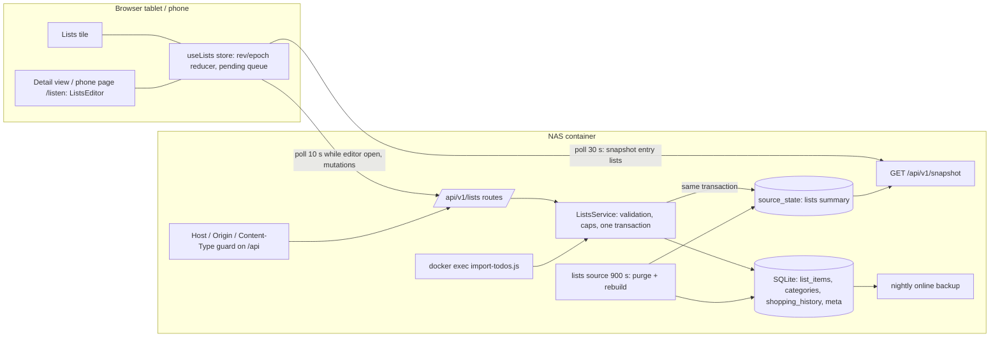

# Tech Spec: Shopping List and To-dos

> **Status:** Ready
> **Confidence:** 90%
> **PRD:** [`prd-shopping-list-todos.md`](prd-shopping-list-todos.md)
> **Created:** 2026-10-31
> **Last updated:** 2026-10-31

## 1. Overview

The first mutable data of the dashboard: a shopping list and a to-do list (with category, priority, effort and prerequisite)
that are shown on the wall tile, edited on the wall tablet and on phones, kept in SQLite and replicated to every device
through the existing snapshot poll.

- **Truth in SQLite** (`list_items`, `categories`, `shopping_history`, `meta`, migration 003). A `lists` **source** rebuilds a
  compact summary from the tables and every mutation records the same summary into `source_state` in the same database
  transaction, so the 30 s snapshot poll shows changes without a new read path for the tile (AD-1, AD-2).
- **Editing through JSON routes** under `/api/v1/lists` (first write API of the project). Every successful call returns the
  complete editor state with `epoch` and `rev`. Ids are chosen by the client, so retries are idempotent (AD-3, AD-4).
- **Safety without login**: strict Host allow-list for all `/api/` requests (new setting `network.allowedHosts`), Origin and
  Content-Type rules for mutations, closed error codes, caps, no titles in logs (AD-5, AD-6).
- **Frontend**: a lists tile with two columns, a generic full-screen **detail view** owned by the shell (`TileDefinition.detail`),
  one `ListsEditor` used by the tablet detail view and by the phone page at `/listen`, optimistic updates with a visible pending
  and failed state and automatic retry (AD-8 to AD-12).
- **Import**: a CLI script inside the container brings over the open tasks of the old to-do app once (AD-7).

Layers: backend, frontend, infrastructure (settings example, runbook, import procedure; no image or compose change).

## 2. Architecture & Design

### 2.1 Component Diagram



### 2.2 Data Flow

1. A user adds an entry: the client creates a uuid, shows the entry at once with a pending mark, and sends `POST /api/v1/lists/items`.
2. The guard checks Host, Origin and Content-Type; the service validates and sanitises, enforces caps, writes the row, bumps `rev`,
   records the new summary in `source_state` — all in one transaction — and answers with the full `ListsState`.
3. The client applies the response if `epoch` is unchanged and `rev` is greater than its last applied `rev`, then clears the
   pending mark. Failed sends keep the mark "Nicht gespeichert" and are retried automatically with the same uuid.
4. Other devices see the change with their next snapshot poll (at most 30 s), earlier while their editor polls `GET /api/v1/lists` every 10 s.
5. At local midnight (and every 15 minutes) the source purges checked entries of earlier days and tombstones older than 1 h and rebuilds the summary.

### 2.3 Integration Points

| System | Direction | Protocol | Purpose |
| ------ | --------- | -------- | ------- |
| `/data/dashboard.sqlite` | Both | SQLite | Lists, categories, history, `meta`, and the `lists` entry of `source_state` |
| Browser | Inbound | HTTP same origin, JSON | `GET/POST/PATCH/DELETE /api/v1/lists…`, snapshot, SPA entry `/listen` |
| `docker exec` import | Inbound (operator) | Process in the container | One-time import of the old open tasks from `data/imports/*.json` |
| Nightly backup | Internal | SQLite online backup | The lists are part of the database copy |

No new egress, no new host, nothing is sent to an outside service.

## 3. Data Model Changes

### 3.1 New Entities

Migration `003_create_lists.sql` (same mechanism as 001/002: numbered file, one transaction, `user_version`):

```text
categories(
  id          TEXT PRIMARY KEY,            -- uuid; seeded rows have fixed ids
  name        TEXT NOT NULL,               -- 1..20 chars
  name_key    TEXT NOT NULL,               -- NFC, lowercased with the German locale; uniqueness key
  position    INTEGER NOT NULL,
  builtin     INTEGER NOT NULL DEFAULT 0,  -- 1 for "Sonstiges"
  created_at  INTEGER NOT NULL,
  deleted_at  INTEGER                      -- tombstone for undo
)
UNIQUE INDEX categories_name_key ON categories(name_key) WHERE deleted_at IS NULL

list_items(
  id            TEXT PRIMARY KEY,          -- uuid chosen by the client
  list          TEXT NOT NULL CHECK (list IN ('shopping','todo')),
  title         TEXT NOT NULL,             -- 1..80 chars, sanitised
  category_id   TEXT REFERENCES categories(id),  -- todo only
  priority      TEXT CHECK (priority IN ('high','medium','low')),  -- todo only
  effort_hours  REAL,                      -- todo only, multiple of 0.5, 0..99
  prerequisite  TEXT,                      -- todo only, 1..80 chars
  checked_at    INTEGER,                   -- epoch ms
  created_at    INTEGER NOT NULL,
  updated_at    INTEGER NOT NULL,
  deleted_at    INTEGER                    -- tombstone for undo
)
INDEX list_items_list ON list_items(list, deleted_at, checked_at)

shopping_history(title_key TEXT PRIMARY KEY, title TEXT NOT NULL, uses INTEGER NOT NULL, last_used INTEGER NOT NULL)
meta(key TEXT PRIMARY KEY, value TEXT NOT NULL)      -- 'rev' (integer as text), starts at 0
```

The migration seeds the categories of the old app (Wohnzimmer, Büro, Balkon, Gang, Großes Bad, Kleines Bad, Küche, Schlafzimmer,
Kinderzimmer) and `Sonstiges` (builtin, fixed id `sonstiges`), with positions 1..10.

Caps (AD-6): at most 500 non-deleted items per list and 600 rows per list including tombstones, at most 100 non-deleted categories.

API types (TypeBox, `backend/src/lists/types.ts`; mirrored by hand in `frontend/src/api/lists-types.ts` with guards):

```text
Priority      = 'high' | 'medium' | 'low'
ListsCategory = { id, name, position, builtin: boolean, openTodoCount: number }
ShoppingItem  = { id, title, checkedAt: string|null (ISO), createdAt: string }
TodoItem      = { id, title, categoryId, priority, effortHours: number|null, prerequisite: string|null, checkedAt: string|null, createdAt: string }
ListsState    = { epoch: string, rev: number, categories: ListsCategory[],
                  shopping: ShoppingItem[]   // open first (newest first), then checked (most recently checked first)
                  todos: TodoItem[]          // open by priority then oldest first, then checked
                  suggestions: string[] }    // up to 100 earlier shopping titles not currently open, most recent first
ListsSummary  = { epoch, rev, categories (id, name), shopping (max 30), todos (max 40), counts: { shoppingOpen, todoOpen, todoHigh }, truncated: boolean }
```

Items of a deleted (tombstoned) category are reported with `categoryId: 'sonstiges'`; their stored `category_id` is unchanged.

### 3.2 Modified Entities

- `Settings`: new optional block `network: { allowedHosts: string[] }` (1..10 host names, no scheme or port, lowercased, no wildcards).
  If absent, only `localhost`, `127.0.0.1` and `[::1]` are allowed and the start logs a warning.
- `ApiErrorCode` gains `FORBIDDEN_HOST`, `UNSUPPORTED_MEDIA_TYPE`, `LIST_LIMIT_REACHED`, `CATEGORY_NAME_TAKEN`, `CATEGORY_PROTECTED`.
- `TileDefinition` (frontend) gains `detail?: ComponentType<{ onClose(): void }>` and `detailLabelKey`.
- Backend logging: redaction paths `*.title`, `*.name`, `*.prerequisite`, `*.body`.

### 3.3 Migration Plan

Additive migration 003. A database with a newer schema than the image keeps failing closed (`DB_SCHEMA_NEWER_THAN_APP`, existing rule). A restored
older backup runs 003 on start. Tests: migration creates the schema and seed on an empty database, is a no-op on a migrated one, and
runs on a database restored from a version-2 backup. No rollback script: rolling back means redeploying the old image on a restored backup.

## 4. API Design

All routes are under `/api/v1/lists`, answer `Cache-Control: no-store` (also errors), carry no `Access-Control-*` headers and need no login
(accepted household model). Request bodies are JSON with `additionalProperties: false`, at most 4 KiB. Every success is `200` with the full
`ListsState` (`201` for the first creation of an id). Errors use the existing envelope `{ "error": { "code", "message", "details": null } }`
with closed codes; messages are fixed English texts and never echo input.

| Method and path | Body | Notes |
| --------------- | ---- | ----- |
| `GET /api/v1/lists` | — | Full `ListsState` |
| `POST /api/v1/lists/items` | `{ id: uuid, list: 'shopping'\|'todo', title, categoryId?, priority?, effortHours?, prerequisite? }` | Shopping accepts only `id,list,title`; to-do needs `categoryId` (default priority `medium`). An existing id returns `200` with the current state (idempotent). Shopping title already open: `200`, state unchanged, no duplicate. Adds `shopping_history`. |
| `PATCH /api/v1/lists/items/:id` | any of `{ title, checked: boolean, categoryId, priority, effortHours: number\|null, prerequisite: string\|null }` (at least one) | `null` clears, omitted keeps. `checked: true` sets `checked_at = now`, `false` clears. Unknown or tombstoned id: `404 NOT_FOUND`. |
| `DELETE /api/v1/lists/items/:id` | — | Tombstone; idempotent for a tombstoned id; unknown id `404`. |
| `POST /api/v1/lists/items/:id/restore` | — | Clears the tombstone (checks caps and category); purged id `404`. |
| `POST /api/v1/lists/categories` | `{ id: uuid, name }` | `409 CATEGORY_NAME_TAKEN`, `409 LIST_LIMIT_REACHED`; existing id idempotent. |
| `PATCH /api/v1/lists/categories/:id` | `{ name }` | `409 CATEGORY_PROTECTED` for `sonstiges`; renaming applies to all to-dos by id. |
| `DELETE /api/v1/lists/categories/:id` | — | Tombstone; its to-dos read as `sonstiges`; `409 CATEGORY_PROTECTED` for `sonstiges`. |
| `POST /api/v1/lists/categories/:id/restore` | — | Clears the tombstone; the to-dos return to it; `409 CATEGORY_NAME_TAKEN` if the name is now used. |

Status codes: `200`, `201`, `400 VALIDATION_FAILED` (field names only), `403 FORBIDDEN_HOST`, `404 NOT_FOUND`, `409` (the codes above), `413 PAYLOAD_TOO_LARGE`,
`415 UNSUPPORTED_MEDIA_TYPE`, `500 INTERNAL_ERROR`.

**Request guard (`/api/` only):**
1. `Host` (name part, case-insensitive, port ignored) must be in `network.allowedHosts` or the loopback names; otherwise `403 FORBIDDEN_HOST` without echoing the value. This covers GET too (DNS rebinding can read).
2. For `POST`, `PATCH`, `DELETE`: if `Origin` is present its host must equal the `Host` name and be allowed (`Origin: null` is rejected); a request without `Origin` (curl, CLI) is accepted; `Sec-Fetch-Site: cross-site` is rejected when present.
3. Mutations with a body need `Content-Type: application/json` (`415` otherwise); bodiless mutations rely on rule 2.
4. `/api/v1/health` stays reachable for the container healthcheck (`127.0.0.1`).

Snapshot addition: one more entry `lists` in `sources` with `ListsSummary` as `data` (no envelope change). Example:

```json
{ "id": "lists", "status": "fresh", "lastUpdated": "2026-10-31T10:00:00.000Z", "ageSeconds": 12, "staleAfterSeconds": 7200, "lastErrorCode": null,
  "data": { "epoch": "9f0c…", "rev": 41, "truncated": false,
    "categories": [{ "id": "sonstiges", "name": "Sonstiges" }],
    "shopping": [{ "id": "…", "title": "Milch", "checkedAt": null, "createdAt": "…" }],
    "todos": [{ "id": "…", "title": "Verkabelung Schreibtisch", "categoryId": "…", "priority": "high", "effortHours": 1, "prerequisite": null, "checkedAt": null, "createdAt": "…" }],
    "counts": { "shoppingOpen": 4, "todoOpen": 30, "todoHigh": 9 } } }
```

Payload sizes: summary at most about 15 KB (30 + 40 rows); `ListsState` at most about 110 KB at the caps and typically under 10 KB.

## 5. Event Design

Not applicable: no queues or push channels. Replication is polling: the snapshot every 30 s for the tile, and `GET /api/v1/lists` every 10 s while an editor is open.

## 6. Service Layer

### Backend (`backend/src/lists/`)

#### Module: Text (`lists-text.ts`)
`sanitiseText(raw, max): string | null` — NFC, strips control characters, bidi overrides (U+202A–202E, U+2066–2069), zero-width characters and line separators,
collapses whitespace, trims; returns `null` when empty or longer than `max`. `keyOf(text)` — `toLocaleLowerCase('de')` of the NFC text, used for
`name_key` and `title_key`.

#### Service: ListsService (`lists-service.ts`)
```text
createListsService({ db, store, clock, timezone, newEpoch }): ListsService
  state(): ListsState                                  // full state, builds from tables
  summary(): ListsSummary
  addItem(input), patchItem(id, input), deleteItem(id), restoreItem(id)
  addCategory(input), renameCategory(id, name), deleteCategory(id), restoreCategory(id)
  purge(now): void                                     // checked entries of earlier local days, tombstones older than 1 h
  importTasks(tasks, { dryRun }): ImportResult         // used by the CLI, same rules and caps
```
- Every mutation runs in `db.transaction`: validate → write → `rev` +1 in `meta` → `store.recordSuccess('lists', summary(), now)` → return `state()`. Failures roll back all of it.
- `epoch` is a random uuid created at process start; the lists are always read from the tables, never from `source_state`, so a restored backup is consistent after restart.
- Caps are counted inside the transaction. Tombstones older than 1 h and expired checked rows are purged before counting, on every mutation.
- Local day: checked rows are removed when the local date (settings time zone) of `checked_at` is before today's local date.
- Shopping add: a title whose `keyOf` equals an open title is not added again. `shopping_history` is updated (uses +1, last used).
- Category removal never changes `list_items.category_id`; reads map tombstoned categories to `sonstiges`. The purge moves the to-dos of categories whose tombstone expired to `sonstiges` in one transaction.
- Logging: only `{ route, status, code }`; never titles, names, ids of bodies or validation values.

#### Source: lists (`lists-source.ts`)
`createListsSource(service)` — `id: 'lists'`, `intervalSeconds: 900`, `staleAfterSeconds: 7200`, `timeoutMs: 5000`; `fetch` calls `service.purge(now)` and returns `service.summary()` (reads the database only, no HTTP). It is registered like the other sources; the runner records the result, so an idle list is refreshed every 15 minutes and never shows stale.

#### Routes (`lists-routes.ts`) and guard (`request-guard.ts`)
Fastify plugins registered in `buildApp` (routes only when `deps.lists` is given, like weather); the guard is an `onRequest` hook for URLs starting with `/api/`. Route schemas with TypeBox (`maxLength`, `pattern` for uuid, `multipleOf: 0.5`, `minimum 0`, `maximum 99`); the 4 KiB limit is set per route.

#### CLI (`backend/src/cli/import-todos.ts`, compiled to `dist/cli/import-todos.js`)
`node dist/cli/import-todos.js <file> [--dry-run] [--delete-file]`. The file must be a regular file (no symlink) inside `${DATA_DIR}/imports/`, at most 1 MiB. Input (documented in the runbook):
```json
{ "version": 1, "tasks": [ { "title": "…", "category": "Büro", "priority": "Hoch", "effortHours": 1.5, "prerequisite": "…", "done": false } ] }
```
It validates with the same rules and caps as the routes, skips `done: true`, creates missing categories, skips duplicates (same title key and category), runs all-or-nothing in one transaction with `busy_timeout`, and prints counts only (read, imported, skipped, categories created). Exit code 0 on success, 1 on failure, 2 on usage errors.

### Frontend (`frontend/src`)

| File | Responsibility |
| ---- | -------------- |
| `api/lists-types.ts`, `api/lists.ts` | Types, guards, typed client (`getLists`, `createItem`, `patchItem`, `deleteItem`, `restoreItem`, category calls), error-code mapping, uuid via `crypto.getRandomValues` (works over plain HTTP) |
| `lists/listsReducer.ts` | Pure reducer: base state, `epoch`/`rev` rule, pending operations keyed by client id, optimistic apply, rollback only for permanent errors |
| `lists/useLists.ts` | Store hook: snapshot summary for the tile, `GET /lists` polling (10 s) while an editor is mounted, mutation queue with automatic retry (every 5 s and on `online`), exposes `state`, `pending`, `failed`, `mutate*`, `undo` |
| `tiles/fit-rows.ts`, `tiles/useFittingRows.ts` | `fitRows` and the measuring hook moved from `tiles/calendar/` (with tests) and shared |
| `tiles/lists/ListsTile.tsx` | Two columns (Einkauf, To-dos), rows with check circle, counts in headings, `+ n weitere`, states per column |
| `tiles/lists/PriorityMark.tsx`, `CheckCircle.tsx`, `TodoRow.tsx`, `ShoppingRow.tsx` | Row parts |
| `lists/ListsEditor.tsx` (+ `ShoppingSection`, `TodoSection`, `CategoryChips`, `ItemSheet`, `CategoryManager`, `UndoToast`, `PendingMarker`) | The complete editor for the detail view and the phone page |
| `shell/DetailOverlay.tsx`, `shell/detail-context.ts` | Generic full-screen detail view inside the shell: dialog, focus, `inert` background, 2 min idle close, busy guard |
| `pages/ListPage.tsx`, `App.tsx` | Phone page at `LIST_PAGE_PATH = '/listen'`; `App` switches on `window.location.pathname` |
| `tiles/TileFrame.tsx`, `tiles/types.ts`, `tiles/registry.ts` | Heading becomes a button when a tile has `detail`; registry entry `lists-live` replaces the placeholder `lists` |
| `i18n/de.ts` | `lists.*` texts |

## Cross-Cutting Technical Design

### Domain Logic & Validation

- **Ordering.** Shopping: open entries newest first, then checked entries (most recently checked first). To-dos: open by priority (`high`, `medium`, `low`) then oldest first, then checked by priority and age. Checked entries of earlier local days are not shown (frontend uses the server-based `now`) and are purged by the server.
- **Rev rule (client).** Apply a server state only if `epoch` equals the known epoch and `rev` is greater than the last applied `rev`; a changed `epoch` resets the base. A response arriving after a newer poll is dropped. Pending operations are re-applied on top of every new base state until acknowledged; a permanent error (`4xx` except `409` retry-able cases) rolls the operation back and shows the failure on the row.
- **Idempotency.** Creates carry the client uuid; retries of `POST`, `DELETE` and `restore` are harmless. `PATCH` retries are idempotent field writes (last write wins per field).
- **Stable UI while polling.** Rows are keyed by id; while a sheet is open, a field has focus or a finger is on the list, incoming states are held and applied afterwards; an open sheet's form is never reset by a poll (a changed server value shows a calm "Geändert" hint).
- **Wall tile fitting.** Rows are at least 56 px high on the wall (check circle target); `fitRows` (pixel heights from probe rows) fills whole rows per column; today's rule from the calendar (`partial` days) does not apply; each column ends with `+ n weitere` (also a button that opens the detail view at that list). On `tablet-short` the category is dropped from the to-do row and the heading shows the count.
- **Priority mark.** `high`: chevrons-up icon, `medium`: single chevron, `low`: minus; always with an `sr-only` text "Priorität hoch/mittel/niedrig"; shape carries the meaning, colour only supports it. In the editor a tap on the mark opens a small chooser (Hoch, Mittel, Niedrig).
- **Check circle (wall).** Only the 56 px circle at the left of a row checks and unchecks; taps on the title do nothing; a tap shorter than 80 ms or with movement over 10 px is ignored. On the phone the whole row of the editor is tappable (44 px). After checking a "Rückgängig" target stays on the row for 8 s.
- **Undo.** Removing an item or category shows an undo toast for 8 s (above the keyboard); undo calls `restore`. The server keeps tombstones for 1 h.
- **Pending and failed rows.** A not yet acknowledged write shows a clock icon; a failed one an amber warning icon with "Nicht gespeichert" and "Erneut versuchen"; the tile heading shows "n nicht gespeichert". Retries run automatically.
- **Detail overlay.** Opens from the tile heading button (accessible name "Listen öffnen", `aria-haspopup="dialog"`) and from `+ n weitere`; dialog with label, `aria-modal`, background `inert`, focus to the back button and returned to the heading button on close, `Esc` closes. Closes after 2 min without pointer or key input and never closes while the editor reports a draft or an open sheet (`busy`). It is rendered inside the shell so the burn-in drift applies; opening and closing use `view-enter`/`view-exit` (150 ms under reduced motion). A heading tap does not trigger the one-tap fullscreen (stop propagation).
- **Sheets.** On the wall tablet add and edit are a centred panel inside the detail view sized with `visualViewport` (buttons above the keyboard, focused field scrolled into view); on the phone a bottom sheet sized with `visualViewport`. Fields: Aufgabe (required), Kategorie, Priorität, Aufwand (Std, `inputmode="decimal"`, unit visible), Voraussetzung.
- **Validation messages** come from error codes and field names through the German dictionary; no server text is shown.

### Error Handling & Operational Concerns

- **Failures:** validation and limit errors map to calm German texts (`VALIDATION_FAILED`, `LIST_LIMIT_REACHED`, `CATEGORY_NAME_TAKEN`, `CATEGORY_PROTECTED`, `FORBIDDEN_HOST`); network errors keep the write pending and retry; the tile shows the foundation's states per column (never loaded, error, stale with age); one list failing never blanks the other.
- **Observability:** request logs carry route, status and an error code only; titles, category names and prerequisites never appear in logs, paths or errors (test); the CLI prints counts only.
- **Security & privacy:** see AD-5 and AD-6. No cookies, no outside access, no `localStorage` or service worker cache of list data (in-memory last state only); text is rendered as React text, never as HTML or `href`. Tombstoned and purged titles remain in the database file and backup for at most about 1 h plus one backup cycle (accepted).
- **Performance:** the 30 s snapshot carries at most about 15 KB for lists; the editor polls `GET /api/v1/lists` every 10 s only while mounted; one mutation is one small transaction.
- **Backup/restore:** `backup-job` copies the whole database online, so the lists are included; restore (stop, copy, remove WAL files, start) yields the state of that backup with a new `epoch`.
- **Runtime configuration:** `network.allowedHosts` (settings). No new environment variable. `DASHBOARD_BIND_IP` must be the NAS LAN address for phones to reach the page (runbook).
- **Operational support:** runbook "Listen" (list page address, allowed hosts when the NAS address or name changes, import procedure and cleanup of the export file, backup and restore).

### Rollout, Migration & Compatibility

Additive: migration 003, one more source, new routes, one new optional setting, a new SPA path. The snapshot envelope is unchanged; older frontends ignore the `lists` entry. Before the first phone use `network.allowedHosts` must list the NAS name and address (otherwise API calls from `dashboard.home` get `403`, which is visible and documented). Rollback: redeploy the previous build; the extra tables are ignored (an older build refuses the newer schema, so restore the data backup first).

### Architectural Decisions

| ID | Decision | Rationale |
| -- | -------- | --------- |
| AD-1 | Lists enter the snapshot through a DB-backed `lists` source: SQLite is the truth, the source rebuilds the summary; the architecture reference sentence "a source is the only way external data enters" becomes "the only way data enters the snapshot" | Keeps one read model, no second polling path for the tile; the wording changes at reconciliation |
| AD-2 | Mutations write tables, `rev` and `source_state` in one transaction; `source_state` is never read back for lists; `epoch` (random per process) plus `rev` guard clients against a restored backup; source interval 900 s, stale after 7200 s | No half-written snapshot, no false "Veraltet" on an idle list, safe restores |
| AD-3 | `ListsState` is returned by every mutation and by `GET /api/v1/lists`; the snapshot carries only the compact `ListsSummary` | Instant, consistent editing; the 30 s snapshot stays small |
| AD-4 | Client-chosen uuids for items and categories (via `getRandomValues`, since `randomUUID` needs a secure context and the display runs over plain HTTP) and idempotent retries | Automatic retry without duplicates (user decision T3) |
| AD-5 | Strict Host allow-list for all `/api/` requests from `network.allowedHosts` (names only, port ignored; loopback always allowed; unset means loopback only plus a start warning); Origin and Content-Type rules for mutations | User decision T1: protects against DNS rebinding and cross-site writes without login; the compose healthcheck keeps working |
| AD-6 | No rate limiter; bounds are caps (500 items per list, 600 rows with tombstones, 100 categories), 4 KiB bodies, 80/20 character limits, closed error codes | Security advisor: caps bound growth; revisits the old "rate limiting then" note |
| AD-7 | Import is a CLI in the container (`docker exec`), file from `data/imports/`, same service rules, all-or-nothing, dry run, counts only; no upload route | No new write surface; input format is documented and adapted when the old app's export is seen |
| AD-8 | The shell owns a generic detail overlay (`TileDefinition.detail`), minimal interface, idle close after 2 min, busy guard, focus and `inert` contract | PRD F-9; later tiles add a detail view without framework changes |
| AD-9 | The overlay renders inside the drifting shell | Avoids burn-in of a static full-screen layer |
| AD-10 | On the wall only the check circle checks; tap filtering; 8 s undo | User decision T2 and UX review |
| AD-11 | Pending and failed states are visible per row, automatic retry every 5 s and on `online`; permanent errors roll back with a message | User decision T3 |
| AD-12 | The phone page lives at `/listen` (SPA path switch, no router library; the existing SPA fallback serves it); it shows only the editor, without the display behaviours (drift, night schedule, kiosk) | Fixed short address (AC-51) with minimal frontend change |
| AD-13 | `fitRows` and `useFittingRows` move to a shared tiles module | Third user (calendar, lists); tests move with the code |
| AD-14 | A deleted category is a tombstone: its to-dos keep the stored category but read as "Sonstiges" until purge (1 h); restore brings them back | Exact undo without touching items |
| AD-15 | Priority chooser instead of cycling in the editor | Avoids accidental level changes (UX review); still "tap the mark" (AC-23) |

## 7. Acceptance Criteria → Test Plan (TDD)

Legend: **BE** backend (`src/**/*.test.ts`, `test/**`, Vitest, real SQLite in memory or a temp file), **FE** frontend (Vitest/jsdom), **E2E** Playwright against the production build and the **real backend** in `e2e/fixtures` (lists are real; helpers create and clean up items through the API; weather stays disabled). Golden contract fixtures: `backend/test/fixtures/lists/lists.state.sample.json`, `lists.snapshot.sample.json` (`UPDATE_FIXTURES=1` regenerates), an old-app style import file `old-todos.sample.json`. **Manual** items need the real tablet, phones or the old app's export. Titles follow the repository style `it('…')`; every test group carries a `// Covers: …` comment.

### 7.0 PRD Coverage Checklist

| PRD item | Addressed in | Proven by |
| -------- | ------------ | --------- |
| F-1 / FR-1, FR-9 | migration 003, service, source | AC-1 to AC-6 |
| F-2 / FR-2, FR-11 | `ListsTile`, shared fitting | AC-7 to AC-14 |
| F-3 / FR-3, FR-4 | ordering, history, suggestions | AC-15 to AC-21 |
| F-4 / FR-5 | to-do fields, `PriorityMark` | AC-22 to AC-29 |
| F-5 / FR-6 | categories | AC-30 to AC-35 |
| F-6 / FR-7 | `ListsEditor`, phone page | AC-36 to AC-42, AC-51 |
| F-7 / FR-8 | rev/epoch, polling | AC-43 to AC-45 |
| F-8 / FR-10 | CLI import | AC-46 to AC-50 |
| F-9 / FR-12 | detail overlay | AC-52 to AC-59 |
| NFR-1 to NFR-8 | see 7.1 | 7.1 |

### Feature 1: Two fixed lists

#### AC-1: Exactly two lists, "Einkauf" and "To-dos"

| # | Test Case | Type | Test Name | Description |
| - | --------- | ---- | --------- | ----------- |
| 1 | State | Unit (BE) | `it('has exactly a shopping list and a to-do list')` | `ListsState` keys, `list` check constraint |
| 2 | Names | Unit (FE) | `it('names the columns Einkauf and To-dos from the dictionary')` | |

#### AC-2: Fields and text rules

| # | Test Case | Type | Test Name | Description |
| - | --------- | ---- | --------- | ----------- |
| 1 | Trim | Unit (BE) | `it('trims, normalises and rejects empty or too long titles')` | 80 chars, NFC, whitespace |
| 2 | Unsafe text | Unit (BE) | `it('strips control, bidi and zero-width characters')` | |
| 3 | Fields | Unit (BE) | `it('accepts category, priority, effort and prerequisite only on to-dos')` | shopping with todo fields → 400 |
| 4 | Route | Integration (BE) | `it('answers 400 VALIDATION_FAILED with field names only')` | no value echoed |

#### AC-3: Persistence across restarts and updates

| # | Test Case | Type | Test Name | Description |
| - | --------- | ---- | --------- | ----------- |
| 1 | Restart | Integration (BE) | `it('keeps the lists after the server restarts on the same database')` | |
| 2 | Migration | Migration (BE) | `it('creates the lists schema and seed and keeps earlier tables intact')` | from version 2 |
| 3 | Browser | E2E | `test('shows an added entry after the backend restarts')` | restart via helper |

#### AC-4: Backup and restore

| # | Test Case | Type | Test Name | Description |
| - | --------- | ---- | --------- | ----------- |
| 1 | Backup | Integration (BE) | `it('contains the lists in the nightly backup copy')` | run `backup-job`, open the copy |
| 2 | Restore | Integration (BE) | `it('serves the restored state with a new epoch after restart')` | rev may go down, epoch changes |

#### AC-5: No sign-in

| # | Test Case | Type | Test Name | Description |
| - | --------- | ---- | --------- | ----------- |
| 1 | Open access | Integration (BE) | `it('serves and changes the lists without credentials from an allowed host')` | |

#### AC-6: The shopping list starts empty

| # | Test Case | Type | Test Name | Description |
| - | --------- | ---- | --------- | ----------- |
| 1 | Empty | Unit (BE) | `it('starts with an empty shopping list and no suggestions')` | seed only categories |

### Feature 2: Lists tile on the wall

#### AC-7: Two columns with names

| # | Test Case | Type | Test Name | Description |
| - | --------- | ---- | --------- | ----------- |
| 1 | Layout | Unit (FE) | `it('shows Einkauf on the left and To-dos on the right with counts in the headings')` | |
| 2 | Browser | E2E | `test('shows both lists side by side on the wall')` | |

#### AC-8: Whole rows and `+ n weitere`

| # | Test Case | Type | Test Name | Description |
| - | --------- | ---- | --------- | ----------- |
| 1 | Fitting | Unit (FE) | `it('fills whole rows per column and counts the rest in + n weitere')` | budget prop like calendar |
| 2 | Shared helper | Unit (FE) | `it('uses the shared fitRows with pixel heights')` | moved tests stay green |
| 3 | Browser | E2E | `test('shows + n weitere with the exact number at 1024x750, 1180x700, 1280x720, 1920x1080')` | 30 to-dos |

#### AC-9: Open entries first; no scrolling

| # | Test Case | Type | Test Name | Description |
| - | --------- | ---- | --------- | ----------- |
| 1 | Order | Unit (FE) | `it('lists open entries before checked ones')` | |
| 2 | No scroll | E2E | `test('never scrolls the tile and keeps everything inside the card')` | `tileFitProblems` |

#### AC-10: Ellipsis, no overflow

| # | Test Case | Type | Test Name | Description |
| - | --------- | ---- | --------- | ----------- |
| 1 | Truncate | Unit (FE) | `it('truncates long titles and keeps the full text for assistive technology')` | |
| 2 | Fit | E2E | `test('fits 80-character titles at all sizes')` | |

#### AC-11: Calm empty texts

| # | Test Case | Type | Test Name | Description |
| - | --------- | ---- | --------- | ----------- |
| 1 | Empty | Unit (FE) | `it('says Nichts zu kaufen and Keine offenen To-dos for empty lists')` | and "Alles erledigt" when only checked remain |

#### AC-12: 28 px and contrast

| # | Test Case | Type | Test Name | Description |
| - | --------- | ---- | --------- | ----------- |
| 1 | Size | E2E | `test('has no text below 28px in the lists tile')` | |
| 2 | Contrast | Unit (FE) | `it('keeps priority marks and checked text at 4.5:1 in both themes')` | token pairs |

#### AC-13: Foundation states

| # | Test Case | Type | Test Name | Description |
| - | --------- | ---- | --------- | ----------- |
| 1 | States | Unit (FE) | `it('shows never-loaded, error and stale states per column with the age')` | |
| 2 | Keep | Unit (FE) | `it('keeps the last lists on screen when a refresh fails')` | |
| 3 | Idle | Integration (BE) | `it('never reports the lists source as stale while the scheduler runs')` | fake clock 3 h |

#### AC-14: One line per to-do

| # | Test Case | Type | Test Name | Description |
| - | --------- | ---- | --------- | ----------- |
| 1 | Row | Unit (FE) | `it('shows priority mark, title and category and no effort or prerequisite')` | |
| 2 | Short | Unit (FE) | `it('drops the category on short screens and shows the count in the heading')` | `tablet-short` |

### Feature 3: Shopping list behavior

#### AC-15: New entries on top

| # | Test Case | Type | Test Name | Description |
| - | --------- | ---- | --------- | ----------- |
| 1 | Order | Unit (BE) | `it('returns open shopping entries newest first')` | |
| 2 | Tile | Unit (FE) | `it('shows a new entry at the top')` | |

#### AC-16: Checking and unchecking

| # | Test Case | Type | Test Name | Description |
| - | --------- | ---- | --------- | ----------- |
| 1 | Patch | Integration (BE) | `it('sets and clears checked_at through PATCH')` | |
| 2 | View | Unit (FE) | `it('moves a checked entry below the open ones, dimmed and crossed out, and back when unchecked')` | |

#### AC-17: Gone on the next local day

| # | Test Case | Type | Test Name | Description |
| - | --------- | ---- | --------- | ----------- |
| 1 | Purge | Unit (BE) | `it('removes entries checked on an earlier local day and keeps those from today')` | 23:59 vs 00:00, `Europe/Berlin`, DST day |
| 2 | Frontend | Unit (FE) | `it('hides entries checked on an earlier local day using the server-based now')` | wrong device clock |
| 3 | Browser | E2E | `test('removes a checked entry at midnight without a jump')` | fake clock |

#### AC-18: Removing

| # | Test Case | Type | Test Name | Description |
| - | --------- | ---- | --------- | ----------- |
| 1 | Delete | Integration (BE) | `it('tombstones an entry and is idempotent')` | |
| 2 | UI | Unit (FE) | `it('removes open and checked entries from the editor')` | |

#### AC-19: Not colour alone

| # | Test Case | Type | Test Name | Description |
| - | --------- | ---- | --------- | ----------- |
| 1 | Shape | Unit (FE) | `it('shows a check icon and a strike-through for checked entries')` | |

#### AC-20: Suggestions

| # | Test Case | Type | Test Name | Description |
| - | --------- | ---- | --------- | ----------- |
| 1 | History | Unit (BE) | `it('keeps earlier titles in the history and returns the 100 most recent')` | |
| 2 | Offer | Unit (FE) | `it('offers matching earlier entries for a single tap while typing')` | max 5 shown |
| 3 | Add | Integration (BE) | `it('adds a suggestion like any entry')` | |

#### AC-21: No duplicates

| # | Test Case | Type | Test Name | Description |
| - | --------- | ---- | --------- | ----------- |
| 1 | Rule | Unit (BE) | `it('does not add a title that is already open (case and umlaut insensitive)')` | "Äpfel"/"äpfel" |
| 2 | Offer | Unit (FE) | `it('does not offer open entries and highlights the existing row')` | "schon auf der Liste" |

### Feature 4: To-dos

#### AC-22: Priority levels and default

| # | Test Case | Type | Test Name | Description |
| - | --------- | ---- | --------- | ----------- |
| 1 | Schema | Unit (BE) | `it('accepts high, medium and low and defaults to medium')` | |
| 2 | Sheet | Unit (FE) | `it('preselects Mittel in the add sheet')` | |

#### AC-23: Changing the priority

| # | Test Case | Type | Test Name | Description |
| - | --------- | ---- | --------- | ----------- |
| 1 | Patch | Integration (BE) | `it('changes the priority through PATCH')` | |
| 2 | Chooser | Unit (FE) | `it('opens a chooser with Hoch, Mittel and Niedrig when the mark is tapped')` | |

#### AC-24: Ordering

| # | Test Case | Type | Test Name | Description |
| - | --------- | ---- | --------- | ----------- |
| 1 | Order | Unit (BE) | `it('orders to-dos by priority then oldest first')` | |
| 2 | View | Unit (FE) | `it('keeps the server order in tile and editor')` | |

#### AC-25: Priority not by colour alone

| # | Test Case | Type | Test Name | Description |
| - | --------- | ---- | --------- | ----------- |
| 1 | Shapes | Unit (FE) | `it('uses a distinct icon and an sr-only text per level')` | |

#### AC-26: Category per to-do

| # | Test Case | Type | Test Name | Description |
| - | --------- | ---- | --------- | ----------- |
| 1 | Required | Integration (BE) | `it('requires an existing category for a to-do and rejects unknown ones')` | |
| 2 | Sheet | Unit (FE) | `it('uses the selected category filter as the default category when adding')` | |

#### AC-27: Effort and prerequisite

| # | Test Case | Type | Test Name | Description |
| - | --------- | ---- | --------- | ----------- |
| 1 | Validation | Unit (BE) | `it('accepts effort in half hours up to 99 and rejects other values')` | 0.25, 100, -1 |
| 2 | Null | Integration (BE) | `it('clears effort and prerequisite with null and keeps them when omitted')` | |
| 3 | Sheet | Unit (FE) | `it('edits effort with a decimal keypad and shows the unit as text')` | |

#### AC-28: Checked to-dos

| # | Test Case | Type | Test Name | Description |
| - | --------- | ---- | --------- | ----------- |
| 1 | Rule | Unit (BE) | `it('applies the same checked and next-day rule to to-dos')` | |
| 2 | View | Unit (FE) | `it('shows checked to-dos below the open ones and lets them be unchecked')` | |

#### AC-29: Most important first on the tile

| # | Test Case | Type | Test Name | Description |
| - | --------- | ---- | --------- | ----------- |
| 1 | Fitting | Unit (FE) | `it('shows the highest priorities and counts the rest in + n weitere')` | |

### Feature 5: Categories

#### AC-30: Seeded categories; "Sonstiges" fixed

| # | Test Case | Type | Test Name | Description |
| - | --------- | ---- | --------- | ----------- |
| 1 | Seed | Migration (BE) | `it('seeds the nine rooms and Sonstiges')` | |
| 2 | Protected | Integration (BE) | `it('refuses to rename or remove Sonstiges with CATEGORY_PROTECTED')` | |

#### AC-31: Manage categories on the phone

| # | Test Case | Type | Test Name | Description |
| - | --------- | ---- | --------- | ----------- |
| 1 | Routes | Integration (BE) | `it('adds, renames and removes categories')` | |
| 2 | UI | Unit (FE) | `it('offers add, rename and remove in the category manager')` | |

#### AC-32: Rename applies to all to-dos

| # | Test Case | Type | Test Name | Description |
| - | --------- | ---- | --------- | ----------- |
| 1 | Rename | Integration (BE) | `it('shows the new name on every to-do of the category')` | by id |

#### AC-33: Removal moves open to-dos to Sonstiges

| # | Test Case | Type | Test Name | Description |
| - | --------- | ---- | --------- | ----------- |
| 1 | Read | Integration (BE) | `it('reads the to-dos of a removed category as Sonstiges and restores them with the category')` | AD-14 |
| 2 | Purge | Unit (BE) | `it('moves the to-dos to Sonstiges when the tombstone expires')` | one transaction |
| 3 | Confirm | Unit (FE) | `it('says how many open to-dos will move before the removal is confirmed')` | `openTodoCount` |

#### AC-34: Names

| # | Test Case | Type | Test Name | Description |
| - | --------- | ---- | --------- | ----------- |
| 1 | Rules | Unit (BE) | `it('requires 1 to 20 characters and a unique name ignoring case and umlauts')` | DB unique index and code |
| 2 | Race | Integration (BE) | `it('keeps names unique under concurrent requests')` | |

#### AC-35: Filter and counts on the phone page

| # | Test Case | Type | Test Name | Description |
| - | --------- | ---- | --------- | ----------- |
| 1 | Filter | Unit (FE) | `it('filters the to-dos by category and shows open and high-priority counts')` | |
| 2 | Chips | E2E | `test('has category chips of at least 44px on the phone')` | |

### Feature 6: Editing

#### AC-36: Checking on the wall

| # | Test Case | Type | Test Name | Description |
| - | --------- | ---- | --------- | ----------- |
| 1 | Circle | Unit (FE) | `it('checks only through the 56 px circle and ignores taps on the title')` | |
| 2 | Tap filter | Unit (FE) | `it('ignores very short or moving taps')` | |
| 3 | Undo | Unit (FE) | `it('shows Rückgängig for 8 seconds after checking')` | fake timers |
| 4 | Size | E2E | `test('has check circles of at least 56px on the wall')` | |

#### AC-37: Adding and removing on the wall

| # | Test Case | Type | Test Name | Description |
| - | --------- | ---- | --------- | ----------- |
| 1 | Panel | Unit (FE) | `it('adds an entry and a to-do with category and priority from a centred panel')` | |
| 2 | Keyboard | Unit (FE) | `it('sizes the panel with the visual viewport and keeps the buttons visible')` | `visualViewport` mock |
| 3 | Flow | E2E | `test('adds, checks and removes an entry on the wall tablet')` | real backend |

#### AC-38: Phone list page

| # | Test Case | Type | Test Name | Description |
| - | --------- | ---- | --------- | ----------- |
| 1 | Page | Unit (FE) | `it('renders both lists with add, check, change and remove on the list page')` | |
| 2 | Browser | E2E | `test('has no horizontal scrolling and targets of at least 44px at 360px')` | |

#### AC-39: Link in the phone layout

| # | Test Case | Type | Test Name | Description |
| - | --------- | ---- | --------- | ----------- |
| 1 | Link | Unit (FE) | `it('shows a clear link to the list page in the phone layout tile')` | |
| 2 | Order | Unit (FE) | `it('keeps the lists tile first on the phone')` | registry order |

#### AC-40: Works without sign-in

| # | Test Case | Type | Test Name | Description |
| - | --------- | ---- | --------- | ----------- |
| 1 | No credentials | Integration (BE) | `it('needs no cookie, token or header for list requests from an allowed host')` | AC-5 |

#### AC-41: Undo

| # | Test Case | Type | Test Name | Description |
| - | --------- | ---- | --------- | ----------- |
| 1 | Restore | Integration (BE) | `it('restores a removed entry and category within the tombstone time')` | |
| 2 | Expired | Integration (BE) | `it('answers 404 for a purged tombstone')` | |
| 3 | Toast | Unit (FE) | `it('offers undo for 8 seconds and restores on tap')` | |

#### AC-42: Stable editing

| # | Test Case | Type | Test Name | Description |
| - | --------- | ---- | --------- | ----------- |
| 1 | Poll merge | Unit (FE) | `it('keeps the open sheet, its draft and the scroll position when a poll arrives')` | |
| 2 | Hold | Unit (FE) | `it('holds incoming states while a finger is on the list or a field has focus')` | |
| 3 | Keys | Unit (FE) | `it('keys rows by id so rows do not jump')` | |

#### AC-51: Fixed address

| # | Test Case | Type | Test Name | Description |
| - | --------- | ---- | --------- | ----------- |
| 1 | Path | Integration (BE) | `it('serves the SPA entry page for /listen with no-cache')` | |
| 2 | Page | E2E | `test('opens the list page directly at /listen and in the tablet browser')` | |
| 3 | No display behaviour | Unit (FE) | `it('runs no drift, night schedule or kiosk logic on the list page')` | |

### Feature 7: Same state everywhere

#### AC-43: Within 30 seconds

| # | Test Case | Type | Test Name | Description |
| - | --------- | ---- | --------- | ----------- |
| 1 | Snapshot | Integration (BE) | `it('shows a mutation in the next snapshot')` | |
| 2 | Two devices | E2E | `test('shows a change from a second browser context within 30 seconds')` | fake clock |
| 3 | Editor poll | Unit (FE) | `it('polls the full state every 10 seconds only while an editor is mounted')` | cleanup |

#### AC-44: Last change wins

| # | Test Case | Type | Test Name | Description |
| - | --------- | ---- | --------- | ----------- |
| 1 | Fields | Integration (BE) | `it('applies concurrent patches per field, the last one wins')` | |
| 2 | Reducer | Unit (FE) | `it('applies a state only when the epoch matches and rev is higher and drops late responses')` | |
| 3 | Epoch | Unit (FE) | `it('resets its base when the epoch changes')` | restore case |

#### AC-45: Failed changes are not lost

| # | Test Case | Type | Test Name | Description |
| - | --------- | ---- | --------- | ----------- |
| 1 | Pending | Unit (FE) | `it('keeps a failed write visible as Nicht gespeichert and retries automatically')` | |
| 2 | Idempotent | Integration (BE) | `it('does not duplicate an entry when the same id is sent twice')` | |
| 3 | Rollback | Unit (FE) | `it('rolls a permanently rejected write back and says why')` | |
| 4 | Heading | Unit (FE) | `it('shows how many changes are not saved in the heading')` | |

### Feature 8: Import

#### AC-46: Import of open tasks with all fields

| # | Test Case | Type | Test Name | Description |
| - | --------- | ---- | --------- | ----------- |
| 1 | Import | Integration (BE) | `it('imports title, category, priority, effort and prerequisite of open tasks')` | `old-todos.sample.json` |

#### AC-47: Completed tasks skipped

| # | Test Case | Type | Test Name | Description |
| - | --------- | ---- | --------- | ----------- |
| 1 | Done | Integration (BE) | `it('skips tasks that are done')` | |

#### AC-48: Categories and duplicates

| # | Test Case | Type | Test Name | Description |
| - | --------- | ---- | --------- | ----------- |
| 1 | Categories | Integration (BE) | `it('creates missing categories within the cap')` | |
| 2 | Duplicates | Integration (BE) | `it('does not add a task twice when run again')` | same title key and category |

#### AC-49: Unreadable files

| # | Test Case | Type | Test Name | Description |
| - | --------- | ---- | --------- | ----------- |
| 1 | Invalid | Integration (BE) | `it('changes nothing and says so for invalid JSON, a wrong schema, a symlink or a file over 1 MiB')` | exit code 1, counts only |
| 2 | Atomic | Integration (BE) | `it('rolls everything back when one task is invalid')` | |

#### AC-50: Old app untouched

| # | Test Case | Type | Test Name | Description |
| - | --------- | ---- | --------- | ----------- |
| 1 | Offline | Integration (BE) | `it('needs only the file, no network and no running old app')` | no `fetch` call; read-only file argument |
| 2 | Dry run | Integration (BE) | `it('writes nothing with --dry-run and prints counts')` | |

### Feature 9: Detail view

#### AC-52: Heading and `+ n weitere` open it

| # | Test Case | Type | Test Name | Description |
| - | --------- | ---- | --------- | ----------- |
| 1 | Open | Unit (FE) | `it('opens the detail view from the tile heading and from + n weitere')` | |
| 2 | Content | E2E | `test('shows the complete lists in the detail view')` | |

#### AC-53: Scrolling and editing

| # | Test Case | Type | Test Name | Description |
| - | --------- | ---- | --------- | ----------- |
| 1 | Editor | Unit (FE) | `it('scrolls, edits and filters by category with counts in the detail view')` | same `ListsEditor` |

#### AC-54: Back and idle close

| # | Test Case | Type | Test Name | Description |
| - | --------- | ---- | --------- | ----------- |
| 1 | Back | Unit (FE) | `it('closes with the back control of at least 56 px and returns focus to the heading')` | |
| 2 | Idle | Unit (FE) | `it('closes after 2 minutes without input and restarts the countdown on input')` | fake timers |
| 3 | Busy | Unit (FE) | `it('does not close while a draft or a sheet is open')` | |
| 4 | Cleanup | Unit (FE) | `it('clears its timers on unmount')` | NFR-1 |

#### AC-55: Current, readable, themed

| # | Test Case | Type | Test Name | Description |
| - | --------- | ---- | --------- | ----------- |
| 1 | Poll | Unit (FE) | `it('keeps the open view current from the 10 second poll')` | |
| 2 | Size | E2E | `test('uses text of at least 28px and the night theme in the detail view')` | |

#### AC-56: Calm transition, tiles unchanged

| # | Test Case | Type | Test Name | Description |
| - | --------- | ---- | --------- | ----------- |
| 1 | Fade | Unit (FE) | `it('uses the shared view fade and a short fade under reduced motion')` | |
| 2 | Underneath | E2E | `test('keeps the clock and the other tiles running while the view is open')` | |
| 3 | Drift | Unit (FE) | `it('renders the overlay inside the drifting shell')` | |

#### AC-57: Same behaviour for every tile

| # | Test Case | Type | Test Name | Description |
| - | --------- | ---- | --------- | ----------- |
| 1 | Generic | Unit (FE) | `it('opens, closes and idles the same way for any tile that offers a detail component')` | stub tile |

#### AC-58: Heading shows the detail view

| # | Test Case | Type | Test Name | Description |
| - | --------- | ---- | --------- | ----------- |
| 1 | Button | Unit (FE) | `it('renders a button with chevron, accessible name and focus ring only when a detail exists')` | |
| 2 | Dialog | Unit (FE) | `it('uses a labelled modal dialog with inert background, focus move and Esc')` | |

#### AC-59: Content taps keep their meaning

| # | Test Case | Type | Test Name | Description |
| - | --------- | ---- | --------- | ----------- |
| 1 | Taps | Unit (FE) | `it('does not open the detail view from a tap on the content or trigger fullscreen from the heading')` | |
| 2 | Weather | Unit (FE) | `it('keeps the weather tap behaviour unchanged')` | existing tests |

### 7.1 Non-functional requirements and security rules

| NFR | Approach | Evidence |
| --- | -------- | -------- |
| NFR-1 stability | timers cleaned up; reducer drops late responses; soak extended with list edits | AC-54.4, AC-43.3, `e2e/soak.spec.ts` list soak |
| NFR-2 readability | 28 px, tokens, shared fitting | AC-12, AC-8.3, AC-10.2 |
| NFR-3 security | AD-5, AD-6, caps, no outside service | tests below |
| NFR-4 efficiency | no extra polling outside editors; one transaction per change | AC-43.3 |
| NFR-5 accessibility | labelled controls, shapes, dialog contract | AC-19, AC-25, AC-58 |
| NFR-6 calm motion | shared fades, opacity-only strike | AC-56 |
| NFR-7 data safety | transactions, TypeBox validation, backup | AC-3, AC-4, AC-49.2 |
| NFR-8 testability | fake clocks, golden fixtures, API helpers | all |

Guard and logging tests (BE, `request-guard.test.ts`, `lists-routes.test.ts`):
- `it('rejects a Host outside network.allowedHosts with 403 FORBIDDEN_HOST for GET and mutations without echoing it')`; `it('accepts localhost and 127.0.0.1 for the healthcheck')`; `it('allows only loopback and warns at start when network.allowedHosts is missing')`.
- `it('rejects a cross-origin Origin, Origin null and Sec-Fetch-Site cross-site on mutations, also for bodiless DELETE')`; `it('answers 415 for a body that is not application/json')`.
- `it('sends no Access-Control headers and answers an OPTIONS preflight without them')`; `it('sends no-store on success and error responses of every lists route')` (extends the cache-policy test).
- `it('never logs titles, category names, prerequisites or request bodies')` (captures stdout during a failing and a succeeding mutation); `it('prints counts only in the import CLI')`.
- `it('rejects more than 500 items per list, 100 categories and a body over 4 KiB')` and `it('counts tombstones against the row cap and purges old ones on write')`.

**Manual verification (cannot run in CI):** the old app's real export (adapter to the documented JSON), real phones adding and checking over Wi-Fi, the on-screen keyboard behaviour on the real tablet, wall-tablet tap behaviour (accidental taps), the 2-minute auto-close feel, restore of a real backup, and `allowedHosts` with the real NAS name and address.

## 8. Infrastructure Changes

| Resource | Type | Location | Notes |
| -------- | ---- | -------- | ----- |
| `network.allowedHosts` | Configuration example | `infrastructure/config.example/settings.example.yaml` | `dashboard.home`, the NAS LAN address; documented, required for LAN access |
| Import folder | Directory on the NAS | `data/imports/` | export file placed here (or `docker cp` into `/data/imports`); remove after use |
| Runbook section "Listen" | Documentation | `infrastructure/README.md` | list page address `/listen` and home-screen icon, allowed hosts after an address change, import (`docker exec … node dist/cli/import-todos.js /data/imports/todos.json --dry-run`), backup and restore, `DASHBOARD_BIND_IP` reminder |
| Compose, image, ports | — | — | unchanged (the compiled CLI is part of `dist`) |

## 9. Implementation Plan

| Step | Description | Layer | Dependencies | Complexity |
| ---- | ----------- | ----- | ------------ | ---------- |
| 1 | Setting `network.allowedHosts`, request guard (Host, Origin, Content-Type), new error codes, redaction paths, cache-policy test | backend | — | Medium |
| 2 | Migration 003, text sanitising, repository functions | backend | — | Medium |
| 3 | `ListsService` (mutations in one transaction, caps, history, purge, rev/epoch, summary/state) | backend | 2 | High |
| 4 | `lists` source, wiring in `startServer`, snapshot contract fixtures | backend | 3 | Medium |
| 5 | Routes and schemas, golden `ListsState`, leakage and logging tests | backend | 1, 3 | High |
| 6 | Import CLI and sample file | backend | 3 | Medium |
| 7 | Frontend types, client, reducer and `useLists` (pending, retry, polling) | frontend | 5 (contract) | High |
| 8 | Move `fitRows`/`useFittingRows` to shared; `TileDefinition.detail`, heading button, `DetailOverlay`, shell wiring | frontend | — | High |
| 9 | `ListsTile` with two columns, rows, states, registry entry | frontend | 7, 8 | Medium |
| 10 | `ListsEditor`, sheets, category manager, undo and pending markers | frontend | 7, 8 | High |
| 11 | Phone page `/listen`, App path switch, phone layout link | frontend | 10 | Medium |
| 12 | E2E (real backend flows, two contexts, restart, fit at all sizes, phone), soak extension | frontend | 9, 10, 11 | Medium |
| 13 | Runbook section, example settings | infrastructure docs | 6, 11 | Low |
| 14 | Manual verification with the real export, phones and tablet | all | 12, 13 | Medium |

Backend contract (steps 1–6) precedes the frontend consumer (step 7). Step 8 can start in parallel. Each step is single-layer and mergeable; tests come first.

## 10. Risks & Mitigations

| Risk | Impact | Likelihood | Mitigation |
| ---- | ------ | ---------- | ---------- |
| Host allow-list locks users out after a NAS address or name change | Lists and dashboard API return 403 | Medium | Visible 403 state and text, runbook step, example file, start warning when unset |
| Old app's export format unknown | Import cannot run as documented | High | Documented JSON, adapter written once the real export is seen (manual step), dry run |
| Tile gets only about two rows per column at 56 px rows | User sees few entries | High | Counts in headings, `+ n weitere`, detail view; revisit tile height after the tablet test |
| Optimistic updates and polling race | Flicker, lost edits | Medium | Pure reducer with `rev`/`epoch`, held states during interaction, tests for late responses |
| `rev` regression after a restore | Clients ignore new state | Low | Per-process `epoch` resets clients |
| Accidental taps on a wall tablet | Entries checked by mistake | Medium | Check circle only, tap filter, 8 s undo |
| Keyboard covers the sheet | Unusable add on the tablet | Medium | `visualViewport` sizing, centred panel, manual tablet check |
| Plain HTTP has no `crypto.randomUUID` | Id creation fails | High (certain) | `getRandomValues` based uuid |
| Soft-deleted titles linger in DB and backup | Minor privacy | Low | 1 h tombstone, purge on write, documented |
| Overlay stuck open on the wall | Dashboard hidden | Low | 2 min idle close with busy guard, cleanup tests |
| Two writers to SQLite (server and CLI) | Locked database | Low | WAL, `busy_timeout`, import in one short transaction |

## 11. Iteration Log

### Iteration 1 — 2026-10-31

- Questions asked: 3 (T1–T3, in chat) plus design reviews by the architecture, security and UX advisors
- Questions resolved: 3
- Confidence: 55% → 90%
- Summary of changes: Full spec drafted from the PRD, the foundation, weather and calendar specs and the code (migrations, snapshot store, runner, app wiring, TileFrame, shell).
  Decisions with the user: T1 strict Host allow-list from `settings.yaml` for all API requests (AD-5); T2 only the check circle checks on the wall, with undo (AD-10);
  T3 failed writes stay visible and retry automatically with client ids (AD-4, AD-11). Advisor input incorporated: (architecture) keep the DB-backed source but redefine it, one transaction for
  write, `rev` and `source_state`, `epoch` against restored backups, summary versus full state, tombstone purge, time-zone-correct cleanup, idempotent POST with client ids, shared `fitRows`;
  (security) Host allow-list, Origin and Content-Type rules including bodiless DELETE, caps counting tombstones, closed error codes, no titles in logs, CLI hardening, no storage of list data in the browser;
  (UX) check circle only, shape-based priority marks, per-row pending and failure state, centred panel with `visualViewport`, overlay inside the drifting shell, heading button and dialog contract, short-screen compaction.
  Decisions taken by the spec author (to confirm at review): undo window 8 s, editor polling 10 s, tombstone 1 h, caps 500/600/100, source interval 900 s and stale 7200 s, priority chooser instead of cycling,
  deleted category shows as Sonstiges and comes back with its to-dos on restore, `/listen` as the page path, `uuid` through `getRandomValues`, Host allow-list compares names only. Guideline updates implied (for `reconcile-docs`):
  the "source" definition and the old "Existing shopping list is reused" note in the architecture reference, the Authentication, mutation and caching rules in the security guidelines, database and networking notes in the infrastructure guidelines.

---

## Open Questions

_None — all questions are reconciled._
