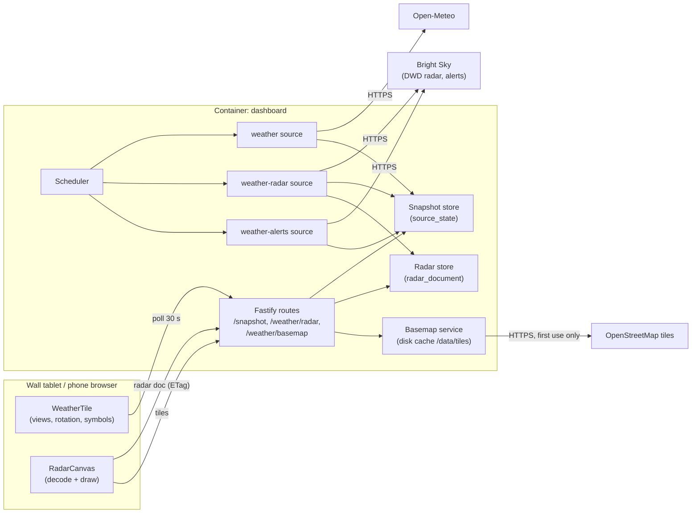

# Tech Spec: Weather

> **Status:** Ready
> **Confidence:** 90%
> **PRD:** [`prd-weather.md`](prd-weather.md)
> **Created:** 2026-10-28
> **Last updated:** 2026-10-28

## 1. Overview

Second epic on top of the foundation. **Affected layers: frontend, backend** (no infrastructure
files change; the existing `/data` volume holds the new SQLite table and the tile cache).

Three independent backend *sources* feed the weather tile through the existing snapshot:

| Source id | Provider | Interval | Stale after | Snapshot payload |
| --------- | -------- | -------- | ----------- | ---------------- |
| `weather` | Open-Meteo forecast API (keyless) | 900 s | 1800 s | current, today, 24 hourly slots, 7 daily slots, 15-minute rain series |
| `weather-radar` | Bright Sky `/radar` (DWD RV composite, keyless) | 300 s | 600 s | version, frame list, rain series at the home cell |
| `weather-alerts` | Bright Sky `/alerts` (DWD warnings, keyless) | 900 s | 1800 s | active alerts for the home location |

The heavy radar grid (25 frames of 101 x 101 values) is **not** part of the snapshot: the radar source
stores it as one gzip blob in SQLite and the backend serves it at `GET /api/v1/weather/radar`; the
snapshot only carries its `version`. A basemap is delivered by a backend tile proxy
(`GET /api/v1/weather/basemap/:z/:x/:y`) that fetches OpenStreetMap raster tiles for a fixed tile list,
caches them on disk and serves them to the browser, so the display never contacts a third party.

The frontend replaces the weather placeholder by `WeatherTile`: three views (now + hours, seven days,
rain + radar) with automatic rotation (swipe, tap, direct selection), calm SVG symbols with day and night
variants, a canvas radar loop drawn from raw values over the basemap, a warning banner and source credits.
All three sources keep their own state; one failing part never hides the others.

Key decisions (details in *Architectural Decisions*): Open-Meteo for values plus Bright Sky for radar and
warnings (AD-1), rain timing from the radar home cell with Open-Meteo as fallback (AD-2), static basemap
from OpenStreetMap tiles via backend proxy with the radar drawn client-side (AD-3), radar delivered on its
own endpoint with the version in the snapshot (AD-4), full-HD class wall screens get the full hourly slots,
smaller screens a compact variant (AD-9).

## 2. Architecture & Design

### 2.1 Component Diagram



### 2.2 Data Flow

**Refresh (backend).** Each source runs on the foundation's scheduler and runner (timeouts, failure
isolation, last-good payload kept). Sources map the provider response to a small internal payload before
returning it. The radar source additionally normalises the raster (integers, clamped 0–255), builds
`RadarDocument` (frames as base64, corner coordinates, tile plan), saves it through `RadarStore`
(gzip) **before** returning its small payload, so a snapshot never announces a version that has no document.

**Display.** The tile reads the three snapshot entries through `useSnapshot`. The `weather` entry drives
the tile frame state (loading, never-loaded, error, stale, fresh); the radar and alert entries drive their own
sub-states inside the views. When the radar view is mounted and visible and `weather-radar.data.version`
differs from the loaded one, `useRadarDocument` requests `GET /api/v1/weather/radar` (browser revalidates
with the ETag), decodes the frames into `Uint8Array`s and replaces the previous document. `RadarCanvas` loads
the basemap tiles listed in the document (same-origin PNGs, cached by the browser), draws them once, and
renders one radar frame at a time from the raw values.

**Radar document tolerance.** A 404 (document not written yet) or a document newer than the snapshot version is accepted: the view shows what it has,
and the next snapshot poll announces the new version. The projection lookup is built once per document geometry and kept; nothing
is recomputed on the 30 s poll.

**Rain timing.** `describeRain` (pure) turns a series of `{time, mmPerHour}` steps into
`none | raining | starts`. `pickRainSeries` uses the radar home-cell series while the radar entry is `fresh`
and covers at least 60 minutes ahead; otherwise the Open-Meteo 15-minute series; otherwise nothing (the rain
view shows the unavailable state).

**Rotation.** `useViewRotation` advances through three views every 15 s while the tile is `fresh`; any manual input
(swipe, tap, indicator tap) pauses it and a single timer resumes it after 60 s without input.

### 2.3 Integration Points

| System | Direction | Protocol | Purpose |
| ------ | --------- | -------- | ------- |
| Open-Meteo `api.open-meteo.com/v1/forecast` | Outbound (backend only) | HTTPS GET, no key | Current, hourly, daily, 15-minute rain |
| Bright Sky `api.brightsky.dev/radar` | Outbound (backend only) | HTTPS GET, `Accept-Encoding: gzip` | DWD RV radar composite, 25 frames x 5 min |
| Bright Sky `api.brightsky.dev/alerts` | Outbound (backend only) | HTTPS GET | DWD warnings for lat/lon |
| OpenStreetMap `tile.openstreetmap.org/{z}/{x}/{y}.png` | Outbound (backend only) | HTTPS GET | Basemap tiles, fixed tile list, cached |
| `/data/dashboard.sqlite` | Both | SQLite | `source_state` rows and `radar_document` |
| `/data/tiles/` | Both | Files | Tile cache |
| Browser | Inbound | HTTP, same origin | `/api/v1/snapshot`, `/api/v1/weather/radar`, `/api/v1/weather/basemap/…` |

The home latitude and longitude are sent to Open-Meteo and Bright Sky as query parameters, **rounded to two decimals
(about 1 km)** by one shared helper (`roundForUpstream`). The three hosts (`api.open-meteo.com`, `api.brightsky.dev`,
`tile.openstreetmap.org`) are constants in code; configuration and request input never supply a host or a path. Outbound
requests carry no cookies and no Referer, and `User-Agent: home-dashboard/<buildId>` without household details; redirects
are not followed (`redirect: 'error'`). OpenStreetMap only ever sees tile indexes of one fixed zoom level (the coarse area
of the radar square). Outbound URLs and query strings are never logged. The container needs outbound HTTPS only.

## 3. Data Model Changes

### 3.1 New Entities

```sql
-- backend/src/db/migrations/002_create_radar_document.sql
CREATE TABLE radar_document (
  id         INTEGER NOT NULL PRIMARY KEY CHECK (id = 1),   -- single row
  version    TEXT    NOT NULL,                              -- ISO time of the newest observed frame
  body_gzip  BLOB    NOT NULL,                              -- gzip(JSON RadarDocument)
  saved_at   INTEGER NOT NULL                               -- epoch ms
) STRICT;
```

Types (backend `src/sources/weather/types.ts`, TypeBox, source of truth; the frontend mirrors them in
`src/tiles/weather/types.ts`):

```ts
export type ConditionId =
  | 'clear' | 'mostly-clear' | 'partly-cloudy' | 'overcast' | 'fog'
  | 'drizzle' | 'rain' | 'showers' | 'snow' | 'thunderstorm' | 'unknown';

export interface WeatherPayload {
  location: { name: string };
  current: { temperature: number; condition: ConditionId; isDay: boolean; windKmh: number; windDirection: number };
  today: { max: number; min: number; precipProbability: number };
  hourly: { time: string; temperature: number; condition: ConditionId; isDay: boolean; precipProbability: number }[]; // 24, ISO UTC
  daily: { date: string; max: number; min: number; condition: ConditionId; precipProbability: number }[];           // 7, date = local YYYY-MM-DD
  rainSeries: { time: string; mmPerHour: number }[];                                                               // 16 x 15 min, ISO UTC
}

export interface RadarPayload {
  version: string;
  frames: { time: string; kind: 'observed' | 'forecast' }[];            // 25
  homeSeries: { time: string; mmPerHour: number }[];                    // 25 x 5 min, ISO UTC
}

export interface AlertsPayload {
  alerts: { id: string; type: string; severity: 'minor' | 'moderate' | 'severe' | 'extreme'; onset: string; expires: string }[]; // most severe first
}

export interface RadarDocument {                                         // served gzip JSON, never in the snapshot
  version: string;
  size: 101;
  corners: [[number, number], [number, number], [number, number], [number, number]]; // [lon, lat]: NW, SW, SE, NE
  home: { col: number; row: number; lat: number; lon: number };   // true home position and the grid cell containing it
  map: { zoom: 9; tileSize: 256; tiles: { x: number; y: number }[] };
  frames: { time: string; kind: 'observed' | 'forecast'; values: string }[]; // base64 of 101*101 bytes, row-major, row 0 = north
}
```

Units: raw radar value `v` is 0.01 mm per 5 minutes, so `mmPerHour = v * 0.12`; Open-Meteo
`mmPerHour = precipitation(15 min) * 4`. A step counts as rain at `mmPerHour >= 0.1` (drizzle threshold).

### 3.2 Modified Entities

- `settings.yaml` schema: `sources.weather.enabled` (boolean, optional, default `true`). The existing
  example file gains the key with a comment. `Settings` type: `sources: { demo: {...}; weather?: { enabled: boolean } }`.
- `TileDefinition` (frontend): new optional `heading?: (data: unknown, t: TFunction) => string | null`
  appended to the title (the weather heading shows `Wetter · <location name>`).
- Error codes: `RADAR_NOT_AVAILABLE` (404) and `UPSTREAM_UNAVAILABLE` (502) join the envelope codes and the
  German dictionary (`errors.*`).

### 3.3 Migration Plan

`002_create_radar_document.sql` is a forward-only numbered file applied by the existing runner (additive, no data
migration). The previous application version refuses to start on a newer schema (guard from the foundation); rollback
is redeploying the older build together with restoring the data backup if needed. The tile cache is rebuildable and
needs no migration.

## 4. API Design

All routes stay under `/api/v1/`. Authorization: none (home network only).

### Endpoint: GET /api/v1/weather/radar

- **Handler:** `weatherRoutes` (v1)
- **Request:** none; honours `If-None-Match`.
- **Response 200:** `RadarDocument` (JSON) with `Content-Encoding: gzip`, `Content-Type: application/json`,
  `ETag: "<version>"`, `Cache-Control: no-cache` (revalidate every time; the 304 costs no body). The 200 body is sent raw (pre-gzipped) and is documented by `radarDocumentSchema` for tests and contract checks, like the health body it is an exception to Fastify response serialisation.
- **Response 304:** when `If-None-Match` equals the version.
- **Response 404:** `{"error":{"code":"RADAR_NOT_AVAILABLE",…}}` until the first successful radar refresh.
- **Status codes:** 200, 304, 404, 500.

### Endpoint: GET /api/v1/weather/basemap/:z/:x/:y

- **Handler:** `weatherRoutes` (v1); params validated as integers by a route schema.
- **Response 200:** `image/png` with `Cache-Control: private, max-age=86400`.
- **Response 404:** `NOT_FOUND` when the tile is not in the current radar tile list (the proxy is not open); the requested values are never echoed.
- **Response 502:** `UPSTREAM_UNAVAILABLE` when the tile is not cached and the upstream fetch fails or times out.
- **Authorization:** none. The upstream host and path are fixed, only integers that matched the server-computed allow-list vary; the cache path is built only from those validated integers.

### Cache rule change

The foundation sets `Cache-Control: no-store` on every `/api/` response. This epic makes exactly two explicit exceptions, listed in one
constant (`cacheableApiRoutes`) next to the hook: the radar document (`no-cache` with ETag, so it is revalidated every time and a 304
saves the body) and the basemap tiles (`private, max-age=86400`). Every other `/api/` route, including snapshot and health, stays
`no-store`; a test enumerates the routes and asserts that. The exception is recorded as an architecture decision (AD-6) and the
architecture, backend and security guidelines are amended when the docs are reconciled.

### Snapshot additions (no envelope change)

Three more entries in `sources` (`weather`, `weather-radar`, `weather-alerts`) with the payloads from §3.1. Disabled or
missing sources are simply absent. Example (abridged):

```json
{ "id": "weather-radar", "status": "fresh", "lastUpdated": "2026-10-28T09:10:00.000Z", "ageSeconds": 30,
  "staleAfterSeconds": 600, "lastErrorCode": null,
  "data": { "version": "2026-10-28T09:10:00+00:00", "frames": [{ "time": "…", "kind": "observed" }], "homeSeries": [{ "time": "…", "mmPerHour": 0.6 }] } }
```

## 5. Event Design

Not applicable: no queues or push channels. Asynchronous behaviour is the scheduler (backend) and polling plus the
radar revalidation request (frontend).

## 6. Service Layer

### Backend

#### Service: WeatherSource (`sources/weather/open-meteo-source.ts`)

- **Responsibility:** Fetch and map Open-Meteo data to `WeatherPayload`.
- **Interface:**
  ```ts
  export function createWeatherSource(deps: {
    location: Settings['location']; timezone: string; fetchImpl: typeof fetch; userAgent: string; now?: () => number;
  }): Source<WeatherPayload>; // id 'weather', intervalSeconds 900, staleAfterSeconds 1800, timeoutMs 15000
  ```
- **Key logic:** Request
  `…/v1/forecast?latitude&longitude&timezone=<tz>&forecast_days=7&forecast_hours=25&forecast_minutely_15=16&past_minutely_15=1`
  `&current=temperature_2m,weather_code,is_day,wind_speed_10m,wind_direction_10m`
  `&hourly=temperature_2m,precipitation_probability,weather_code,is_day`
  `&daily=temperature_2m_max,temperature_2m_min,precipitation_probability_max,weather_code&minutely_15=precipitation`.
  Local times are converted to ISO UTC with `utc_offset_seconds`. `hourly` keeps the 24 slots after "now" (starting
  with the next full hour). `today` comes from `daily[0]`. `rainSeries` starts at the 15-minute slot that contains
  now. WMO codes map through `wmoToCondition`. The response is validated against a TypeBox schema before mapping;
  missing arrays or mismatched lengths fail the refresh (`SOURCE_FETCH_FAILED`).

#### Module: Conditions (`sources/weather/conditions.ts`)

`wmoToCondition(code)`: 0 → clear, 1 → mostly-clear, 2 → partly-cloudy, 3 → overcast, 45/48 → fog, 51–57 → drizzle,
61–67 → rain, 80–82 → showers, 71–77 and 85–86 → snow, 95–99 → thunderstorm, anything else → unknown.

#### Service: RadarSource (`sources/weather/radar-source.ts`)

- **Interface:**
  ```ts
  export function createRadarSource(deps: {
    location: Settings['location']; fetchImpl: typeof fetch; userAgent: string;
    radarStore: RadarStore; now?: () => number;
  }): Source<RadarPayload>; // id 'weather-radar', intervalSeconds 300, staleAfterSeconds 600, timeoutMs 20000
  ```
- **Key logic:** `GET /radar?lat&lon&distance=50000&format=plain` (the runtime fetch sends `Accept-Encoding`; the
  response must be decompressed by fetch). Expects 101 x 101 arrays, 25 frames; integer values are clamped to 0–255
  (`null` or negative → 0), flattened row-major to bytes, base64 encoded. `kind` is `observed` for frames at or before
  now, `forecast` after. `version` is the newest observed frame time. `homeSeries` reads the grid cell that contains the true home position (computed with the parallelogram of §6, not assumed to be the centre) times 0.12; the request itself is centred on the rounded coordinates.
  `corners` come from the response geometry in the order NW, SW, SE, NE. `map.tiles` are computed by
  `planBasemap(corners, 9)`. The document is saved first, then the small payload is returned.

#### Service: AlertsSource (`sources/weather/alerts-source.ts`)

- **Interface:** `createAlertsSource(deps): Source<AlertsPayload>` (id `weather-alerts`, 900 s, stale 1800 s, timeout 15000).
- **Key logic:** `GET /alerts?lat&lon`. Only alerts with `status = actual` and `expires` in the future and `onset` not later
  than 12 hours ahead are kept. `type` is `event_de` normalised to sentence case and cut at 40 characters; `severity` is
  lower-cased and must be one of the four values (otherwise the alert is dropped and counted in a debug log without content).
  Sorted most severe first, then earliest onset; at most 5 kept.

#### Service: RadarStore (`sources/weather/radar-store.ts`)

```ts
export interface RadarStore {
  save(doc: RadarDocument, now: number): void;   // gzip + upsert id 1
  load(): { version: string; bodyGzip: Buffer } | undefined;
}
export function createRadarStore(db: Database.Database): RadarStore;
```

#### Service: BasemapService (`sources/weather/basemap.ts`)

```ts
export function planBasemap(corners: RadarDocument['corners'], zoom: number): { x: number; y: number }[];
export interface BasemapService {
  setAllowed(tiles: { z: number; x: number; y: number }[]): void;
  isAllowed(z: number, x: number, y: number): boolean;
  get(z: number, x: number, y: number, signal: AbortSignal): Promise<Buffer>;   // cache hit or upstream
}
export function createBasemapService(deps: { dir: string; fetchImpl: typeof fetch; userAgent: string; maxBytes: number }): BasemapService;
```

`planBasemap` converts the four corners to Web Mercator tile coordinates and returns the covering tile rectangle (at most
16 tiles). `get` checks the allow-list first (integers only, nothing else reaches a path or URL), reads `<dir>/<z>/<x>/<y>.png`, otherwise fetches
`https://tile.openstreetmap.org/<z>/<x>/<y>.png` with a 10 s timeout, `redirect: 'error'`, a size cap (512 KiB), a `Content-Type` of
`image/png` and the PNG magic bytes, writes atomically (temporary name, rename) and returns it. A total cache cap of 64 files or 8 MiB
evicts the oldest files. Tiles are fetched lazily on first request, never bulk-prefetched, and never per browser request once cached. Concurrent requests for the same tile share one upstream call.
The allow-list is seeded from `RadarStore.load()` at start and updated by the radar source. The service is an *integration module* and an
explicit exception to "external data only enters through a Source" (AD-12): it is lazy and bounded, has a timeout, a failure response
(`502`) and a cache instead of a schedule. The tile cache is rebuildable and is not part of the backup (which copies the database only).

#### Module: shared HTTP (`sources/weather/http.ts`)

`getJson(fetchImpl, url, { signal, userAgent, maxBytes })`: checks `ok`, content length and a streamed size limit,
parses JSON, throws a generic error (no upstream text reaches logs).

#### Wiring

`startServer(env, overrides?)` registers the three sources **together** when `settings.sources.weather?.enabled !== false`
(`overrides.fetchImpl` is used by tests); the flag toggles all three at once. Routes: `weatherRoutes({ radarStore, basemap })` in `src/routes/weather.route.ts`.

### Frontend (`src/tiles/weather/`)

| File | Responsibility |
| ---- | -------------- |
| `WeatherTile.tsx` | Content component of the `weather` tile: reads all three sources, holds the view rotation, renders wall views or the phone stack, alert banner and credits |
| `types.ts`, `conditions.ts` | Payload types (mirror), condition id → symbol component and German label key |
| `rain.ts` | `describeRain`, `pickRainSeries`, thresholds |
| `NowView.tsx` | Now block (temperature, symbol, label, day line, optional wind), rain line, hourly slots (wall: 5, phone: 24; compact slots on short screens) |
| `DaysView.tsx` | Seven day rows |
| `RainView.tsx` | Rain bars, rain statement, radar section |
| `RadarView.tsx`, `RadarCanvas.tsx`, `useRadarDocument.ts`, `radar-geo.ts`, `radar-render.ts` | Radar document fetch and decode, basemap drawing, projection lookup, colour ramp, animation loop, frame labels, legend |
| `WeatherSymbol.tsx` | Inline SVG symbols for the condition ids with day and night variants and slow CSS motion |
| `AlertBanner.tsx` | Warning banner: none, active, unknown |
| `ViewIndicators.tsx`, `useViewRotation.ts` | Indicators (tabs, 56 px targets) and the rotation/swipe state machine |
| `Credits.tsx` | Abbreviated credit on the wall, full wording on the phone and in the radar view |

```ts
export type ViewId = 'now' | 'days' | 'rain';
export function useViewRotation(opts: { viewCount: 3; dwellMs: 15000; resumeMs: 60000; autoplay: boolean }): {
  index: number; goTo(i: number): void; next(): void; prev(): void; paused: boolean;
};
export type RainStatement =
  | { kind: 'none' }
  | { kind: 'raining'; endsAt: number | null }                  // null: beyond the horizon
  | { kind: 'starts'; startsAt: number; durationMin: number; beyondHorizon: boolean };
export function describeRain(steps: { time: number; mmPerHour: number }[], stepMin: number, now: number, threshold?: number): RainStatement;
export function pickRainSeries(radar: SourceSnapshot | undefined, weather: SourceSnapshot | undefined, now: number):
  { source: 'radar' | 'open-meteo'; stepMin: 5 | 15; steps: { time: number; mmPerHour: number }[] } | null;
```

**Radar drawing.** `buildLookup(corners, mapOrigin, w, h)` returns an `Int16Array` mapping each output pixel to a grid cell
(or -1). The grid is treated as a parallelogram spanned by `TL = NW`, `TR = NE`, `BL = SW` in a local equirectangular plane
(`x = lon * cos(lat0)`, `y = lat`); at 100 km the error is below 0.1 cell. `renderFrame(values, lookup, ramp, imageData)` writes
ARGB pixels from a precomputed 256-entry colour ramp (transparent below 0.1 mm/h; light blue, blue, green, yellow, orange, red,
magenta for increasing intensity; the legend lists the breakpoints in mm/h). The loop shows a frame every 450 ms, holds the last
frame 2 s, and runs only while the radar section is visible (`IntersectionObserver` on the phone, active view on the wall),
the document is visible and reduced motion is off; with reduced motion one static frame (the current observed frame) is shown.
The basemap canvas applies a CSS filter in the night theme (`invert(0.92) hue-rotate(180deg) saturate(0.6) brightness(0.8)`).

**Interaction.** On the wall the view container handles pointer events: movement under 10 px on release is a tap (next view);
horizontal movement of at least 60 px with `|dx| > 1.5 |dy|` is a swipe (left = next, right = previous, wrapping); both pause the
rotation and (re)start the 60 s resume timer. The container has `touch-action: pan-y`. Indicators are `role="tab"` buttons of at
least 56 px with German `aria-label`s ("Jetzt", "7 Tage", "Regen und Radar"); their pointer events do not reach the container.
Transitions are an opacity cross-fade of 600 ms (CSS), 150 ms under reduced motion. Only the active view (and the outgoing one
during the fade) is mounted on the wall.

**Compact variant.** `tablet-short` (screens up to 850 px high): hourly slots show hour and temperature only (the symbol stays as
screen-reader text), paddings shrink, hints are visually hidden (existing rules).

### Cross-Cutting Technical Design

#### Domain Logic & Validation

- Upstream payloads are validated (TypeBox) and mapped; unknown condition codes become `unknown`; arrays must have the expected
  length (weather: hourly >= 24, daily = 7, minutely >= 16; radar: 25 frames of 101 x 101) or the refresh fails.
- A radar frame time later than now is `forecast`. `homeSeries` is computed at fetch time; the frontend re-derives nothing from
  frame kinds except labels.
- Rain thresholds: step is wet at `>= 0.1 mm/h`. A single wet step still counts (showers are short).
- The warning banner: `none` renders nothing and reserves no space; `unknown` shows "Warnungen nicht prüfbar" only when the alerts
  entry is `stale`, `error` or `never-loaded` beyond its first refresh interval.
- Time handling: backend payload times are ISO UTC; the frontend formats them with `Intl` in the settings time zone. Daily dates are
  local `YYYY-MM-DD` and formatted as weekday names. A DST change inside the 24 h hourly window can shift later slots by one hour
  (Open-Meteo applies one offset per response); accepted for this version.
- Concurrency: the radar blob is written in one SQL statement; readers read one row. Tile writes are atomic renames; duplicate
  requests are coalesced.

#### Error Handling & Operational Concerns

- **Failures:** each source fails independently through the existing runner (`SOURCE_FETCH_FAILED` / `SOURCE_TIMEOUT`), logging only
  `{ sourceId, code }`. Basemap upstream failures return `502 UPSTREAM_UNAVAILABLE` (logged without upstream text); the radar view then
  draws the radar over a plain surface with range rings. No retries beyond the next scheduled run (the basemap request is retried by the
  browser only on the next radar version change).
- **Observability:** stale and error states are visible on the tile; the foundation's offline indicator applies. Per-source counters are
  not added.
- **Security & privacy:** see AD-6, AD-12 and AD-14. The browser never contacts third parties (CSP `img-src 'self' data:` unchanged). The tile proxy only
  serves tiles from the server-computed list at one zoom level (no SSRF, no open proxy), the upstream host is fixed, response size and time
  are capped, error text from upstream is never logged or returned. The home coordinates (rounded to about 1 km) leave the NAS only to Open-Meteo and Bright Sky
  (and implicitly a coarse tile area to OpenStreetMap); no credentials exist. This is a documented exception to the guideline that location data stays
  in the backend, recorded in the security guideline at reconciliation.
- **Performance:** snapshot growth is a few kilobytes (about 4 KB for `weather`, 2 KB for `weather-radar`). The radar document is about
  60–340 KB gzip/base64 and is fetched only while the radar view is shown and its version changed. Drawing a frame touches one
  `ImageData` (about 260 k pixels, a lookup and a ramp) and runs at about 2 fps; no per-frame allocation. Memory for 25 decoded frames is
  about 250 KB plus one basemap canvas.
- **Fair use:** per day about 96 Open-Meteo calls, 288 radar calls, 96 alert calls and at most 16 tile downloads per radar area (cached on disk for
  the life of the volume). Tile downloads run only for missing tiles.
- **Runtime configuration:** `sources.weather.enabled`; the home location from `settings.location`. No new environment variables.
- **Operational support:** `backend/scripts/weather-live-check.mjs` (manual, not a gate) fetches the three upstream endpoints once and prints
  shapes, to detect provider changes; documented in the runbook.

#### Rollout, Migration & Compatibility

- Additive: new sources, one new table, two new routes, one relaxed cache rule. The snapshot envelope is unchanged and the frontend ignores
  unknown sources, so backend and frontend can deploy together through the existing script; the open display reloads itself on the new build.
- Rollback: redeploy the previous build; the extra table and `/data/tiles` are ignored (the older build would refuse the newer schema version,
  so restore the data backup first if a rollback past this epic is needed).
- Feature switch: `sources.weather.enabled: false` removes the three sources from the snapshot and the tile shows the placeholder again
  (the tile checks `requiresSource`).

#### Architectural Decisions

| ID | Decision | Rationale |
| -- | -------- | --------- |
| AD-1 | Open-Meteo for values and the 15-minute series; Bright Sky for radar and warnings; three independent sources | Each part has its own state and failure isolation; all keyless; verified live |
| AD-2 | Rain timing from the radar home cell with Open-Meteo `minutely_15` as fallback | Same data as the animation; works when only one provider is up |
| AD-3 | Basemap from OpenStreetMap raster tiles via a backend proxy with disk cache; radar drawn client-side on a canvas from raw values | CARTO now asks for an API key for raster tiles; OSM tiles need no key (attribution, caching and an identifying User-Agent required); small data, no image library |
| AD-4 | Radar document on its own endpoint with ETag; the snapshot carries only the version | The snapshot is polled every 30 s and must stay small |
| AD-5 | Radar document stored as one gzip row in SQLite | One consistent latest document, survives restarts, no extra files to manage |
| AD-6 | Exactly two routes are exempt from the global `no-store`: the radar document (`no-cache` + ETag) and the basemap tiles (`private, max-age=86400`), listed in one constant and tested | Tiles must be cacheable, the document is revalidated; everything else stays `no-store`; guidelines are amended at reconciliation |
| AD-7 | Frontend: CSS opacity cross-fade and Pointer Events for rotation, swipe and tap; no new animation library; SVG symbols with CSS motion | Smallest bundle, consistent with the foundation (transform and opacity only) |
| AD-8 | Rotation only while the tile is `fresh`; manual input always works | PRD AC-27, calm behaviour on stale data |
| AD-9 | Layout unchanged; the full hourly slots (with symbol) on screens taller than 850 CSS px, a compact variant on shorter ones (`tablet-short`: location name, day symbols and hourly symbols as screen-reader text only; with an active warning no hourly strip and no rain line in the now view) — accepted by the user at verification | Target is a Full HD class tablet; its CSS size depends on scaling, so the compact fallback guards 1280 x 800 and 1024 x 768 |
| AD-10 | Radar refresh 300 s (PRD: at least every 15 min), values and warnings 900 s | Radar frames change every 5 min; still far below fair use limits |
| AD-12 | `BasemapService` is an integration module outside the `Source` contract (lazy, bounded, timeout, 502, disk cache) | A tile list is static per radar area, a schedule would only add traffic; exception is explicit |
| AD-13 | The rain statement is computed in the frontend from the series in the payload | It depends on the current time and must not go stale between 5/15 minute refreshes; the pure function is tested once |
| AD-14 | Upstream coordinates are rounded to two decimals; three fixed hosts; no cookies, Referer or redirects; URLs never logged | Home location is private household data (security review) |
| AD-11 | Parallelogram approximation for projecting the radar grid onto the basemap | Error below 0.1 cell at 100 km, no projection library |

## 7. Acceptance Criteria → Test Plan (TDD)

Legend: **BE** backend (`src/**/*.test.ts`, `test/**`), **FE** frontend (Vitest/jsdom), **E2E** Playwright against the production build
with the real backend and mocked `/api/v1/snapshot`, `/api/v1/weather/radar` and `/api/v1/weather/basemap/*` routes. Upstream providers
are faked with recorded fixtures (`backend/test/fixtures/open-meteo.sample.json`, `brightsky-alerts.sample.json`,
`brightsky-radar.sample.json` trimmed to 5 frames; snapshot contract fixtures `weather.snapshot.sample.json`). **Manual** items need real
services or a real tablet.

### 7.0 PRD Coverage Checklist

| PRD item | Addressed in | Proven by |
| -------- | ------------ | --------- |
| F-1 / FR-1, FR-2, FR-3, FR-15 | WeatherSource, conditions, NowView | AC-1 to AC-5 |
| F-2 / FR-4 | WeatherSource hourly, NowView | AC-6 to AC-8 |
| F-3 / FR-5 | WeatherSource daily, DaysView | AC-9 to AC-11 |
| F-4 / FR-6 | rain.ts, RainView, rain line in NowView | AC-12 to AC-15 |
| F-5 / FR-7, FR-8 | RadarSource, RadarStore, BasemapService, radar routes, RadarView | AC-16 to AC-21 |
| F-6 / FR-9 | useViewRotation, ViewIndicators | AC-22 to AC-27, AC-44 to AC-46 |
| F-7 / FR-10 | WeatherSymbol | AC-28 to AC-30 |
| F-8 / FR-11 | AlertsSource, AlertBanner | AC-31 to AC-35 |
| F-9 / FR-12, FR-13, FR-14 | sources, runner, Credits, tile states | AC-36 to AC-40 |
| F-10 / FR-16, FR-17 | dictionary, fit tests | AC-41 to AC-43 |
| NFR-1 Stability | visibility-gated loops, cleanup | AC-16/22/29 unit cleanup tests, existing soak spec extended with the weather tile (accelerated, heap ≤ 1.25x) |
| NFR-2 Performance | lookup render, 2 fps, opacity/transform only | `radar-render` timing test (frame render under 8 ms in Node), E2E check that animations use only transform/opacity |
| NFR-3 Resilience | independent sources, fallbacks | AC-19, AC-37, AC-39 |
| NFR-4 Privacy | backend-only upstream calls, CSP | E2E off-origin request test, BE route tests |
| NFR-5 Fair use | intervals | source interval unit tests, long-run test extended |
| NFR-6 Licence | credits, UA | AC-21, AC-40; licence texts reviewed during implementation (checklist step 17) |
| NFR-7 Readability | tokens, fit tests | AC-41, AC-43 |
| NFR-8 Observability | runner logging | existing log tests plus basemap log test |
| NFR-9 i18n | dictionary | AC-43 |

### 7.0.1 Cross-cutting tests (NFR-4, NFR-6, NFR-8)

| Test | Type | Description |
| ---- | ---- | ----------- |
| `it('rounds the home coordinates to two decimals for every upstream request')` | Unit (BE) | all three sources and the radar centre |
| `it('only calls the three fixed hosts and sends no cookie or referer')` | Unit (BE) | fake fetch records URL and init; `redirect: 'error'`, User-Agent without household details |
| `it('never logs outbound URLs or upstream text')` | Unit (BE) | capture logs with sentinel coordinates and error bodies |
| `it('builds the tile cache path only from allow-listed integers and never echoes input')` | Unit (BE) | traversal strings such as `../../etc` get 404 without reflection |
| `it('rejects non-PNG or oversized tile responses and caches nothing')` | Unit (BE) | content-type, magic bytes, 512 KiB cap |
| `it('evicts the oldest tiles beyond the cache cap')` | Unit (BE) | |
| `it('keeps no-store on every API route except the two listed cacheable ones')` | Integration (BE) | enumerates routes with `printRoutes` and checks headers |
| `it('makes no browser request to any other origin while the weather tile runs')` | E2E | request listener, CSP console check |
| `it('stores the previous radar document when a refresh fails')` | Unit (BE) | version unchanged |

### Feature 1: Current conditions

#### AC-1: The now view shows temperature, symbol, German description, today's high and low and rain probability

**PRD source:** F-1, FR-1  **Implementation touchpoints:** `open-meteo-source`, `NowView`, `WeatherSymbol`, dictionary  **Unresolved technical questions:** none

| # | Test Case | Type | Test Name | Description |
| - | --------- | ---- | --------- | ----------- |
| 1 | Mapping from fixture | Unit (BE) | `it('maps the Open-Meteo fixture to current conditions and today values')` | temperature, condition, high, low, probability |
| 2 | Request | Unit (BE) | `it('requests the documented variables for the home location and time zone')` | URL contains latitude, longitude, timezone, current/hourly/daily/minutely_15 |
| 3 | Rendering | Unit (FE) | `it('renders temperature, symbol, description and the day line')` | "Heute 8° / 14°, Regen 60 %" |
| 4 | Contract | Contract | `it('accepts the backend weather snapshot sample')` | FE guard on the shared fixture |

**Arrange:** `open-meteo.sample.json`, fake `fetch`. **Key assertions:** values, German texts, rounded degrees.

#### AC-2: The tile heading contains the location name

**PRD source:** F-1  **Touchpoints:** `TileDefinition.heading`, registry  **Unresolved:** none

| # | Test Case | Type | Test Name | Description |
| - | --------- | ---- | --------- | ----------- |
| 1 | Heading | Unit (FE) | `it('appends the location name to the weather heading')` | "Wetter · Zuhause" |
| 2 | No data | Unit (FE) | `it('shows only the base heading while no data exists')` | |
| 3 | Source payload | Unit (BE) | `it('puts the configured location name into the payload')` | |

#### AC-3: Every condition maps to a German label and symbol; unknown conditions get a neutral fallback

**PRD source:** FR-2  **Touchpoints:** `wmoToCondition`, `conditions.ts`, dictionary  **Unresolved:** none

| # | Test Case | Type | Test Name | Description |
| - | --------- | ---- | --------- | ----------- |
| 1 | WMO table | Unit (BE) | `it.each(table)('maps WMO code %i to %s')` | all documented codes 0-99 |
| 2 | Unknown | Unit (BE) | `it('maps unknown or missing codes to unknown')` | |
| 3 | Labels | Unit (FE) | `it('has a German label and a symbol for every condition id')` | no empty text, symbol component exists |
| 4 | Fallback render | Unit (FE) | `it('renders a neutral label and symbol for unknown')` | |

#### AC-4: Wind appears only at or above the notable threshold

**PRD source:** FR-3  **Touchpoints:** `NowView`, constant `NOTABLE_WIND_KMH = 40`  **Unresolved:** none

| # | Test Case | Type | Test Name | Description |
| - | --------- | ---- | --------- | ----------- |
| 1 | Below | Unit (FE) | `it('hides wind below 40 km/h')` | 39 |
| 2 | At threshold | Unit (FE) | `it('shows wind speed and direction at 40 km/h and above')` | German compass abbreviation (N, NO, …) |
| 3 | Phone | Unit (FE) | `it('always shows wind in the phone section')` | per PRD Q10 (phone detail) |

#### AC-5: Units are °C, km/h and 24-hour time

**PRD source:** FR-15  **Touchpoints:** formatters, API params  **Unresolved:** none

| # | Test Case | Type | Test Name | Description |
| - | --------- | ---- | --------- | ----------- |
| 1 | Request | Unit (BE) | `it('requests Celsius and km/h defaults without unit overrides')` | no `temperature_unit`/`wind_speed_unit` |
| 2 | Formatting | Unit (FE) | `it('formats hours in 24-hour time and temperatures with the degree sign')` | |

### Feature 2: Hourly forecast

#### AC-6: The wall now view shows exactly five hourly slots starting with the next full hour

**PRD source:** F-2, FR-4  **Touchpoints:** `open-meteo-source` hourly window, `NowView`  **Unresolved:** none

| # | Test Case | Type | Test Name | Description |
| - | --------- | ---- | --------- | ----------- |
| 1 | Window | Unit (BE) | `it('keeps 24 hourly slots after now starting with the next full hour')` | now 09:15 → first slot 10:00 |
| 2 | Wall slots | Unit (FE) | `it('renders five slots on the wall')` | |
| 3 | E2E | E2E | `test('shows five hourly slots in the wall now view')` | |

#### AC-7: Each slot shows hour, symbol and temperature; rain probability from 20 %

**PRD source:** F-2  **Touchpoints:** `NowView`, `tablet-short` classes  **Unresolved:** none (AD-9 notes the compact variant)

| # | Test Case | Type | Test Name | Description |
| - | --------- | ---- | --------- | ----------- |
| 1 | Content | Unit (FE) | `it('shows hour, symbol and temperature, and the probability from 20 percent')` | 19 % hidden, 20 % shown |
| 2 | Compact | Unit (FE) | `it('keeps the symbol as screen-reader text in the compact variant')` | class `tablet-short:sr-only`, accessible name present |
| 3 | Browser | E2E | `test('shows slot symbols at 1920x1080 and hides them visually at 1280x800')` | |

**PRD note:** the compact variant on screens up to 850 px high deviates from the literal "symbol shown" wording (AD-9); the symbol stays available to assistive technology.

#### AC-8: On the phone the hourly list covers 24 hours

| # | Test Case | Type | Test Name | Description |
| - | --------- | ---- | --------- | ----------- |
| 1 | Count | Unit (FE) | `it('renders 24 hourly slots in the phone section')` | |
| 2 | Layout | E2E | `test('lays out 24 hourly slots without horizontal scrolling at 360px')` | |

### Feature 3: Seven-day forecast

#### AC-9: Seven days starting today with weekday, symbol, high and low

**PRD source:** F-3, FR-5  **Touchpoints:** `open-meteo-source` daily, `DaysView`

| # | Test Case | Type | Test Name | Description |
| - | --------- | ---- | --------- | ----------- |
| 1 | Mapping | Unit (BE) | `it('maps seven daily entries with local dates')` | |
| 2 | Rendering | Unit (FE) | `it('renders seven rows with German weekday, symbol, high and low')` | today labelled "Heute" |
| 3 | Browser | E2E | `test('shows the seven day view on the wall')` | |

#### AC-10: Days with at least 20 % rain probability show it

| # | Test Case | Type | Test Name | Description |
| - | --------- | ---- | --------- | ----------- |
| 1 | Threshold | Unit (FE) | `it('shows the probability only from 20 percent')` | |

#### AC-11: On the phone the seven-day list is part of the weather section without interaction

| # | Test Case | Type | Test Name | Description |
| - | --------- | ---- | --------- | ----------- |
| 1 | Phone stack | Unit (FE) | `it('renders now, days and rain in one section on the phone without rotation')` | |
| 2 | Browser | E2E | `test('shows all weather views on a phone viewport')` | |

### Feature 4: Rain timing

#### AC-12: The rain view shows precipitation for at least two hours in 15-minute steps

**PRD source:** F-4, FR-6  **Touchpoints:** `rain.ts`, `RainView`, both sources

| # | Test Case | Type | Test Name | Description |
| - | --------- | ---- | --------- | ----------- |
| 1 | Series length (OM) | Unit (BE) | `it('provides at least 8 fifteen-minute rain steps')` | 16 expected |
| 2 | Series (radar) | Unit (BE) | `it('derives 5-minute steps at the home cell')` | |
| 3 | Bars | Unit (FE) | `it('draws one bar per step covering at least two hours')` | radar steps aggregated to 15 min for display |

#### AC-13: The sentence names start and duration, the end if raining now, or that none is expected

| # | Test Case | Type | Test Name | Description |
| - | --------- | ---- | --------- | ----------- |
| 1 | Starts | Unit (FE) | `it('describes the start time and duration of the next rain')` | "Regen ab 14:15, ca. 40 Min." |
| 2 | Raining | Unit (FE) | `it('describes the expected end when it rains now')` | |
| 3 | None | Unit (FE) | `it('says that no rain is expected')` | |
| 4 | Horizon | Unit (FE) | `it('states a minimum duration when rain continues beyond the horizon')` | "mindestens bis …" |
| 5 | Source choice | Unit (FE) | `it('uses the radar series while fresh and the Open-Meteo series otherwise')` | |

#### AC-14: The now view contains the one-line rain statement

| # | Test Case | Type | Test Name | Description |
| - | --------- | ---- | --------- | ----------- |
| 1 | Line | Unit (FE) | `it('shows the next rain start or kein Regen in den nächsten 2 Stunden in the now view')` | |
| 2 | Browser | E2E | `test('shows the rain line in the wall now view')` | |

#### AC-15: Precipitation below the drizzle threshold produces no statement

| # | Test Case | Type | Test Name | Description |
| - | --------- | ---- | --------- | ----------- |
| 1 | Threshold | Unit (FE) | `it('ignores steps below 0.1 mm/h')` | boundary 0.09 vs 0.1 |

### Feature 5: Animated rain radar

#### AC-16: Animated loop of observed and forecast frames with a home marker

**PRD source:** F-5, FR-7  **Touchpoints:** `RadarSource`, `RadarStore`, routes, `RadarView`, `radar-geo/render`

| # | Test Case | Type | Test Name | Description |
| - | --------- | ---- | --------- | ----------- |
| 1 | Source | Unit (BE) | `it('turns the radar fixture into 25 frames of 101x101 bytes and a home series')` | |
| 2 | Orientation | Unit (BE) | `it('keeps row 0 as north and column 0 as west according to the corner order')` | corner assertions on fixture |
| 3 | Store | Unit (BE) | `it('stores and loads the radar document as gzip and keeps only the latest')` | |
| 4 | Route | Integration (BE) | `it('serves the radar document with ETag, gzip and 304 on revalidation')` | |
| 5 | Projection | Unit (FE) | `it('maps every pixel inside the radar polygon to the right cell and the home position to the centre cell')` | lookup |
| 6 | Render | Unit (FE) | `it('colours cells by intensity and leaves dry cells transparent')` | ramp thresholds |
| 7 | Loop | Unit (FE) | `it('steps through all frames and holds the last one, then restarts')` | fake timers |
| 8 | Browser | E2E | `test('shows the radar canvas with a moving loop and a home marker')` | canvas pixel sampling of two frames differs |

#### AC-17: Frames are labelled with time and observed vs forecast

| # | Test Case | Type | Test Name | Description |
| - | --------- | ---- | --------- | ----------- |
| 1 | Kind | Unit (BE) | `it('marks frames after now as forecast')` | |
| 2 | Label | Unit (FE) | `it('shows the frame time and Beobachtung or Vorhersage as text')` | not colour alone |

#### AC-18: Radar images are at most 15 minutes old under normal conditions

| # | Test Case | Type | Test Name | Description |
| - | --------- | ---- | --------- | ----------- |
| 1 | Interval | Unit (BE) | `it('declares an interval of 300 s and a stale threshold of 600 s')` | |
| 2 | Version refresh | Unit (FE) | `it('loads a new radar document when the snapshot version changes and not otherwise')` | no refetch without change |
| 3 | Long run | Integration (BE) | `it('keeps refreshing the radar source for 10000 intervals without growth')` | one row, constant timers |

#### AC-19: Without radar images the radar view shows a calm state and the rain view still works

| # | Test Case | Type | Test Name | Description |
| - | --------- | ---- | --------- | ----------- |
| 1 | 404 | Integration (BE) | `it('answers RADAR_NOT_AVAILABLE before the first refresh')` | |
| 2 | Fallback | Unit (FE) | `it('shows a calm radar state and keeps the rain bars from Open-Meteo')` | |
| 3 | Basemap failure | Unit (FE) | `it('draws the radar over a plain surface with range rings when tiles fail')` | |
| 4 | Basemap upstream | Integration (BE) | `it('answers UPSTREAM_UNAVAILABLE when an uncached tile cannot be fetched')` | |
| 5 | Browser | E2E | `test('shows the unavailable radar state while the rain statement remains')` | route returns 404 |

#### AC-20: The loop stops and shows one frame under reduce motion

| # | Test Case | Type | Test Name | Description |
| - | --------- | ---- | --------- | ----------- |
| 1 | Static | Unit (FE) | `it('shows a single frame and starts no timer under reduced motion')` | |
| 2 | Browser | E2E | `test('does not animate the radar with reducedMotion=reduce')` | two samples identical |

#### AC-21: The radar view shows the credit of its data sources

| # | Test Case | Type | Test Name | Description |
| - | --------- | ---- | --------- | ----------- |
| 1 | Credit | Unit (FE) | `it('shows the DWD and OpenStreetMap credit in the radar view')` | wording: "Radar: Deutscher Wetterdienst (Bright Sky) · Karte: © OpenStreetMap-Mitwirkende" |
| 2 | Tiles | Integration (BE) | `it('sends an identifying User-Agent on tile requests')` | |

### Feature 6: Automatic view rotation

#### AC-22: The wall tile changes view every 15 seconds (+/- 2 s) through all three views

| # | Test Case | Type | Test Name | Description |
| - | --------- | ---- | --------- | ----------- |
| 1 | Timing | Unit (FE) | `it('advances every 15 seconds through now, days and rain and wraps around')` | fake timers |
| 2 | Cleanup | Unit (FE) | `it('clears its timers on unmount')` | `getTimerCount() === 0` |
| 3 | Browser | E2E | `test('rotates the weather views with the fake clock')` | |

#### AC-23: A tap advances to the next view and pauses; resume after 60 s without input

| # | Test Case | Type | Test Name | Description |
| - | --------- | ---- | --------- | ----------- |
| 1 | Tap | Unit (FE) | `it('advances on tap and pauses the rotation')` | |
| 2 | Resume | Unit (FE) | `it('resumes after 60 seconds without input and restarts the timer on every input')` | |
| 3 | Browser | E2E | `test('advances on tap and resumes after a minute')` | |

#### AC-24: The current view is indicated, not by color alone

| # | Test Case | Type | Test Name | Description |
| - | --------- | ---- | --------- | ----------- |
| 1 | Indicator | Unit (FE) | `it('marks the current view with aria-selected and a longer pill shape')` | |

#### AC-25: Under reduce motion the views change with a short fade

| # | Test Case | Type | Test Name | Description |
| - | --------- | ---- | --------- | ----------- |
| 1 | Fade | E2E | `test('uses a transition of at most 150 ms with reducedMotion=reduce')` | computed style |

#### AC-26: The phone shows all views in one section without rotation

| # | Test Case | Type | Test Name | Description |
| - | --------- | ---- | --------- | ----------- |
| 1 | Phone | Unit (FE) | `it('starts no rotation timer in the phone layout')` | |

#### AC-27: A view never rotates away while the tile is stale, error or never-loaded

| # | Test Case | Type | Test Name | Description |
| - | --------- | ---- | --------- | ----------- |
| 1 | Autoplay off | Unit (FE) | `it('stops the automatic rotation while the weather source is not fresh')` | |
| 2 | States | Unit (FE) | `it('shows the tile state instead of a view when never loaded or failed')` | |

#### AC-44: A swipe of at least 60 px switches to the next or previous view

| # | Test Case | Type | Test Name | Description |
| - | --------- | ---- | --------- | ----------- |
| 1 | Swipe | Unit (FE) | `it('treats a horizontal move of 60px as swipe: left next, right previous, with wrap')` | |
| 2 | Thresholds | Unit (FE) | `it('treats a vertical or short move as no swipe')` | 59 px, `|dx| <= 1.5|dy|` |
| 3 | Browser | E2E | `test('switches views with a mouse drag and does not scroll the page')` | pointer events |

#### AC-45: View indicators are 56 px touch targets with names and jump to their view

| # | Test Case | Type | Test Name | Description |
| - | --------- | ---- | --------- | ----------- |
| 1 | Names | Unit (FE) | `it('gives each indicator a German accessible name')` | |
| 2 | Jump | Unit (FE) | `it('jumps to the view and pauses; the tap does not advance a second time')` | |
| 3 | Size | E2E | `test('keeps every indicator at least 56px')` | |

#### AC-46: Manual switches use the same transition as automatic ones

| # | Test Case | Type | Test Name | Description |
| - | --------- | ---- | --------- | ----------- |
| 1 | Same class | Unit (FE) | `it('uses one transition for rotation, swipe, tap and indicator')` | |

### Feature 7: Calm animated symbols

#### AC-28: Symbols exist as day and night variants and follow the theme

| # | Test Case | Type | Test Name | Description |
| - | --------- | ---- | --------- | ----------- |
| 1 | Variants | Unit (FE) | `it('renders a day and a night variant for clear, partly cloudy, cloudy, rain, thunderstorm, snow and fog')` | |
| 2 | Theme | Unit (FE) | `it('uses the night variant when isDay is false')` | `isDay` from the payload per slot |

#### AC-29: Symbol movement uses only transform and opacity and is slower than one change every three seconds

| # | Test Case | Type | Test Name | Description |
| - | --------- | ---- | --------- | ----------- |
| 1 | Keyframes | E2E | `test('animates symbols only with transform and opacity at durations of at least 6 seconds')` | stylesheet inspection |

#### AC-30: Symbols are static under reduce motion

| # | Test Case | Type | Test Name | Description |
| - | --------- | ---- | --------- | ----------- |
| 1 | Static | E2E | `test('has no running symbol animation with reducedMotion=reduce')` | |

### Feature 8: Severe-weather warning

#### AC-31: An active warning is shown on every wall view and in the phone section

| # | Test Case | Type | Test Name | Description |
| - | --------- | ---- | --------- | ----------- |
| 1 | Mapping | Unit (BE) | `it('maps active alerts and drops expired, past and unknown-severity ones')` | |
| 2 | Banner | Unit (FE) | `it('shows icon, German type, severity text and validity period')` | |
| 3 | All views | E2E | `test('keeps the warning banner visible in every wall view')` | |

#### AC-32: Severity is not conveyed by color alone

| # | Test Case | Type | Test Name | Description |
| - | --------- | ---- | --------- | ----------- |
| 1 | Text | Unit (FE) | `it('writes the severity level as text and uses distinct icons per level')` | |

#### AC-33: With several warnings the most severe is shown plus a count

| # | Test Case | Type | Test Name | Description |
| - | --------- | ---- | --------- | ----------- |
| 1 | Sorting | Unit (BE) | `it('orders by severity then onset and keeps at most five')` | |
| 2 | Count | Unit (FE) | `it('shows the most severe warning and "+N weitere"')` | |

#### AC-34: Without an active warning no element and no reserved space

| # | Test Case | Type | Test Name | Description |
| - | --------- | ---- | --------- | ----------- |
| 1 | Empty | Unit (FE) | `it('renders nothing for no alerts')` | |
| 2 | Layout | E2E | `test('leaves the weather layout unchanged without a warning')` | bounding boxes equal |

#### AC-35: Unavailable warning data never claims "no warning"

| # | Test Case | Type | Test Name | Description |
| - | --------- | ---- | --------- | ----------- |
| 1 | States | Unit (FE) | `it.each(['stale','error','never-loaded'])('shows Warnungen nicht prüfbar for %s once it is overdue')` | |
| 2 | Isolation | Unit (FE) | `it('keeps the weather views working when the alerts source failed')` | |

### Feature 9: Freshness, outage and credit

#### AC-36: Weather data is refreshed every 15 minutes while the dashboard runs

| # | Test Case | Type | Test Name | Description |
| - | --------- | ---- | --------- | ----------- |
| 1 | Registration | Integration (BE) | `it('registers the three weather sources when enabled and none when disabled')` | `startServer` with fake fetch |
| 2 | Interval | Unit (BE) | `it('declares 900 seconds for weather and alerts and 300 seconds for radar')` | |
| 3 | Settings | Unit (BE) | `it('accepts a missing sources.weather key and defaults to enabled')` | |
| 4 | No display needed | Integration (BE) | `it('refreshes without any request to the API')` | fake timers |

#### AC-37: Parts older than twice their refresh interval are stale with last known values

| # | Test Case | Type | Test Name | Description |
| - | --------- | ---- | --------- | ----------- |
| 1 | Server | Unit (BE) | `it('derives stale after twice the interval for each weather source')` | uses `deriveStatus` |
| 2 | Tile | Unit (FE) | `it('keeps the last values and shows the amber footer with the age when stale')` | |
| 3 | Radar part | Unit (FE) | `it('labels a stale radar document as Veraltet with its age')` | |

#### AC-38: Calm never-loaded and first-failure texts

| # | Test Case | Type | Test Name | Description |
| - | --------- | ---- | --------- | ----------- |
| 1 | Texts | Unit (FE) | `it('shows Wetter noch nicht geladen before the first data and Wetter derzeit nicht verfügbar after a failed first fetch')` | no codes; weather-specific dictionary entries |

#### AC-39: A failure of one part does not hide the others

| # | Test Case | Type | Test Name | Description |
| - | --------- | ---- | --------- | ----------- |
| 1 | Isolation | Integration (BE) | `it('keeps the other two weather sources fresh when one upstream fails')` | |
| 2 | Tile | Unit (FE) | `it('renders values, radar and warnings independently of each other')` | 3 x 2 combinations |

#### AC-40: Credits for every data source stay legible on a 1024 x 768 screen

| # | Test Case | Type | Test Name | Description |
| - | --------- | ---- | --------- | ----------- |
| 1 | Wall credit | Unit (FE) | `it('shows the abbreviated credit Open-Meteo · DWD · OSM on the wall')` | |
| 2 | Phone credit | Unit (FE) | `it('shows the full credit wording on the phone')` | |
| 3 | Fit | E2E | `test('keeps the credit inside the card at 1024x750 without overlap')` | |

### Feature 10: Wall and phone fit

#### AC-41: Content stays inside the tile at the supported sizes with at least 28 px text

| # | Test Case | Type | Test Name | Description |
| - | --------- | ---- | --------- | ----------- |
| 1 | Fit | E2E | `test('fits every view without clipping at 1024x750, 1180x700, 1280x800, 1920x1080, 1920x1200 and 2048x1536')` | `tileFitProblems` for the three views and the warning banner |
| 2 | Text size | E2E | `test('has no weather text below 28px on the wall')` | |

#### AC-42: The phone section has no horizontal scrolling at 360 px and 44 px touch targets

| # | Test Case | Type | Test Name | Description |
| - | --------- | ---- | --------- | ----------- |
| 1 | Phone | E2E | `test('has no horizontal scrolling at 360px and interactive elements of at least 44px')` | |

#### AC-43: All texts come from the dictionary; contrast floors are met

| # | Test Case | Type | Test Name | Description |
| - | --------- | ---- | --------- | ----------- |
| 1 | Pseudo language | Unit (FE) | `it('renders the weather tile with dictionary text only')` | pseudo-language run |
| 2 | Lint | Static | `eslint . (react/jsx-no-literals)` | |
| 3 | Contrast | Unit (FE) | `it('keeps radar legend and banner colours at 4.5:1 or better in both themes')` | token pairs |

**Manual verification (cannot run in CI):** real upstream shapes (`weather-live-check.mjs`); radar/basemap alignment at the home
location compared with the DWD WMS image for the same time; behaviour on the real tablet (swipe feel, radar smoothness, 24 h soak);
OpenStreetMap, Open-Meteo and DWD licence texts re-read before the first deployment.

## 8. Infrastructure Changes

None to the compose project or image: `/data` already persists the SQLite file and receives `/data/tiles/`; no new environment variable,
port or secret. The container now needs outbound HTTPS to three fixed hosts (no inbound change); this is noted in the infrastructure guideline at reconciliation. The runbook (`infrastructure/README.md`) gains a short "Wetter" section (data sources and credits, the cached tile folder,
how to disable the tile, the live-check script).

## 9. Implementation Plan

| Step | Description | Layer | Dependencies | Complexity |
| ---- | ----------- | ----- | ------------ | ---------- |
| 1 | Settings schema `sources.weather.enabled`, example file, error codes `RADAR_NOT_AVAILABLE`/`UPSTREAM_UNAVAILABLE`, cache hook rule | backend | — | Low |
| 2 | Weather types (TypeBox), `wmoToCondition`, shared `getJson`, recorded fixtures | backend | 1 | Low |
| 3 | `weather` source (Open-Meteo) with tests | backend | 2 | Medium |
| 4 | `weather-alerts` source | backend | 2 | Low |
| 5 | Migration 002, `RadarStore`, `weather-radar` source, `planBasemap` | backend | 2 | High |
| 6 | `BasemapService` and `weatherRoutes` (radar, basemap), wiring in `startServer`, snapshot contract fixtures | backend | 3, 4, 5 | High |
| 7 | Frontend types, dictionary, conditions, `rain.ts`, `TileDefinition.heading` | frontend | 6 (contract) | Medium |
| 8 | `WeatherSymbol` with day/night variants and motion | frontend | 7 | Medium |
| 9 | `NowView`, `DaysView`, alert banner, credits | frontend | 7, 8 | Medium |
| 10 | `radar-geo`, `radar-render`, `useRadarDocument`, `RadarCanvas`, `RadarView`, `RainView` | frontend | 7 | High |
| 11 | `useViewRotation`, `ViewIndicators`, `WeatherTile` (wall rotation, phone stack, states) and registry switch | frontend | 9, 10 | High |
| 12 | E2E specs, fixtures routes, soak extension, fit tests at all sizes | frontend | 11 | Medium |
| 13 | `weather-live-check.mjs`, runbook section | backend/infrastructure docs | 6 | Low |
| 14 | Manual real-service and real-tablet verification, licence texts review | all | 12, 13 | Medium |

Backend contract steps (1–6) precede the frontend consumer (step 7). Each step is a single layer and mergeable; tests come first.

## 10. Risks & Mitigations

| Risk | Impact | Likelihood | Mitigation |
| ---- | ------ | ---------- | ---------- |
| Bright Sky outage or stale data (one outage reported around 1 Oct 2026) | No radar/warnings | Medium | Independent sources and states; rain line falls back to Open-Meteo; optional later fallback to the DWD map service (documented, not built) |
| Radar grid orientation or projection assumption wrong (row order, corner order) | Rain drawn mirrored or shifted | Medium | Fixture-based orientation test, parallelogram approximation test, manual comparison with the DWD WMS image (step 14) |
| OpenStreetMap tile usage policy (identifying User-Agent, caching, low volume) | Blocked tiles | Low | At most 16 tiles, disk cache, UA with app name; plain surface fallback |
| Licence texts (Open-Meteo CC BY, DWD, OSM) differ from assumption | Non-compliance | Medium | Credits on the tile and runbook; texts re-read in step 14 |
| Open-Meteo free tier is non-commercial only | Violation if the use changes | Low | Private household use only; documented |
| Compact content still clips on small tablets | Unreadable tile | Medium | AD-9 compact variant, fit tests at 6 sizes incl. 1024x750 |
| Radar canvas and loop stress a low-powered tablet | Stutter, memory growth | Medium | 2 fps, no per-frame allocation, visibility-gated loop, soak test |
| Provider changes data format | Tile shows nothing | Medium | TypeBox validation, fixtures, live-check script, per-source error state |
| DWD enlarges the radar range on 2026-11-24 (grid unchanged in size) | Slightly more cells with data | Low | No code impact expected; verified by the live check |
| DST change inside the hourly window shifts later slots by 1 h | Minor display error twice a year | Low | Documented; revisit if noticed |
| Swipe conflicts with browser gestures (iOS back swipe from the edge) | Unwanted navigation | Low | `touch-action: pan-y`; kiosk mode/guided access documented |

## 11. Iteration Log

### Iteration 1 — 2026-10-28

- Questions asked: 5 (T1–T5, in chat, plus verification of upstream services by live requests)
- Questions resolved: 5
- Confidence: 55% → 90%
- Summary of changes: Full spec drafted from the PRD, the foundation docs and live checks of Open-Meteo, Bright Sky radar and alerts, the DWD
  map service and tile providers. Decisions with the user: AD-1 sources (Open-Meteo + Bright Sky), AD-2 radar-based rain timing with fallback, AD-3 static
  basemap via backend with client-side radar drawing, AD-4 separate radar endpoint. For T5 (layout) the user asked to assume a Full HD class
  tablet; since Full HD does not fix the CSS size, AD-9 keeps the layout and adds a compact hourly variant on screens up to 850 CSS px high.
  Decisions taken by the spec author (to confirm at review): basemap provider OpenStreetMap instead of CARTO (CARTO now asks for a key), radar refresh
  300 s (PRD: at least every 15 min), cache rule exemption for the two new routes (AD-6), parallelogram projection (AD-11), alerts limited to five and
  12 h ahead, `sources.weather.enabled` switch.
  **PRD interpretations flagged:** AC-7 (symbol per hourly slot) is met visually only on screens taller than 850 CSS px; FR-12/AC-36 "every 15 minutes"
  is implemented as at least every 15 minutes (radar 5 min).
  Advisor reviews of the data design were incorporated: (security) coordinates rounded to about 1 km, three fixed hosts constant in code,
  no cookies/Referer/redirects, URLs never logged, tile proxy hardened (integer allow-list, content-type and magic-byte checks, size and total cache caps),
  cache exemption limited to the two routes with `private` for tiles and `no-cache` + ETag for the radar document, a test that every other route stays
  `no-store`; (architecture) the exemption and the tile proxy are recorded as explicit exceptions (AD-6, AD-12) to be written into the guidelines at
  reconciliation, `sources.weather.enabled` toggles all three sources together, the radar document keeps its own store module and keeps the old row on failure,
  `RADAR_NOT_AVAILABLE` gets an English message and a German dictionary key, the frontend tolerates a 404 or a newer version. The architecture advisor's
  suggestion to compute the rain statement in the backend was not adopted (AD-13: it depends on the current time).

### Iteration 2 — 2026-10-28

- Questions asked: 1 (verification finding, answered in chat)
- Questions resolved: 1
- Confidence: 90% → 90%
- Summary of changes: Verification found AC-2, AC-6, AC-9 and AC-14 only partly met on screens up to 850 CSS px high. The user accepted the
  compact variant; the PRD wording of those criteria and AD-9 now describe it. The wall area is four grid rows (lists use rows 5–6), the radar
  window is 1 h back and 2 h ahead, and today's weekday is abbreviated on the wall.

---

## Open Questions

_None — all questions are reconciled._
